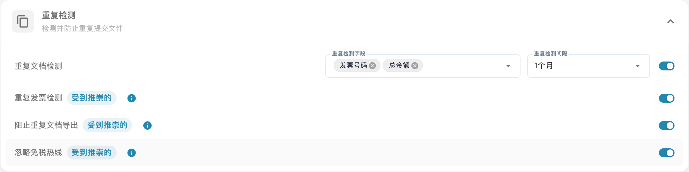
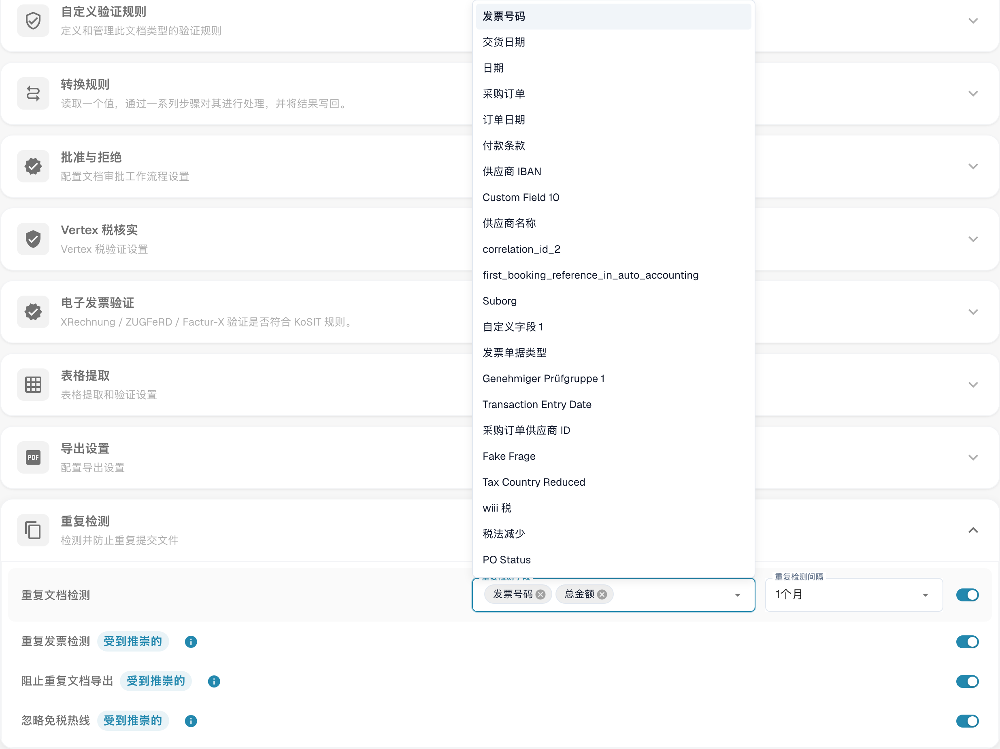
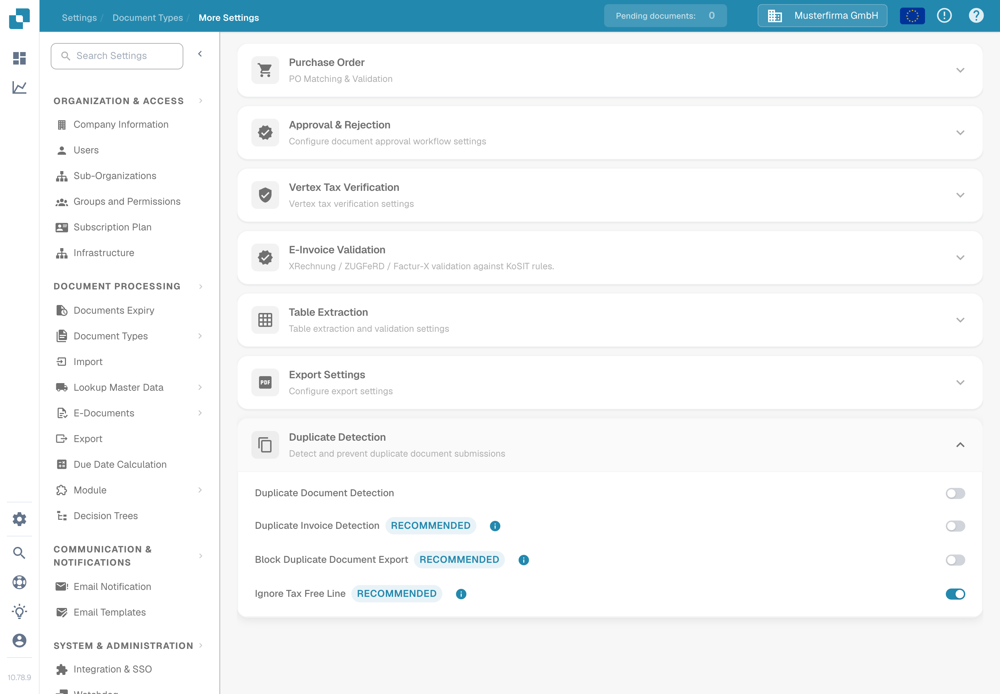
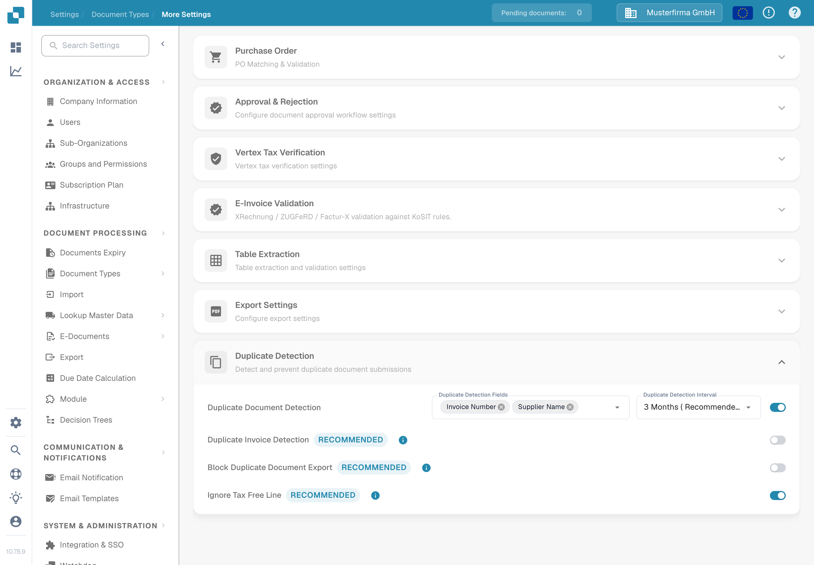
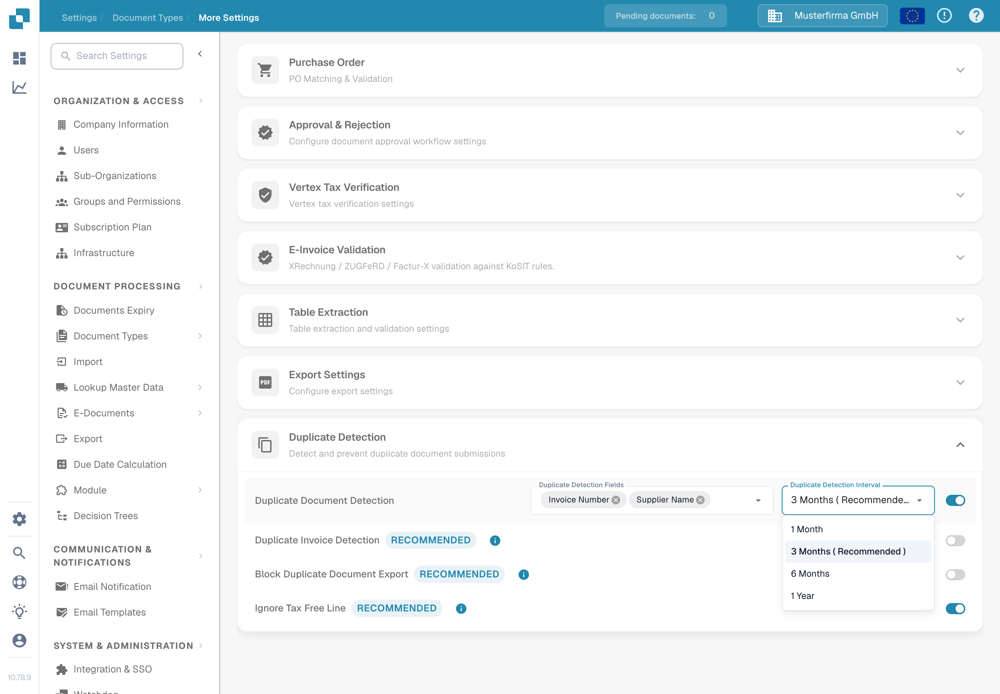

# 重复检测

<figure><figcaption>
重复文档检测设置。
</figcaption></figure>

<figure><figcaption>
可用于重复检测的字段。
</figcaption></figure>

使用 **重复检测** 可根据选定字段，在指定时间范围内标记与其他文档匹配的文档。这些选项适用于各个文档类型。

## 打开设置

1. 打开 **设置 → 文档类型**。
2. 在要配置的文档类型上，选择 **设置**。
3. 在 **更多设置**中，打开 **重复检测**。

<figure><figcaption>
发票设置中显示了四个独立开关。启用检测后，会显示字段和时间间隔选择器。
</figcaption></figure>

## 选择重复项的判定条件

1. 开启 **重复文档检测**。此时会显示 **重复检测字段**和 **重复检测时间间隔**选择器。
2. 选择必须匹配的字段。对于发票，可以选择 **供应商 ID**和 **发票号码**。请选择适合您自身流程、能够区分文档的字段。
3. 选择时间间隔：**1 个月**、**3 个月（推荐）**、**6 个月**或 **1 年**。时间间隔越长，检查的日期范围越大，加载时间也可能越长。

每次更改都会立即保存；此部分没有单独的“保存”按钮。如果关闭检测，字段和时间间隔选择器将隐藏。

<figure><figcaption>
请先启用检测，再选择比较字段和时间间隔。
</figcaption></figure>

<figure><figcaption>
菜单中将三个月标记为推荐时间间隔。
</figcaption></figure>

对于 **发票**，此部分还提供 **重复发票检测**、**阻止重复文档导出**和 **忽略免税行**。这些是独立开关；请仅启用发票流程所需的行为。其他文档类型不会显示这些额外开关。

## 查看已标记的文档

当 DocBits 找到匹配项时，**仪表板**上的文档行会显示重复项图标。选择该图标，即可在侧边面板中比较匹配的记录。只有存在匹配项时才会显示此图标。

打开已标记的文档时，重复项警告会提供 **查看重复项**、**仍然继续**，以及（如果文档尚未归档）**归档**选项。选择操作前，请先查看匹配的记录。有关文档列表，请参阅[仪表板指南](../../dashboard/README.md)。

发现疑似重复文档时，比较发票编号、供应商、日期和金额。结合警告及文档详情判断需要更正的内容。
