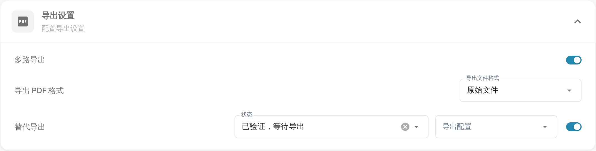

# 备用导出

## 概述

当文档处于特定状态时，您可以配置一个备用导出选项，使其显示在采购订单部分的导出下拉菜单中。\
本页介绍如何设置此选项。 该设置位于文档类型的**导出设置**部分。

## 激活步骤

1. 前往 **设置** -> **全局设置** -> **文档类型**
2.  找到文档类型卡片，点击齿轮（**更多设置**）打开其设置。

    <figure><figcaption>
<strong>导出设置</strong>中的<strong>替代导出</strong>开关。启用后旁边会出现<strong>状态</strong>和<strong>导出配置</strong>。
</figcaption></figure>
3.  打开**导出设置**部分并启用**替代导出**。

## 设置方法

启用该设置后，您可以选择一种文档状态，并指定预定义的导出配置。

* **状态**——提供该额外导出选项的文档状态。
* **导出配置**——该选项使用的导出配置。

有关设置导出配置的更多信息，请参阅[此处](../../../../document-processing/export/)。

您可以选择以下状态：

* Classified（已分类）
* Pending confirmation（待确认）
* Pending approval（待审批）
* Pending second approval（待二次审批）
* Validated, pending export（已验证，待导出）
* Approved pending export（已批准，待导出）
* Rejected（已拒绝）
* Finished（已完成）
* Exported（已导出）
* On hold（暂停）
* Workflow（工作流）
* Error（错误）
* In Review（审核中）

设置完成后，采购订单匹配导出选项中会显示一个额外的导出选项。当文档符合指定状态时，此选项将使用指定的导出配置。
