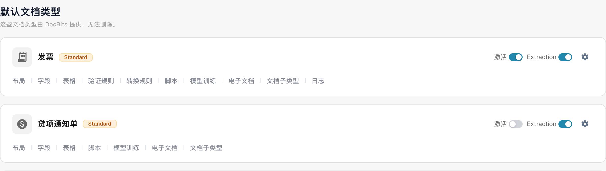
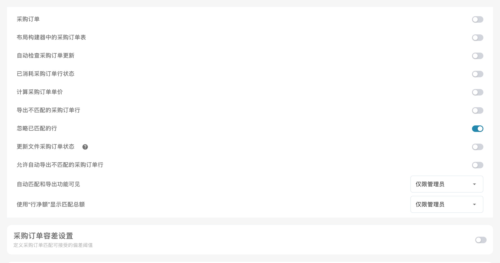

# 计算采购订单单价

## **概述**

您可以选择根据每个采购订单行项目的**金额**和**数量**自动计算其**单价**，而不是使用采购订单中自带的单价。当采购订单（在 Infor ERP / SAP 中）的单价与文档上的价格不同时，这项功能尤其有用。这种差异可能是因为采购订单中的单价已应用折扣，而文档只对净额应用了折扣。

## **启用步骤**

1.  前往 **设置** -> **全局设置** -> **文档类型**。

2.  选择所需的文档类型，然后点击 **更多设置**。

    <figure><figcaption>
打开发票文档类型的更多设置。 “Standard”和“Extraction”仍是当前界面保留的英文标签。
</figcaption></figure>
3.  在 **采购订单** 部分，启用 **计算采购订单单价** 选项。

    <figure><figcaption>
已使用采购订单行的状态设置。
</figcaption></figure>

## 价格计算方式

启用此设置后，采购订单行项目的单价按以下公式计算：

**`Unit Price = Line Amount ÷ Quantity × Unit Price Per`**

其中，**行项目金额**按以下方式确定：

| 采购订单行项目包含的内容                                                              | 使用的行项目金额                       |
| ---------------------------------------------------------------------------------------- | -------------------------------------- |
| 大于 0 且不超过行项目总额的**净额**（`extended_amount`） | 净额                         |
| 没有净额，或净额超过行项目总额                                      | 行项目**总额**（`total_amount`）    |
| 没有正金额，或没有正数量                                       | 不进行计算，保留采购订单中的价格 |

优先使用净额的原因：ERP 数据源（Infor BOD）会将行项目净额作为 `extended_amount` 发送，并将**税费和其他费用计入** `total_amount`。如果用含税总额除以数量，得出的就是含税单价；这样一来，即使发票定价正确，系统也会将其显示为_单价匹配不足_。一个实际采购订单行项目的示例：数量为 9，净额为 879.84，总额为 954.63（含 8.5% 税费）——按净额计算的价格为 97.76，与发票一致；按总额计算则为 106.07。

净额如果**大于**行项目总额，就不能作为净额使用，此时改用总额。`Unit Price Per` 为 0 或为空时，按 1 处理。


计算出的价格会写入存储在文档上的采购订单快照中，并且**每次匹配文档时都会重新计算**（自动采购订单匹配、手动匹配、保存时匹配）。因此，在更改此设置之前已匹配的文档会在下次匹配时使用新价格，无需重新加载采购订单。


## 示例：

在此示例中，从文档中提取的是未折扣的单价，而 ERP 中的采购订单存储的是已应用折扣的单价，因此单价不匹配。启用此设置后，系统会改为根据行项目金额和数量计算单价，使两边的价格一致。

## 相关设置

* [采购订单匹配规则](purchase-order-matching-rules.md) — 这些规则比较的是**有效**单价；启用此设置时，有效单价就是计算得出的价格。
* [采购订单容差设置](purchase-order-tolerance-settings-additional-purchase-order-tolerance.md) — 设置发票价格与计算价格之间允许的偏差。

数量为 9、价格基数为 1 时，879.84 ÷ 9 × 1 = 97.76，即未税单价。含 8.5% 税的总额 954.63 对应 106.07。对于未税价格的发票，应比较未税单价。
