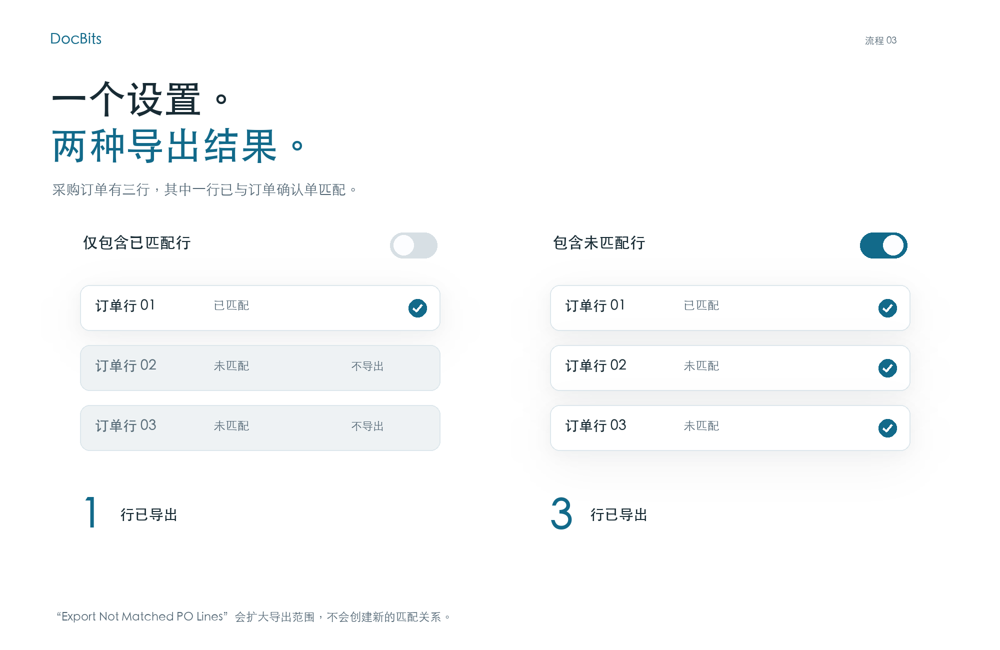

# 导出未匹配的采购订单行

## 通过三个采购订单行了解导出范围

<figure><picture><source srcset="../../../../../../.gitbook/assets/intro-process-03-po-export-zh-dark-20261029.png" media="(prefers-color-scheme: dark)"></picture><figcaption>
通过三个采购订单行了解导出范围
</figcaption></figure>

本例中，采购订单有三行，只有一行与订单确认单的某一行匹配。关闭“Export Not Matched PO Lines”时，仅导出已匹配行。开启该选项时，还会包含另外两个未匹配行。该设置不会创建新的匹配关系。

## **在哪里可以找到**

前往 **设置 → 常规设置 → 文档类型 → 更多设置 → 采购订单部分 → 导出未匹配的采购订单行**。\
切换按钮以启用此设置。

<figure><figcaption></figcaption></figure>

## **工作原理**

* **禁用时**，系统只会导出与订单确认行匹配的采购订单行。未匹配的采购订单行不会包含在导出内容中。
* **启用时**，系统会导出所有采购订单行，即使它们未与订单确认行匹配。

例如，如果采购订单有 **三行**，但供应商发送的**订单确认只有一行**，您将该行与一条采购订单行匹配。其余两条未匹配的采购订单行将：

* 如果禁用此设置，**不会包含在导出内容中**。
* 如果启用此设置，**会包含在导出内容中**。
