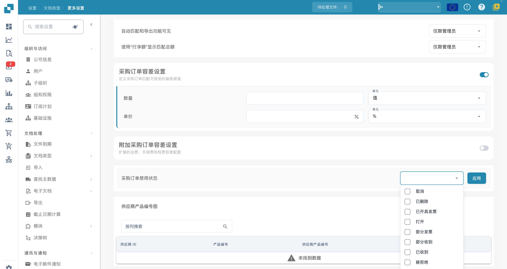

# 采购订单禁用状态

## **概述**

**PO Disable Statuses** 设置允许用户指定会阻止发票与相应采购订单（PO）匹配的采购订单状态。如果采购订单的状态列在此设置中，则该采购订单**无法**在 PO 匹配页面中用于发票匹配。这限制的是该采购订单的匹配资格；发票能否通过其他途径继续处理，还取决于审批、验证和工作流配置。\
\
使用此设置可排除不应参与匹配的采购订单；它本身不构成付款审批或付款阻止机制。

## **启用步骤**

1.  前往 **Settings → Global Settings → Document Types**

    <figure><figcaption>
中文文档类型页面；Standard 和 Extraction 仍为英文。文档类型激活与提取模式属于独立配置。
</figcaption></figure>
2.  选择所需的文档类型，然后点击 **More Settings**。

    <figure><figcaption>
中文发票采购订单设置中的“采购订单禁用状态”菜单。当前只展开选项，没有勾选状态或点击“应用”；下方供应商产品编号映射列表为空。
</figcaption></figure>
3.  在 **Purchase Order** 部分中，找到 **PO Disable Statuses** 选项。

### **如何识别已禁用的采购订单**

在 **PO Matching** 页面中，已禁用的采购订单会显示为**带删除线**的状态。这表示由于其状态限制，该采购订单目前无法进行匹配。

### **如何设置**

1. 在**采购订单禁用状态**设置中，展开状态选择框。
2.  点击此框会打开可用采购订单状态的下拉列表。\\

    

3. 点击状态即可选择一个或多个状态。再次点击可取消选择。
4.  点击 **应用** 按钮保存更改。

**可用状态**

* Canceled
* Deleted
* Invoiced
* Open
* Partially Invoiced
* Partially Received
* Received
* Rejected
* Unapproved
* Hold
* Closed
