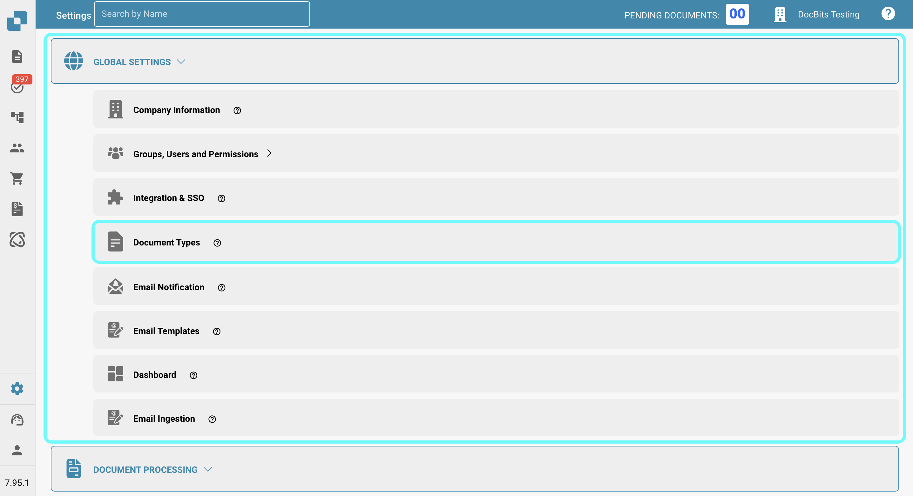
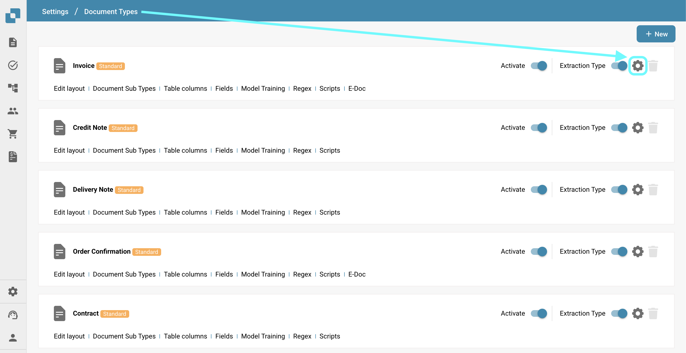
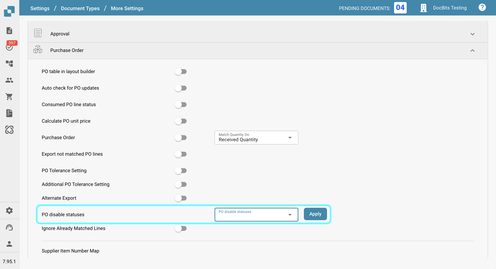

# 采购订单禁用状态

## **概述**

**PO Disable Statuses** 设置允许用户指定会阻止发票与相应采购订单（PO）匹配的采购订单状态。如果采购订单的状态列在此设置中，则该采购订单**无法**在 PO 匹配页面中用于发票匹配。在采购订单状态变更为未禁用的状态之前，与其相关的发票将无法继续处理。\
\
使用此设置，用户可以确保特定状态的采购订单不会继续进行发票处理，从而减少错误并避免不必要的付款。

## **启用步骤**

1.  前往 **Settings → Global Settings → Document Types**

    <figure><figcaption></figcaption></figure>
2.  选择所需的文档类型，然后点击 **More Settings**。

    <figure><figcaption></figcaption></figure>
3.  在 **Purchase Order** 部分中，找到 **PO Disable Statuses** 选项。

    <figure><figcaption></figcaption></figure>

### **如何识别已禁用的采购订单**

在 **PO Matching** 页面中，已禁用的采购订单会显示为**带删除线**的状态。这表示由于其状态限制，该采购订单目前无法进行匹配。

<figure><figcaption></figcaption></figure>

### **如何设置**

1. 在 **PO Disable Statuses** 设置中，您会看到左侧有一个选择框。
2.  点击此框会打开可用采购订单状态的下拉列表。\\

    
<figure><figcaption></figcaption></figure>

3. 点击状态即可选择一个或多个状态。再次点击可取消选择。
4.  点击 **Apply** 按钮保存更改。

    <figure><figcaption></figcaption></figure>

**可用状态**

* Canceled
* Deleted
* Invoiced
* Open
* Partially Invoiced
* Partially Received
* Received
* Rejected
* Unapproved
* Hold
* Closed
