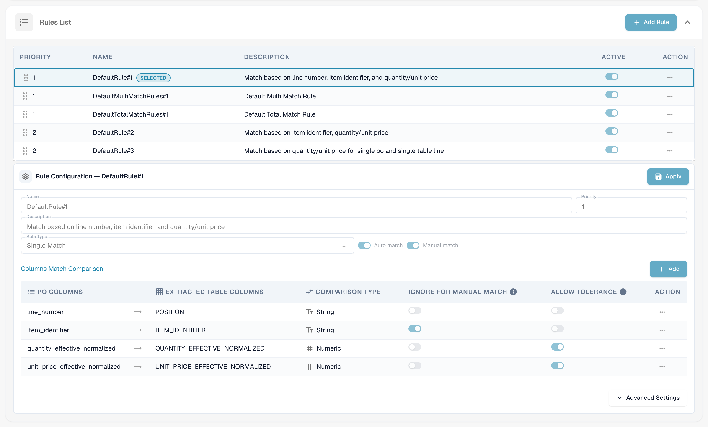
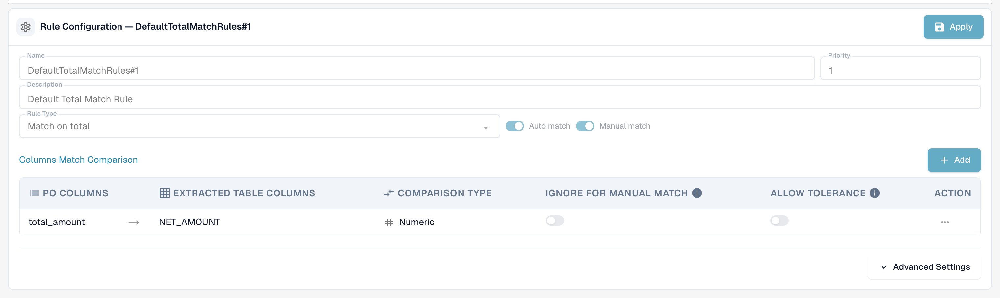
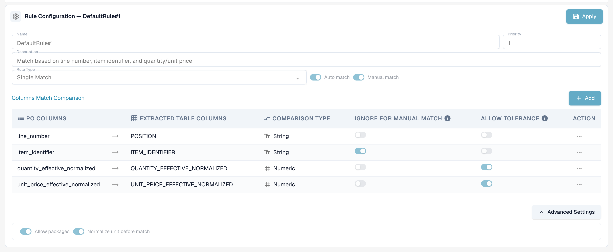
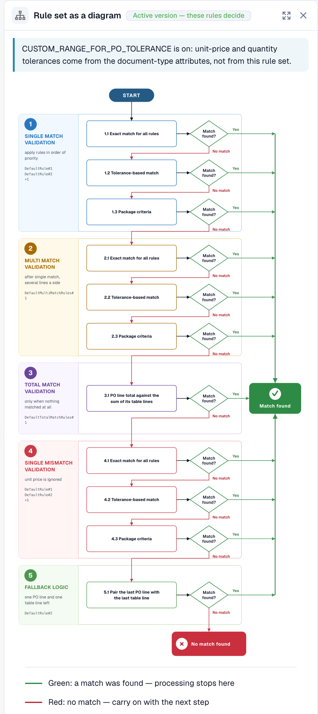

# 采购订单匹配规则

## 配置采购订单匹配规则和容差

本教程打开“发票”文档类型，检查已发布的规则版本，并将其克隆为未激活的草稿。内容包括规则类型、匹配阶段内的优先级、比较列、数量基准、匹配模式以及容差计算。仅保存教程草稿；活动版本和全局容差保持不变。百分之五的计算只是示例，并不修改当前容差。



[观看带字幕的视频](https://docbits-videos.fra1.cdn.digitaloceanspaces.com/settings-assistant/po-matching-rules-admin/v3/zh.html)

## 简介：采购订单与采购订单规则管理

采购订单（PO）匹配是确保采购订单（PO）与相应的收到的发票或收货单保持一致的关键流程。建立完善的规则集对于提高自动匹配率、防止欺诈并确保付款正确至关重要。

此配置页面用于定义和管理规则，这些规则决定如何将采购订单行项目与相应的收到的文档（发票、订单确认）进行匹配。


**前提条件：**只有在文档类型中启用了 **PO match server side**，匹配规则才会生效（设置 → 文档类型 → 更多设置 → 采购订单）。关闭此开关后，DocBits 会使用内置匹配器（数量、单价、项目编号、采购订单编号）进行匹配，并忽略规则集。


***

## 如何访问

1. 前往 **设置** → **全局设置** → **文档类型**，选择文档类型，然后点击 **更多设置**。
2. 在 **采购订单** 卡片中启用 **PO match server side**。
3. 点击开关旁边的 **Configure PO Matching Rules**。

<figure><figcaption>
采购订单卡片。<strong>Configure PO Matching Rules</strong> 位于 <strong>PO match server side</strong> 旁边。
</figcaption></figure>

## 页面概览

<figure><figcaption>
采购订单匹配规则页面。
</figcaption></figure>

页面顶部有三个按钮：

* **Rule set as a diagram** 会打开当前活动规则集的流程图。请参阅[规则集图示](#rule-set-as-a-diagram)。
* **Save Rules** 会将更改保存到你正在编辑的草稿。
* **Configure Versioning** 会打开版本历史记录。请参阅[版本和草稿](#versions-and-drafts)。

查看已发布版本时，按钮下方会显示 **Read Only** 提示：*这是已发布的版本，无法编辑。克隆为草稿后即可进行更改。* 再往下是 **Global Settings (Base Rules)** 卡片和 **Rules List**。在列表中选择一条规则，即可在列表下方的 **Rule Configuration** 区域配置该规则。

***

## 全局设置（基本规则）

这些设置定义了适用于所有匹配规则的框架：

<figure><figcaption>
已展开的全局设置（基本规则）卡片。
</figcaption></figure>

* **设置：** Match Quantity On
  * **用途：**定义用于与文档行比较的采购订单行数量字段，例如订购数量或**发票未结数量**（订购数量减去已开票数量）；发票通常使用后者。
  * **有效值：**系统中可用的数量字段，具体取决于数据结构（例如，其他标准化数量字段）。
  * **依赖关系：**决定所有将数量作为比较条件的匹配规则所使用的依据。
* **设置：** Standard Tolerance（默认容差）
  * **用途：**定义文档中的数值最多可以偏离多少采购订单值，同时仍视为匹配。此设置用于补偿舍入差异。它适用于启用了“Allow Tolerance”的**所有数值列**，包括数量和单价。
  * **有效值：**十进制数。数值按**绝对值**（0.005 = 比较数量或价格最多允许偏差 0.005）还是按**百分比**（0.5 = 比较值的 0.5%）读取，由规则集的**容差类型**（`value` 或 `percent`）决定；新规则集使用 `value`。单项容差（请参阅[容差设置](purchase-order-tolerance-settings-additional-purchase-order-tolerance.md)）会覆盖该项的默认容差。
  * **依赖关系：**适用于使用数值字段进行匹配且启用了“Allow Tolerance”选项的规则。
* **设置：** Enable Fallback Single Match（启用单个匹配的回退处理）
  * **用途：**启用后，即使装箱单编号不同，最后一条尚未匹配的采购订单行也会自动匹配。此匹配会标记为不匹配，供你检查。
  * **有效值：**启用或关闭。默认值为关闭。

***

## 规则列表

规则列表会显示所有可用的匹配规则，并管理它们的执行顺序。

<figure><figcaption>
规则列表。所选规则会标记为 <strong>Selected</strong>。可以通过规则的 <strong>Active</strong> 开关将其关闭。
</figcaption></figure>

#### 结构和执行

* **优先级：**此数值字段（例如 1、2、3）决定规则的执行顺序。优先级编号较低的规则会先尝试。这使管理员能够建立规则层级，通常从最具体、限制最严格的规则开始（例如，同时按行号和零件号匹配），再逐步采用更宽泛或限制较少的规则。
* **名称和描述：**提供规则的清晰标识和背景信息，说明其主要条件（例如，“Standard Rule No. 1：根据行号、部件 ID 和数量进行匹配”）。
* **启用：**简单的切换开关，可立即启用或停用规则，无需删除其配置。

**执行流程：**系统按级联顺序执行匹配。如果某条规则（例如优先级 1）成功匹配某个行项目，该项目的匹配流程就会停止。如果未找到匹配项，系统会继续执行优先级顺序中的下一条规则（例如优先级 2）。每次运行都会记录在文档上；采购订单匹配屏幕中的**匹配历史记录**会显示尝试了哪些规则、哪条规则匹配成功，以及哪些规则被跳过及原因。

***

## 规则配置（详细设置）

此详细配置区域用于定义单条规则的具体逻辑和条件。

<figure><figcaption>
单条匹配规则的规则配置区域。点击 <strong>Apply</strong> 可将更改保留在草稿中。
</figcaption></figure>

#### 基本参数

* **规则类型：**指定匹配的基数。

| 规则类型           | 功能                                                                                                                                                      | 典型用途                                                                   |
| ------------------ | --------------------------------------------------------------------------------------------------------------------------------------------------------- | -------------------------------------------------------------------------- |
| **Single match**   | 一条采购订单行对应一条文档行。每个已配置的列都必须一致（允许容差时，在容差范围内一致即可）。                                                                  | 标准场景。                                                                 |
| **Multi match**    | 多条采购订单行对应一条文档行，或多条文档行对应一条采购订单行。数量会**求和**，单价按**平均值**比较，其他列必须一致。                                        | 分批交付，或一条发票行涵盖多条订单行。                                     |
| **Match on total** | 比较一个**金额**（通常是文档行的净金额与采购订单的**总额**），并一次性匹配整个采购订单。                                                                      | 供应商开具一笔总额发票、服务发票或只有一行的发票。                         |

<figure><figcaption>
多项匹配规则会比较项目标识符、汇总后的数量和平均单价。
</figcaption></figure>

<figure><figcaption>
总额匹配规则会比较一个金额，此处比较的是净金额与采购订单总额。
</figcaption></figure>

* **自动匹配：**启用后，系统会尝试完全自动地应用此规则。自动处理要求匹配条件具有较高的可信度。
* **手动匹配：**启用后，系统可在手动对账步骤中向用户显示或应用此规则，为用户提供预定义的比较条件以解决异常情况。
* **回退：**标记为回退的规则会在稍后的阶段运行，仅针对所有常规规则运行后仍未匹配的行对。可将它用于更宽松的规则，以捕获严格规则未能匹配的项目。

#### 激活条件 

规则可以包含**激活条件**，即规则运行前必须满足的表达式。如果条件为假，则该规则会**对当前文档跳过**（匹配历史记录会将其显示为“未运行”，并说明原因）。这些表达式使用正在匹配的行数：

| 表达式                   | 含义                                                           |
| ------------------------ | -------------------------------------------------------------- |
| `[[count(po_lines)]]`    | 可供匹配的采购订单行数量                                       |
| `[[count(table_lines)]]` | 文档中映射为可供匹配的行项目数量                               |

可以使用 `==`、`!=`、`>`、`>=`、`<`、`<=` 进行比较，并使用 `&`（与）组合多个条件。示例：

* `([[count(po_lines)]] > 1) & ([[count(table_lines)]] > 1)` — 仅适用于两侧都有多行的文档（多项匹配规则的典型场景）。
* `([[count(po_lines)]] == 1) & ([[count(table_lines)]] == 1)` — 仅适用于一行文档对应一行订单的情况。
* `([[count(po_lines)]] >= 1) & ([[count(table_lines)]] >= 1)` — 只要有内容可供匹配即可运行。


激活条件是规则“没有效果”的最常见原因。激活条件为 `[[count(table_lines)]] > 1` 的总额匹配规则不会对只有一行的发票运行；而会将发票汇总为一条总额行的[转换规则](../../transformation-rules.md)会生成这样的文档。更改规则本身前，请先检查匹配历史记录中的行数。


#### 列比较（匹配条件）

这是规则逻辑的核心定义，用于指定文档之间哪些字段必须一致。

1. 定义要比较的列：
   * **PO 列：**从采购订单数据中提取的字段（例如行号）。
   * **提取的表格列：**从收到的文档（发票/订单确认）中提取或解析的对应字段（例如 `POSITION`）。
2. **比较类型：**定义所需匹配的性质（例如 Tt 表示文本/字符串比较，要求逐字符完全匹配；# 表示数值比较）。
3. **允许容差：**对于数值字段（数量、价格），启用此选项后，系统会应用前面定义的全局默认容差。对于未启用此选项的数值字段，数值必须完全一致。
4. **手动匹配时忽略：**选中后，手动处理期间会放宽此条件。此选项适用于描述或内部参考等可能略有差异的字段，允许用户忽略不重要的不匹配。

**可比较的列**

| 列                               | 文档侧                              | 采购订单侧                          | 备注                                                                                                                                                                                                                          |
| -------------------------------- | ----------------------------------- | ----------------------------------- | ----------------------------------------------------------------------------------------------------------------------------------------------------------------------------------------------------------------------------- |
| 行号                             | `POSITION`                          | `line_number`                       | 文本，精确匹配。仅当供应商在文档上打印了订单行号时才有用。                                                                                                                                                                     |
| 项目标识符                       | `ITEM_IDENTIFIER`                   | `item_identifier`                   | 文本，精确匹配。项目编号或供应商项目编号，也可通过[供应商项目编号映射](supplier-item-number-map-admin-documentation.md)匹配。                                                                                                 |
| 有效标准化数量                   | `QUANTITY_EFFECTIVE_NORMALIZED`     | `quantity_effective_normalized`     | 数值。由 **Match Quantity On** 选定的数量，在两侧转换为相同单位后得到（包括单位代码转换和“per”数量）。                                                                                                                       |
| 有效标准化单价                   | `UNIT_PRICE_EFFECTIVE_NORMALIZED`   | `unit_price_effective_normalized`   | 数值。折扣后、应用 **Unit Price Per** 后的单个单位单价；如果启用了 [Calculate PO unit price](calculate-po-unit-price.md)，还包括根据订单行金额和数量计算出的价格。 |
| 净金额                           | `NET_AMOUNT`                        | `total_amount`                      | 数值。由总额匹配规则使用。                                                                                                                                                                                                     |

**示例：严格的采购订单匹配规则（`DefaultRule#1`）**

典型的严格规则会结合必要的身份检查和值检查：

* **必要的身份条件：**行号和项目标识符必须完全匹配（文本比较，不允许容差）。
* **值检查：**有效标准化数量和有效标准化单价必须匹配（数值比较，允许容差）。只有四项条件全部满足（数值允许在容差范围内）时，才会执行自动匹配。

***

#### 高级设置

点击列列表下方的 **Advanced Settings** 可打开另外两个规则选项。

<figure><figcaption>
规则的高级设置。
</figcaption></figure>

* **Allow packages：**允许规则匹配数量和单价相差一个包装规格的行。默认包装规格为 10、20、100 和 1000。然后 DocBits 会按包装规格调整文档数量和单价，再进行比较。这是[规则图示](#rule-set-as-a-diagram)中每个阶段的**包装条件**步骤。
* **Normalize unit before match：**在比较数量之前，将两侧的计量单位转换为相同单位。此选项默认启用。

***

## 规则集图示 

**Rule set as a diagram** 会在规则旁边打开一个面板，以流程图形式显示活动版本中的规则，让你了解 DocBits 尝试规则的顺序，以及匹配流程在哪里停止。

<figure><figcaption>
规则集图示。
</figcaption></figure>

DocBits 会从上到下依次处理五个阶段。每个阶段最多包含三次尝试：**所有规则的精确匹配**、**基于容差的匹配**和**包装条件**。首次找到匹配项的尝试会结束流程（绿色箭头）。如果某次尝试未找到匹配项，DocBits 会继续下一次尝试（红色箭头）。

| 阶段 | 功能 |
| ----- | ---- |
| 1. 单项匹配验证 | 按优先级顺序应用单项匹配规则。 |
| 2. 多项匹配验证 | 单项匹配之后运行，适用于一侧有多行的情况。 |
| 3. 总额匹配验证 | 仅在完全没有匹配项时运行。将采购订单总额与表格行的总和进行比较。 |
| 4. 单项不匹配验证 | 再次应用单项匹配规则，但忽略单价。 |
| 5. 回退逻辑 | 当两侧各恰好剩下一行时，将最后一条采购订单行与最后一条表格行配对。 |

图表下方的面板会按优先级列出每个阶段的规则，以及每条规则比较的列。顶部的提示会说明容差的来源：来自规则集；或者在启用 `CUSTOM_RANGE_FOR_PO_TOLERANCE` 时，来自[文档类型设置](purchase-order-tolerance-settings-additional-purchase-order-tolerance.md)。

<figure><figcaption>
图表下方：各阶段的规则，包括比较列、容差，以及自动匹配、手动匹配和回退选项。
</figcaption></figure>

***

## 默认规则集

每个组织最初都使用相同的默认规则集。创建自己的规则集时，可以将其作为参考：

| 规则                       | 类型/优先级                         | 比较列                                                           | 激活条件                                           |
| -------------------------- | ----------------------------------- | ---------------------------------------------------------------- | -------------------------------------------------- |
| `DefaultRule#1`            | 单项匹配，优先级 1                  | 行号、项目标识符、数量（允许容差）、单价（允许容差）             | 始终                                               |
| `DefaultMultiMatchRules#1` | 多项匹配，优先级 1，回退            | 项目标识符、数量（允许容差）、单价（允许容差）                   | `count(po_lines) > 1` 且 `count(table_lines) > 1`  |
| `DefaultTotalMatchRules#1` | 总额匹配，优先级 1                  | 净金额 ↔ 采购订单总额（不允许容差）                              | `count(po_lines) >= 1` 且 `count(table_lines) > 1` |
| `DefaultRule#2`            | 单项匹配，优先级 2，回退            | 项目标识符、数量（允许容差）、单价（允许容差）                   | 始终                                               |
| `DefaultRule#3`            | 单项匹配，优先级 2，回退            | 数量（允许容差）、单价（允许容差）                               | `count(po_lines) == 1` 且 `count(table_lines) == 1` |

从上到下看：先运行严格规则（文档上必须打印行号和项目编号），然后运行不含行号的回退规则，最后为只有一行的文档提供备用规则，仅比较数量和价格。

***

## 对采购订单匹配流程的影响

定义的规则集会直接影响采购订单匹配工作流的效率和完整性：

* **优先级和回退规则：**设定的优先级可确保系统首先尝试最可靠的匹配方法。如果优先级高、限制严格的规则失败，系统会回退到更宽泛的规则，以尽量减少需要用户处理的异常数量。
* **控制匹配质量：**要求匹配更精确且容差更小的严格规则，会减少自动匹配数量，但能提高匹配可靠性。宽松规则会提高自动匹配率，但也会增加误报风险。
* **异常处理（手动匹配）：**启用手动匹配规则后，系统会为用户提供结构化选项。如果交易未达到自动匹配条件，就会成为异常。用户随后可以应用预定义的手动规则来尝试解决异常，该规则可能采用放宽后的条件（例如，根据“手动匹配时忽略”设置忽略轻微的文本差异）。

## 还有哪些因素会影响结果

* **匹配何时运行：**文档处理期间、用户点击 **Auto PO Match** 时，以及每次保存时——前提是采购订单编号已更改，或此前从未查询过该编号（例如，主数据在处理后填入了编号）。保存时不会覆盖已存在的匹配结果。
* [**转换规则**](../../transformation-rules.md)会在匹配前运行，并可更改行项目以及激活条件检查的行数。重建行的表格规则只要保持行不变，就会保留已有匹配；如果替换了已匹配的行，匹配就会被移除，并将该规则的名称显示为原因。
* [**Calculate PO unit price**](calculate-po-unit-price.md)会更改规则在采购订单侧比较的单价。
* [**容差设置**](purchase-order-tolerance-settings-additional-purchase-order-tolerance.md)和[**禁用状态**](purchase-order-disable-statuses.md)决定比较的严格程度，以及哪些采购订单行会被提供用于匹配。

## 故障排除

| 现象                                             | 检查内容                                                                                                                                                     |
| ------------------------------------------------ | ------------------------------------------------------------------------------------------------------------------------------------------------------------ |
| 所有值都一致，但显示“未匹配”                     | 打开匹配历史记录：运行了哪条规则？哪一列未通过（每列都会显示偏差）？规则是否因激活条件而被跳过？                                                               |
| 单价匹配不足，差值恰好等于税率                   | 采购订单总额包含税；启用 [Calculate PO unit price](calculate-po-unit-price.md)（先计算净金额），或比较行净金额。                                                |
| 总额匹配规则从未运行                             | 其激活条件要求文档行数大于 1。设置 `[[count(table_lines)]] >= 1`，或不要使用转换规则合并行。                                                                  |
| 规则集完全没有效果                               | 文档类型未启用 **PO match server side**，或者更改后的规则集仍是草稿——请激活该版本。                                                                           |

***

## 版本和草稿 

匹配规则采用版本管理。你只能编辑**草稿**，已发布的版本只能查看。点击 **Configure Versioning** 可打开 **Version History**。

<figure><figcaption>
规则集的所有版本及其版本历史记录。
</figcaption></figure>

每个版本都会显示其编号、日期和时间以及状态，例如 **Draft** 或 **Approved**。版本菜单会提供相应操作。要更改默认规则集，请先克隆该规则集：打开 **Configure Versioning**，然后在相应版本的卡片选项中选择 **Clone as draft**。编辑草稿，对每条更改过的规则点击 **Apply**，然后点击 **Save Rules**。版本激活后，更改的规则才会生效。
