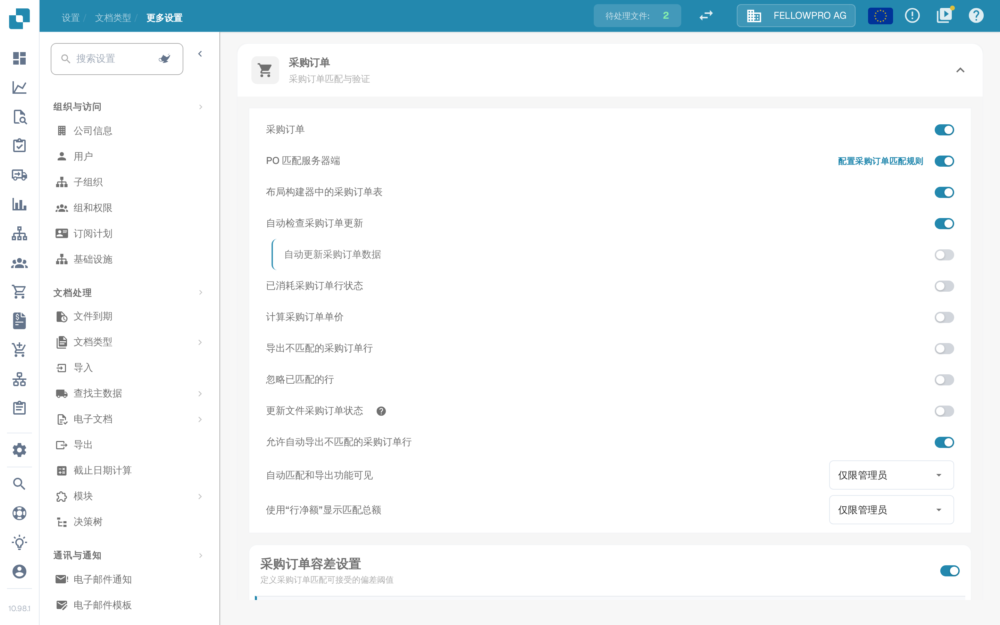

# 采购订单

## 概述

此设置会启用[**采购订单匹配**](../../../../../../end-user-and-partner-section/end-user-section/purchase-order-matching/)部分，该部分在文档验证后即可访问。

<mark style="color:red;">**注意**</mark>：对于**发票**文档类型，还必须满足以下要求：

* 必须启用**采购订单**设置（如本页所述）
* 发票类型必须为**采购发票**
* 必须存在**已提取表格**

## 激活步骤 

1. 前往**设置** -> **全局设置** -> **文档类型**
2.  找到文档类型卡片，点击齿轮（**更多设置**）打开其设置。
3.  展开**采购订单**部分并启用**采购订单**。

<figure><figcaption>
<strong>更多设置</strong>中的<strong>采购订单</strong>部分。第一个开关为该文档类型启用采购订单匹配，下面的开关进一步细化匹配行为。
</figcaption></figure>

## **功能**

激活后，[**采购订单匹配**](../../../../../../end-user-and-partner-section/end-user-section/purchase-order-matching/)部分会在文档验证后变为可用。&#x20;

### 匹配哪个数量

匹配时比较采购订单中的哪个数量取决于 **PO 匹配服务器端**：

* **PO 匹配服务器端关闭** – **采购订单**开关旁会出现一个下拉列表，可选**数量**、**已收货数量**和**已收货未结交货数量**。此时 DocBits 使用内置匹配器比较所选数量。
* **PO 匹配服务器端开启** – 匹配按文档类型的规则执行，数量包含在这些规则中。该行右侧的 **配置采购订单匹配规则** 链接可打开这些规则。


上图是在 **PO 匹配服务器端** 开启的状态下截取的，因此该界面没有数量下拉列表，数量在匹配规则中设置。

