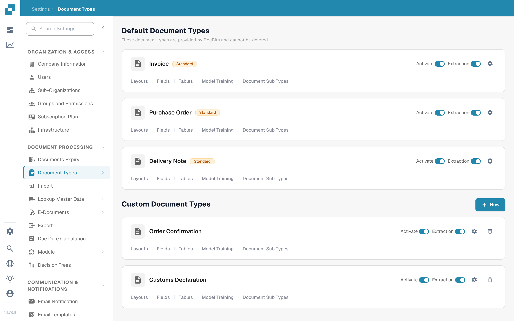
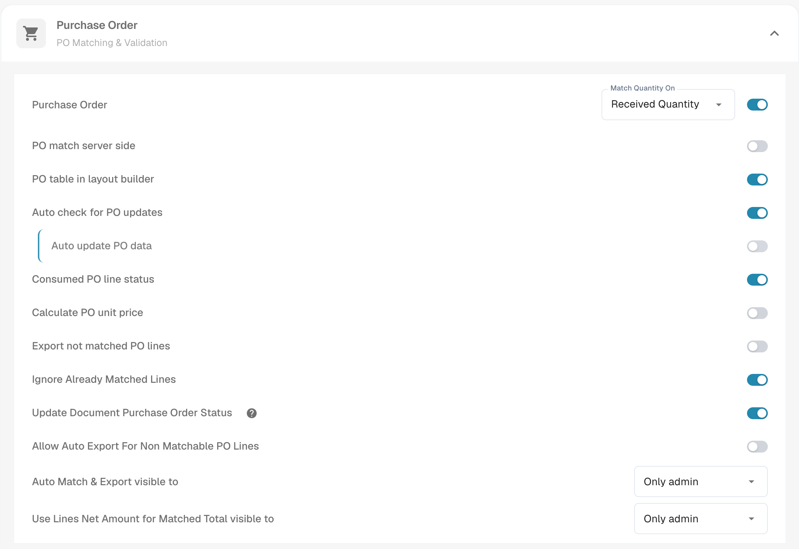
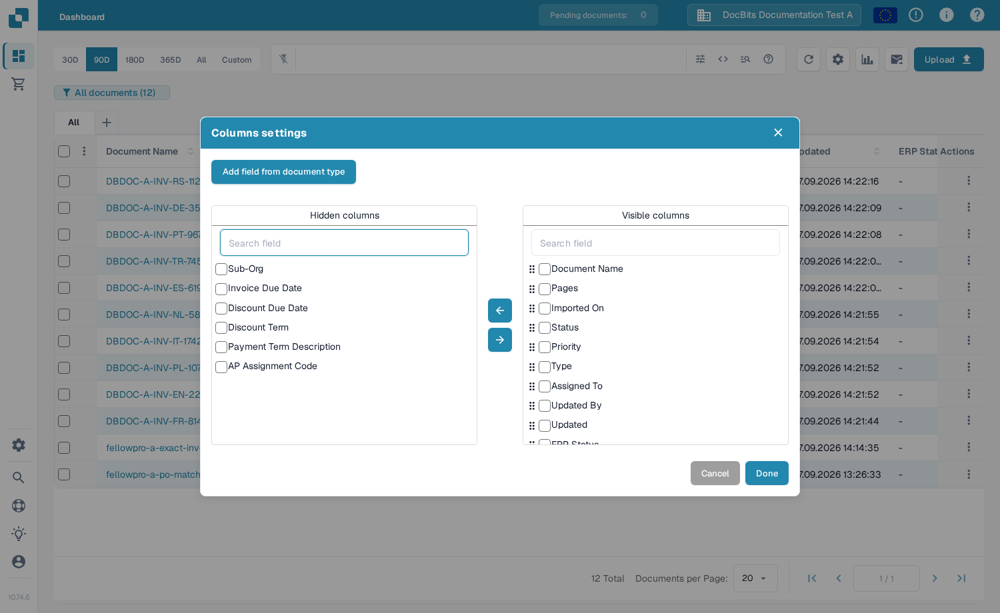
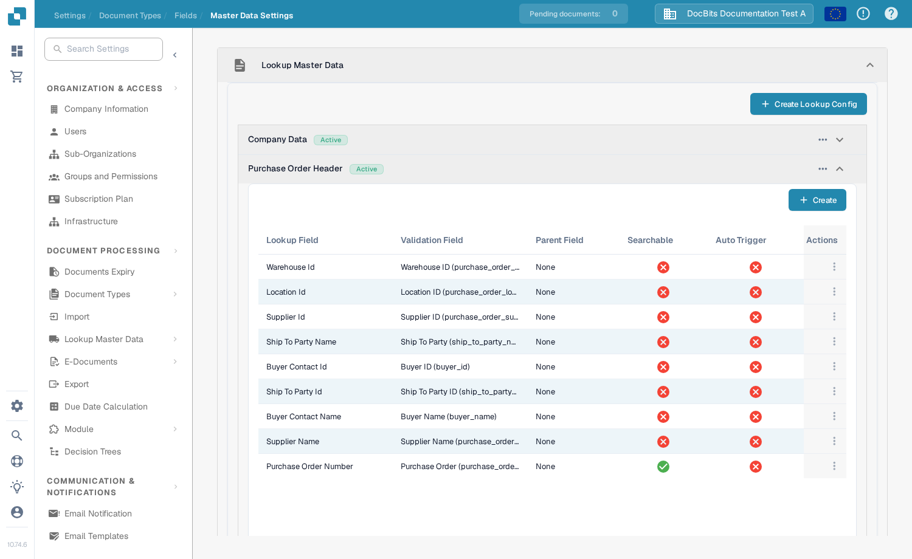

# 更新文档采购订单状态

此设置适用于使用采购订单的文档类型。它控制文档是否可以接收其关联采购订单的状态更新。此开关按文档类型配置。若要在仪表板中查看 PO 状态，相应字段也必须可用，并且已设为可见列。

更改设置前，请选择正确的组织和文档类型。编辑文档类型设置需要管理员权限。要检查状态是否发生变化，必须先将采购订单关联到文档。

## 开启此设置

1. 打开 **设置 → 文档处理 → 文档类型**。
2. 找到用于关联 PO 文档的文档类型，例如 **发票**，然后选择其卡片上的齿轮图标以打开 **更多设置**。
3. 展开 **采购订单**。找到 **更新文档采购订单状态** 并将其开启。旁边的帮助图标会在应用中说明此选项。更改此开关不会影响同一部分中的其他 PO 设置。

<figure><figcaption>打开所用文档类型的设置。</figcaption></figure>

<figure><figcaption>“采购订单”设置中的状态更新开关。</figcaption></figure>

## 在仪表板中显示 PO 状态

1. 返回仪表板，然后选择文档表格上方的齿轮图标。
2. 在 **高级设置** 菜单中打开 **列设置**。
3. 选择 **从文档类型添加字段**，选择文档类型，然后搜索 **PO 状态**。如果该字段可用，请选中它，选择 **添加到可见列**，然后选择 **完成**。

列对话框包含 **隐藏列** 和 **可见列**。使用箭头在两者之间移动选定的列。完整的列设置指南请参阅[更改文档列](../../../../../../end-user-and-partner-section/end-user-section/dashboard/change-document-columns.md)。如果所选类型中没有 **PO 状态**，请让管理员检查其字段和查找配置；仅开启显示开关不会创建缺失的字段。

<figure><figcaption>选择要在仪表板中显示的列。</figcaption></figure>

## 检查采购订单查找

在 **设置 → 文档处理 → 文档类型 → 字段 → 主数据设置** 中，展开 **查找主数据**，然后展开 **采购订单抬头**。检查是否存在所需的 PO 字段映射；如果需要自动查找，还要确认相关查找已启用 **自动触发**。下方截图展示了配置列表；其中的红色叉号表示示例行已关闭“自动触发”。该截图并未展示 PO 状态已更新。

<figure><figcaption>检查该文档类型对应的实际查找行。</figcaption></figure>

有关查找设置的帮助，请参阅[使用主数据配置模糊数据](../../../../../setup/document-types/fuzzy-data-configuration-with-master-data.md)。

## 使用已知文档进行验证

使用一份已关联到测试采购订单的文档。通过常规流程更改该采购订单的状态，刷新仪表板，然后检查文档及其可见的 PO 状态字段。如果状态未更新，请检查文档的 PO 关联、查找配置，以及相关字段是否已添加到仪表板。不要仅凭开关已开启就认定更新成功。
