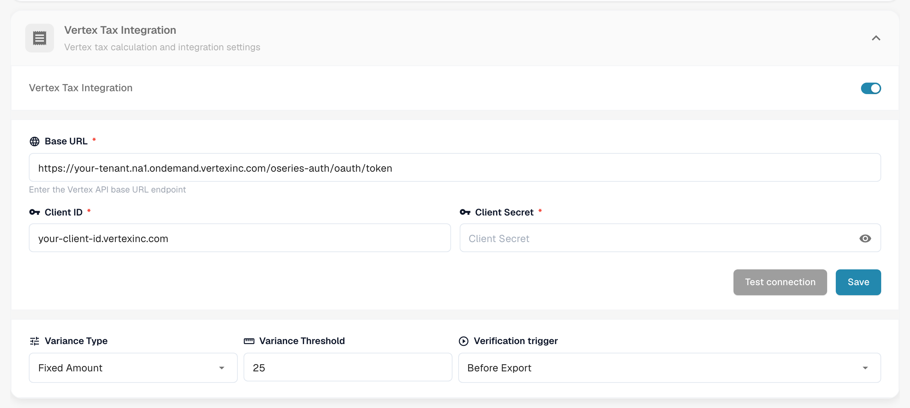
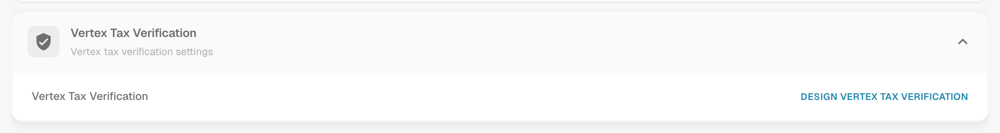

# Vertex 税务验证

Vertex 税务验证会将供应商在发票上收取的税额与 Vertex 对相同行项目计算出的税额进行比较。DocBits 会向 Vertex 请求计算结果，并向用户显示这两个金额；如果供应商税额过高，则会停止处理文档。

## 工作原理

1. 文档到达触发点。你可以在模块设置中选择触发点：**导出前**（默认）或**审批前**。
2. DocBits 将发票行项目发送给 Vertex，并接收计算出的税额。
3. DocBits 将结果写回文档：每个行项目的 **Vertex 税额**和 **Vertex 税率**，以及页眉汇总金额：**供应商税额**（发票上收取的税额）、**Vertex 税额**、小计和**差额**。
4. DocBits 将供应商税额与 Vertex 税额进行比较：

| 情况 | 结果 |
| --------- | ------ |
| 供应商税额高于 Vertex 税额，且差额**超过差额阈值** | 文档被拒绝。其状态变为**Vertex 税务已拒绝**。 |
| 供应商税额较高，但差额**在阈值范围内** | 文档被接受。 |
| 供应商税额等于 Vertex 税额 | 文档被接受。 |
| 供应商税额**较低**于 Vertex 税额 | 文档被接受，并计提差额。 |

结果消息会列出相关金额，例如：*已拒绝：供应商税额 $380.00 高于 Vertex 计算的税额 $140.00，差额为 $240.00（171.4%），超过已配置的 $25.00 阈值。*

用户可以在文档仪表板行中的 Vertex 图标处打开结果。**Vertex 税务验证**屏幕会显示横幅（包含消息的**验证失败**，或**验证成功**）、你设计的布局字段，以及按行显示税额的 Vertex 表格。


此验证仅针对导出配置类型为 **Vertex** 的文档类型运行。如果没有此类配置，文档将继续处理，不进行验证。


## 设置集成

打开**设置** → **模块** → **订单与财务**，然后转到 **Vertex 税务集成**卡片。此页面还包含采购订单匹配和自动会计设置。

<figure><figcaption>
Vertex 税务集成卡片。在此截图中，租户和客户端值已替换为占位符。
</figcaption></figure>

1. 打开 **Vertex 税务集成**开关。此功能需要 Vertex 税务订阅。
2. 输入 Vertex 令牌端点的**基础 URL**、**客户端 ID**和**客户端密钥**。
3. 点击**测试连接**，然后点击**保存**。
4. 设置容差和触发点：
   * **差额类型：****固定金额**或**百分比**。
   * **差额阈值：**仍可接受的偏差。默认值为固定金额 25。使用百分比模式时，请输入小数值，例如 0.05 表示 5 %。
   * **验证触发点：****导出前**或**审批前**。选择**审批前**时，系统会在文档处理期间、进入审批流程前运行检查。如果检查本身失败，文档状态将变为**导出错误**。

然后，为该文档类型添加类型为 **Vertex** 的导出配置（**设置** → **导出**）。该配置使用 TOML 映射文件。

## 设计验证表单

验证屏幕上向用户显示的字段是按文档类型设计的。

1. 打开**设置** → **全局设置** → **文档类型**，选择文档类型，然后点击**更多设置**。
2. 打开 **Vertex 税务验证**卡片，然后点击**设计 Vertex 税务验证**。

<figure><figcaption>
Vertex 税务验证卡片。
</figcaption></figure>

布局构建器会打开，布局类型为 **Vertex 税务验证**。将分组和字段拖入表单，例如包含发票号码、日期和交货日期的**发票详情**。**Vertex 表格面板**会显示税额比较结果，以及逐行显示 Vertex 税额的行项目。该面板是布局的一部分。

<figure><figcaption>
一个 Vertex 税务验证布局，包含“发票详情”分组和 Vertex 表格面板。
</figcaption></figure>

有关布局构建器的工作方式，请参阅[布局管理器](../layout-manager/README.md)。
