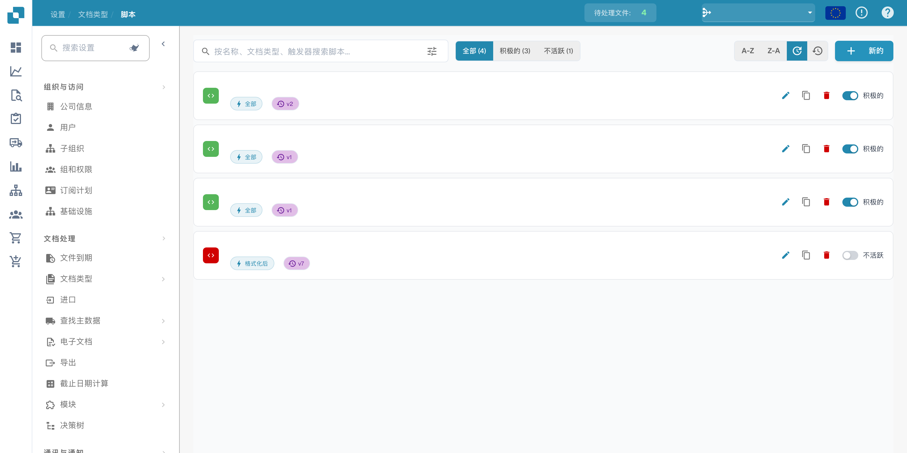
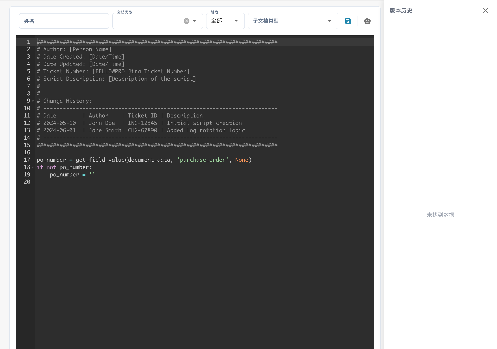

# 创建和编辑脚本


DocBits 文档脚本说明：自动化文档工作流中的自定义逻辑


## 按照以下详细说明在 DocBits 中创建新脚本：

**选择脚本语言：**

请选择当前 DocBits 安装版本的编辑器和运行环境实际提供的脚本类型与语言。可用类型及执行上下文取决于已部署的版本。

**打开脚本开发环境：**

登录 DocBits 并导航到脚本开发环境。该环境位于管理区域。

<figure><figcaption><p>脚本列表，已隐藏名称、日期和组织信息；所示版本中的“积极的”表示已启用。</p></figcaption></figure>

**创建新脚本：**

点击“+ New”按钮，打开新的脚本编辑器。

<figure><figcaption><p>新建脚本编辑器及其初始模板；所示版本将脚本名称标签误译为“姓名”。模板中的英文注释及虚构人物名保留原文，这与下方的独立 Python 示例不同。</p></figcaption></figure>

**编写代码：**

使用编辑器编写脚本代码。请从所选脚本语言的基本语法开始。

例如，如果使用 Python，脚本可能如下所示：

## 1. Python 脚本示例


## 清理患者姓名的函数

以下独立 Python 示例仅演示语法，并非已验证的 DocBits 生命周期脚本入口。使用前，请根据文档规定的脚本上下文进行调整。

```python
def clean_patient_name(name):
    cleaned_name = name.strip().title()
    return cleaned_name

if __name__ == "__main__":
    patient_name = " john doe "
    cleaned_name = clean_patient_name(patient_name)
    print("Cleaned patient name:", cleaned_name)
```

## 2. 脚本示例


**测试脚本：**

检查代码是否存在错误，并在测试环境中进行测试。确保脚本能产生预期结果并正常运行。


**保存脚本：**

在 DocBits 中保存脚本，并为其指定一个能描述脚本用途的名称。


**将脚本映射到文档类型：**

重要的一步是将脚本映射到相应的文档类型。这决定了脚本何时以及如何应用。通常可以通过 DocBits 中的配置界面完成此操作：将脚本分配给特定文档类型，并指定应用脚本的条件。


**审核并发布：**

创建、测试并映射脚本后，再次检查是否存在错误或不一致之处。如果一切正常，就可以将脚本发布到 DocBits 生产环境。


按照这些步骤，您可以在 DocBits 中成功创建、测试并实施新脚本，从而实现流程自动化并提高医疗文档处理的效率。
