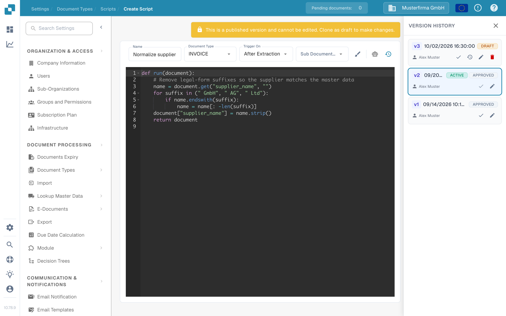
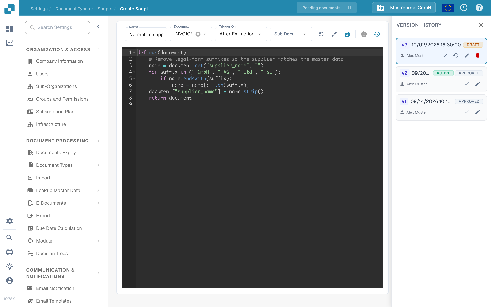

# 脚本启用与管理

管理员可以使用 **Scripts** 管理文档类型的处理规则。本指南介绍在哪里查找脚本、如何启用或停用脚本，以及如何安全地修改已发布的脚本。

## 查找脚本

1. 打开 **Settings → Document Types**。
2. 在要管理的文档类型上，选择 **Scripts**。该页面会列出此文档类型的脚本。
3. 按名称搜索，或使用 **All**、**Active** 和 **Inactive** 缩小列表范围。你也可以按名称或修改日期排序。

每张卡片都显示脚本名称、触发器、版本和状态。铅笔图标可打开编辑器；复制图标可复制脚本。**New** 会打开新脚本的编辑器。

<figure><figcaption>
更改脚本前，请检查脚本卡片右侧显示的状态。
</figcaption></figure>

## 启用或停用脚本

使用脚本卡片上的 **Active/Inactive** 开关。更改会立即保存；列表计数会更新以显示更改结果。停用的脚本仍可查看或编辑，但不会在文档处理中运行。

**创建脚本后请检查其状态。** 在当前的 Sandbox 界面中，保存新脚本会创建一个启用状态的版本，并将卡片设为 **Active**。如果脚本只是草稿或测试示例，请将其切换为 **Inactive**。

## 修改现有脚本

1. 选择脚本卡片或其铅笔图标。已发布的版本为只读，因此不能直接在其上输入内容。
2. 在 **Version History** 中，选择要修改版本上的铅笔图标。这会基于该版本创建一个 **Draft**。
3. 编辑草稿并选择 **Save** 图标。保存前，请检查名称、文档类型、触发器和代码。
4. 在测试环境中使用有代表性的文档测试修改后的脚本。准备就绪后，在 **Version History** 中选择该草稿的勾选图标，将其设为启用版本。
5. 返回 **Scripts** 列表，检查卡片上的 **Active/Inactive** 开关。**Version History** 中标记为 **ACTIVE** 的版本表示当前选定的版本；卡片开关则控制脚本是否运行。

<figure><figcaption>
已发布的版本不能直接编辑。请使用 Version History 中的铅笔图标创建草稿。
</figcaption></figure>

<figure><figcaption>
将草稿设为启用版本前，请先保存并检查。
</figcaption></figure>

有关脚本示例和可用函数，请参阅 [DocBits 中的脚本编写](scripting-in-docbits/README.md)。
