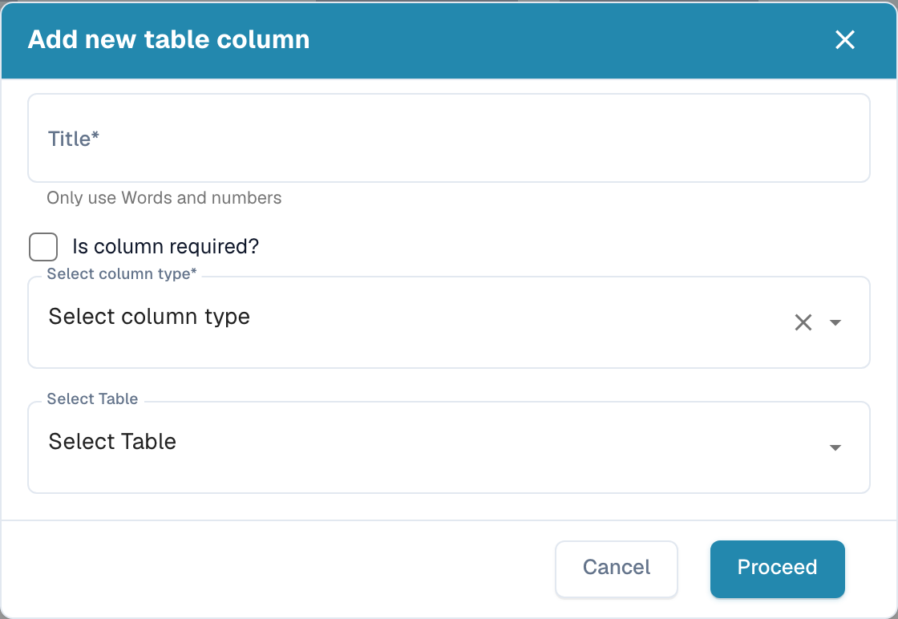

# 添加新列

当每个行项目都需要采集某个值，而默认列无法满足需求时，可以添加一列，例如成本中心、项目编号或内部物料编号。

## 开始之前

* 确定该列所属的**表格**。大多数文档类型只有一个表格（例如 `INVOICE_TABLE`）。如果列表为空，请先点击 **Create new table**；该对话框只要求填写表格名称。
* 确定**类型**：金额使用 `AMOUNT`，数量使用 `NUMBER`，日期使用 `DATE`，是/否使用 `BOOLEAN`，ISO 货币代码使用 `CURRENCY`，其他情况使用 `STRING`。保存后无法更改类型。
* 检查是否已有含义相同但被隐藏的**默认列**。隐藏列会带有 _Hidden_ 标记；请取消隐藏该列，而不是创建重复列。

## 步骤

1. 打开 **Settings → Global Settings → Document Types → Table Columns**。
2. 点击 **Add new table column**。

<figure><figcaption>
添加新表格列
</figcaption></figure>

3. 填写对话框：

| 字段                    | 填写内容                                                                                                                                                              |
| ----------------------- | ----------------------------------------------------------------------------------------------------------------------------------------------------------------------- |
| **Title**               | 用户在验证界面上看到的标签，例如 `Cost Centre`。仅限字母和数字。DocBits 会根据该值生成技术性 _Column name_（`COST_CENTRE`）。 |
| **Is column required?** | 如果任何行的该列为空时都不允许审批文档，请勾选。                                                                                       |
| **Select column type**  | 参见上方的类型列表。                                                                                                                                                |
| **Select Table**        | 添加该列的表格。                                                                                                                                         |

4. 点击 **Proceed**。该列会出现在列表中，且 _Read Only_、_Hidden_ 和 _Use AI_ 标记均未设置。如有需要，可在列表中切换这些标记，参见[编辑和删除列](editing-and-deleting-columns.md)。

## 添加后

* **现有文档中的该列为空**。更改后上传或重新启动的文档会填充该列。
* 对于配置了**训练规则**的供应商，请在表格训练中打开该供应商的一份文档，并映射新列；否则该供应商的该列会一直为空。参见[定义表格和列](../../../../setup/document-training/training-line-fields-table-training/defining-tables-and-columns.md)。
* 使用**AI 表格提取**时，如果该值能在文档中识别，AI 就会填充该列。如果供应商配置了训练规则，但该列仍应由 AI 提取，请将该列标记为 _Use AI_。
* 如果 ERP 需要接收该列，请将其添加到**导出映射**中，参见[导出](../../../document-processing/export/)。

## 消息

| 消息                                                                       | 含义                                                                                       |
| -------------------------------------------------------------------------- | --------------------------------------------------------------------------------------------- |
| _Column name already exists_                                               | 表格中已存在具有此技术名称的列。请选择其他标题。          |
| _Column name already exists – Please activate it in Table Column settings_ | 此名称对应一个隐藏的默认列。请取消设置其 _Hidden_ 标记，而不是创建新列。 |
| _No table exists. Please create table before creating columns._            | 此文档类型尚无表格：请先点击 **Create new table**。                         |
