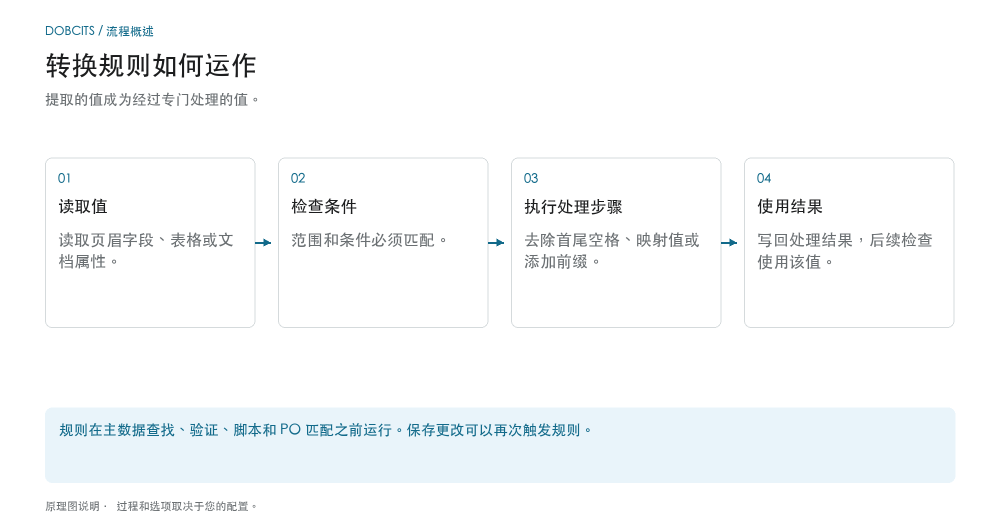
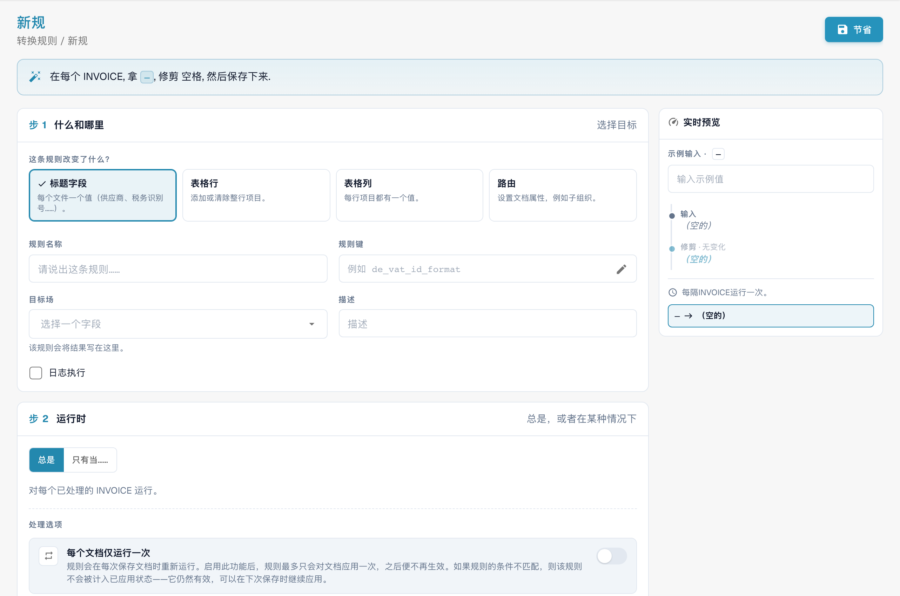
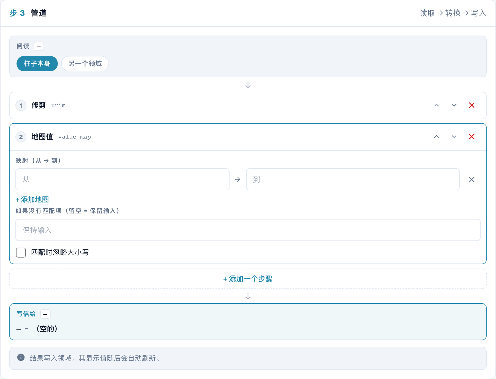
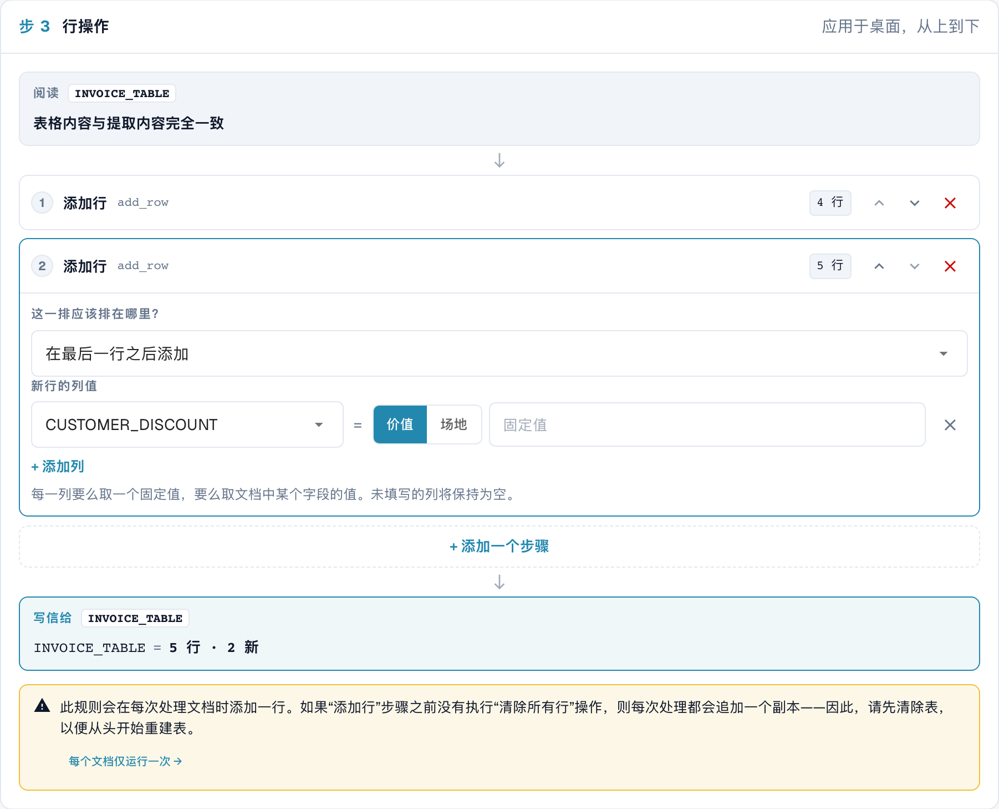
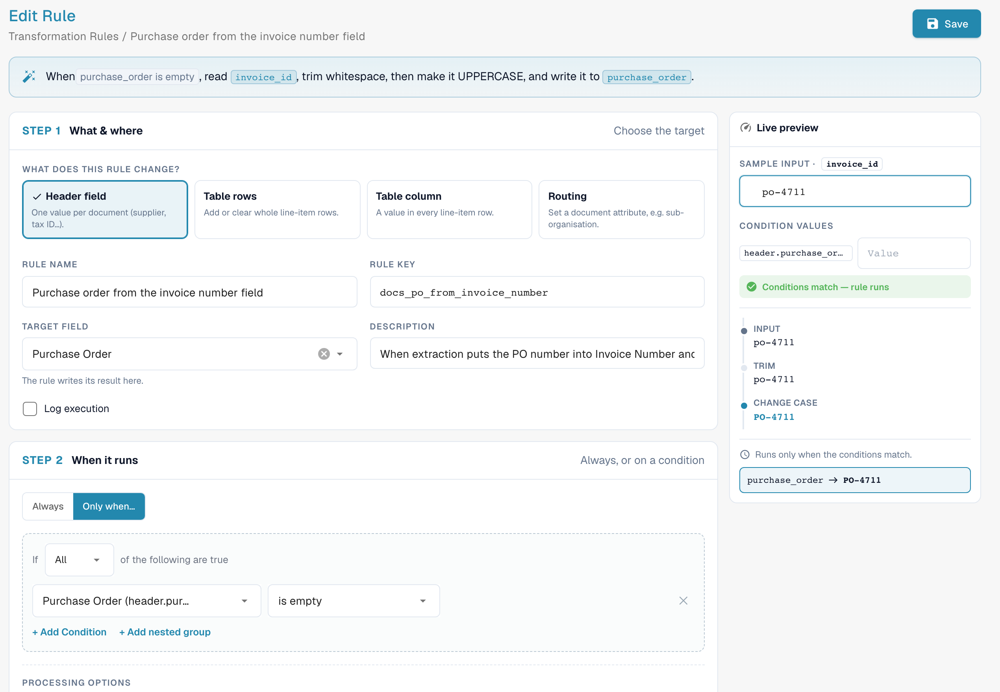
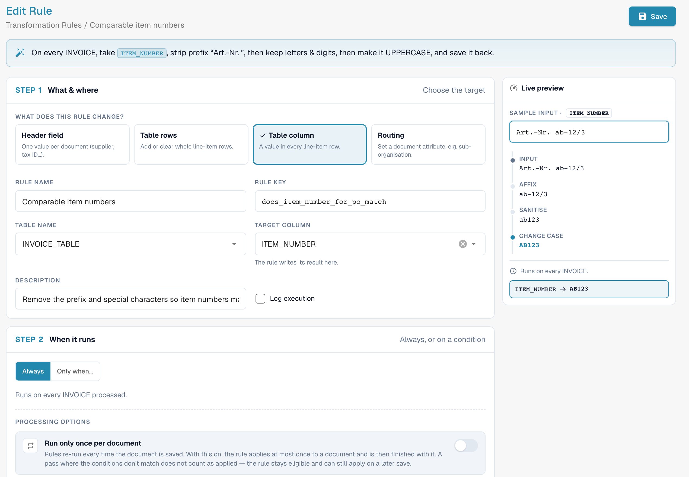

# 转换规则

## 从提取价值到下游验证

<figure><figcaption>
提取的值成为经过专门处理的值。 该图是示意性的；您组织的活动设置决定了实际行为。
</figcaption></figure>

转换会改变现有数据；它不再执行OCR。它读取输入，检查其条件，运行配置的步骤并将结果写回。如果不满足条件，则跳过该规则。

**示例：** 表格单元格包含 `STK`。适用于供应商的值映射写入 `PCE`。下游 PO 匹配然后使用标准化单元代码。还要测试已标准化的值和不应应用规则的值。

1. **触发器：** 在文档处理过程中，规则在提取后运行。当保存修改的提取数据时，它们还可以再次运行。
2. **顺序：** 在一次运行中，范围按以下顺序处理：**页眉字段 → 路由 → 表行 → 表列**。在每个范围内，优先级和关键决定顺序。
3. **效果：** 表格规则可以更改或删除行项目。这可以更改行数和采购订单匹配的先决条件。替换已匹配的行可以删除现有分配。
4. **控制：** 比较输入、预览和保存的结果。启用执行日志记录后，条件跟踪会显示应用或跳过规则的原因。

**检查重复：** 规则不应在每次保存时更改其已准备的值。使用适当的幂等步骤、未更改的源或预期的一次性执行。详细信息和示例如下； [PO匹配规则](more-settings/purchase-order/purchase-order-matching-rules.md) 解释下行映射。



## 概述

**触发器：** 在文档处理过程中，规则在提取后运行。当保存修改的提取数据时，它们还可以再次运行。

* 一个**抬头字段**（发票号码、币种、供应商税号等），
* 表格每一行中的一个**列**（单位、项目编号、价格基准等），
* 表格的**行**（清空行、添加行），
* 文档的一个**属性**——目前是文档所属的子组织（**路由**）。

每条规则都会**读取**一个值，将它传递给由若干步骤组成的**处理流程**，然后将结果写回。规则在验证、脚本和采购订单匹配之前运行，因此后续流程看到的都是已更正的值。

转换规则通过表单、实时预览和免代码配置，取代了组织过去编写的大多数小型脚本，例如“始终去掉此字段的首尾空格”“映射此供应商的单位代码”“添加 ERP 所需的前缀”或“将此供应商的多个行项目合并为一个总额行”。

### 解决的问题

| 需求 | 规则 |
| --- | --- |
| 供应商打印的发票号码没有 ERP 要求的 `INV-` 前缀 | 抬头字段 *Invoice Number*，仅适用于该供应商：Trim → UPPERCASE → Affix：添加前缀 `INV-` |
| 供应商发送德国单位代码（`STK`、`Std`），ERP 需要 UN/ECE 代码（`PCE`、`HUR`） | 表格列 *UNIT*：映射值 `STK → PCE`、`KG → KGM`、`Std → HUR` |
| 项目编号带有前缀，例如 `Art.-Nr. 4711` | 表格列 *ITEM_NUMBER*：Affix：去除前缀 `Art.-Nr. ` |
| 税号中包含空格和句点 | 抬头字段 *Supplier Tax ID*：Sanitise，仅保留字母数字字符 |
| 供应商按总额匹配，而不是按行项目匹配 | 表格行：Clear all rows → 添加一行并填入净额 |
| 某些供应商的所有文档都属于某个子组织 | 路由：当 *Supplier ID 属于以下值之一时*，设置子组织 |
| 日期必须以固定格式写入自由文本字段 | 抬头字段：Reformat date `%d.%m.%Y` |
| PO 号码位于错误字段中（例如 *Invoice Number*） | 抬头字段 *Purchase Order*：从 *Invoice Number* 读取，仅当 *Purchase Order 为空时* |
| PO 号码带有前导零或采购订单中没有的前缀 | 抬头字段 *Purchase Order*：使用 Trim 去除左侧的 `0`，或使用 Affix 去除前缀 |
| 项目编号在大小写、空格或前缀方面与采购订单行项目不一致 | 表格列 *ITEM_NUMBER*：Affix：去除前缀 → Sanitise → UPPERCASE |

## 启用转换规则

组织管理员可以**按文档类型**启用转换规则。

1. 前往 **Settings → Global Settings → Document Types**。
2. 点击文档类型卡片上的**设置**（齿轮）图标。
3. 打开 **转换规则** 并启用开关。点击 **管理转换规则** 打开规则列表。

<figure><figcaption>
文档类型附加设置中的 Transformation Rules 开关
</figcaption></figure>

现在，文档类型卡片上会显示 **转换规则** 链接，以及用于查看执行日志的 **日志** 链接。

## 规则列表

列表会按照运行顺序显示该文档类型的所有规则，并为每条规则显示一句话摘要（“当 invoice_id 为 abcd 时，读取 invoice_id，将其转换为大写，然后写回。”）、适用范围（**抬头**、**表格**、**列**、**路由**）、步骤数、来源，以及是否启用了 **记录执行日志**。可以按适用范围和 **Active / Inactive** 筛选、搜索，也可以使用 **⋮** 菜单复制或删除规则。

规则有三种来源，与验证规则相同：DocBits 提供的 **系统默认设置** 规则（点击 **定制** 创建可编辑副本）、**定制** 系统规则（使用 **重置为默认值** 还原原始规则），以及你创建的 **自定义** 规则。

## 创建规则

点击 **新规**。构建器左侧有三个步骤，右侧是 **实时预览**。构建过程中，顶部会用一句话概述规则。

<figure><figcaption>
转换范围：页眉字段、表格行、列和路由。 界面中的“节省”实际表示保存规则；本例未保存。
</figcaption></figure>

### 第 1 步 — 内容与范围

**此规则要更改什么？**——适用范围：

| 范围 | 更改内容 | 目标 | 运行次数 |
| --- | --- | --- | --- |
| **抬头字段** | 每个文档的一个值 | 一个抬头字段，例如 *Invoice Number* | 每个文档一次 |
| **表格行** | 完整的行项目行——清空行或添加行 | 一个表格，例如 `INVOICE_TABLE` | 每个文档一次 |
| **表格列** | 每个行项目行中的一个值 | 一个表格和一个列，例如 `INVOICE_TABLE` / `UNIT` | 每行一次 |
| **路由** | 文档的一个属性——目前是子组织 | *子组织* | 每个文档一次 |

然后输入 **规则名称**（系统会根据名称生成 **规则键**），选择 **目标字段** / **表名** / **目标列**，并可选择填写 **描述**。启用 **记录执行日志** 后，每次应用规则都会写入一条日志，便于调整规则时排查问题。

### 第 2 步 — 运行条件

* **总是** — 规则会应用于该类型的每个文档。
* **只有当……** — 只有条件成立时才运行规则，例如 *Supplier ID is HP0000278*。对于 **表格列** 规则，条件可以使用当前行的列，并会逐行检查。所有字段、运算符和示例请参见[规则条件（应用条件）](rule-conditions-applies-when.md)。

以下两个选项用于控制规则的应用频率：

| 选项 | 效果 |
| --- | --- |
| **每个文档仅运行一次** | 规则通常会在每次保存时重新运行。启用此选项后，规则对每个文档**最多应用一次**，之后就不再处理该文档。条件不匹配的运行不计入次数，因此规则仍可在之后保存时应用。适用于每次保存都会再次更改值的步骤（请参见[幂等性](#run-once-and-idempotency)）以及不应反复重建行项目的表格规则。 |
| **Run after lookup population (before PO match)**（查找数据填充后、采购订单匹配前执行） | *（较新版本）* 在查找数据（例如供应商主数据）填充后、采购订单匹配开始前，额外运行一次规则。若规则需要查找操作提供的值，请启用此选项。规则仍会在常规阶段运行；启用此选项的仅运行一次规则会等待此阶段，而不会在提取后立即运行。 |

### 第 3 步 — 处理流程

<figure><figcaption>
转换规则的处理步骤。 界面中的“场地本身”指当前字段；“管道”指数据处理流水线。
</figcaption></figure>

* **阅读** — 读取**字段（或列）本身**的值，或者读取**另一个字段**的值。通过读取另一个字段，可以使用其他字段的值填充字段，例如从自由文本字段复制采购订单号码。
* **步骤** — 值会按**从上到下**的顺序经过各个步骤；上一步的输出是下一步的输入。使用 **+ Add a step** 添加步骤，使用箭头调整顺序，使用 **✕** 移除步骤。每个步骤右侧都会显示样本的中间值。
* **写信给** — 第 1 步中指定的目标。DocBits 会写入存储值，然后自动刷新显示值。

### 步骤说明

<figure><figcaption>
按用途分组的所有步骤
</figcaption></figure>

| 步骤 | 设置 | 输入 → 输出示例 |
| --- | --- | --- |
| **更改大小写** | UPPERCASE、lowercase、Title Case、首字母大写 | `inv-4711` → `INV-4711` |
| **修剪** | 侧边（两侧、左侧、右侧）；字符（留空表示空白字符） | `  4711 ` → `4711`；字符设为 `0` 且侧边设为左侧时：`004711` → `4711` |
| **软垫** | 长度、填充字符、侧边 | 长度 10、字符 `0`、左侧：`4711` → `0000004711` |
| **截短** | 最大长度 | 10：`ABCDEFGHIJKL` → `ABCDEFGHIJ` |
| **词缀** | 添加前缀、添加后缀、去除前缀、去除后缀；文本 | 添加前缀 `INV-`：`4711` → `INV-4711`；去除前缀 `Art.-Nr. `：`Art.-Nr. 4711` → `4711` |
| **消毒** | 仅保留（字母数字字符、字母、数字、字母数字字符及空格），或去除指定字符 | 仅保留字母数字字符：`DE 123.456.789` → `DE123456789` |
| **截取片段** | 起始位置、长度或结束位置 | 起始位置 0，长度 4：`2026-09-29` → `2026` |
| **提炼** | 模式、捕获组 | 模式 `PO[- ]?(\d+)`，组 1：`Order PO-45001234` → `45001234` |
| **查找和替换** | 模式、替换为、次数（0 = 全部） | 模式 `\s+`，替换为 ` `：`ACME    GmbH` → `ACME GmbH` |
| **映射值** | 映射（从 → 到）、未匹配时的值（留空 = 保留输入）、忽略大小写 | `STK → PCE`：`stk` → `PCE` |
| **重新格式化日期** | 输出格式（`%d.%m.%Y`、`%m/%d/%Y`、`%Y-%m-%d`、`%d %b %Y`） | `%d.%m.%Y`：`2026-09-29` → `29.09.2026` |
| **格式化数字** | 区域设置（de_DE、en_US、en_GB、fr_FR）、小数位数最小值和最大值 | de_DE，2 位小数：`1234.5` → `1.234,50` |
| **固定值** | 值 | 无论字段原有内容是什么，始终写入此值 |
| **清除** | – | 清空字段 |

**表格行**规则使用两个不同的步骤，这些步骤处理的是行而不是值：

| 步骤 | 效果 |
| --- | --- |
| **清除所有行** | 删除所有已提取的行。之后步骤添加的行会保留。 |
| **添加行** | 在**最后一行之后**或**第一行之前**添加一行。对于每个列，可选择 **值**（固定值）或 **字段**（抬头字段的值）。未设置的列保持为空。 |


**重新格式化日期** 需要使用 DocBits 内部存储日期的格式（`YYYY-MM-DD`）。请将其应用于字段本身，而不是已经包含格式化日期的文本。


### 实时预览

实时预览会在构建规则时使用样本运行规则：

* **示例输入** — 输入文档中可能出现的值。对于表格规则，输入提取行的数量（**示例表**）以及新行所读取字段的值（**行源值**）。
* **条件值** — 对于设有条件的规则，输入条件字段的值。预览会显示 **条件匹配——规则运行** 或 **条件不匹配——规则被跳过。**。
* 下方会显示**每个步骤之后**的值，以及最终将写入的结果（“invoice_id → INV-230620-03A”或“unchanged”）。

使用预览时不会保存任何内容。点击 **保存** 保存规则。

## 示例

### 清理供应商的发票号码

抬头字段 **发票号码** · 仅当 *Supplier ID is HP0000278* 时 · Trim → Change case UPPERCASE → Affix 添加前缀 `INV-`。
样本 `  230620-03a ` → `INV-230620-03A`。请参见上方的处理流程截图。

### 映射单位代码 

表格列 **INVOICE_TABLE / UNIT** · 始终运行 · Trim → Map values：`STK → PCE`、`KG → KGM`、`Std → HUR`，启用 **匹配时忽略大小写**，未匹配时的值留空（保留输入值）。

<figure><figcaption>
表格列的值映射。 界面中的“柱子本身”指当前列，“地图值”指值映射，“添加地图”指添加映射项。
</figcaption></figure>

### 将供应商的多个行项目合并为一个总额行 

表格行 **INVOICE_TABLE** · 仅当 *Supplier ID is HP0000278* 时 · Clear all rows → 添加一行，其中 `POSITION` = 值 `001`、`QUANTITY` = 值 `1`、`NET_AMOUNT` = 字段 *Total Net Amount*。

<figure><figcaption>
向表格添加行的转换步骤，尚未保存。 界面中的“价值”指固定值，“场地”指字段；技术列标识符保持原样。
</figcaption></figure>

顺序很重要：**清除所有行** 必须位于 **添加行** 之前。如果顺序不正确，构建器会发出警告（“Clear all rows runs after Add a row …”）；如果 **添加行** 步骤之前没有 **清除所有行**，构建器也会发出警告，因为规则会在每次保存时再追加一份相同的行。请将此规则与适用于单行文档的按总额匹配采购订单规则配合使用。

### 从发票号码字段填充采购订单号码 

抬头字段 **采购订单** · 仅当 *Purchase Order is empty* 时 · **阅读** *Invoice Number* → Trim → Change case UPPERCASE。

<figure><figcaption>
规则及其实时预览：<code>po-4711</code> 在 <code>purchase_order</code> 中变为 <code>PO-4711</code>。测试文档类型上的示例规则。
</figcaption></figure>

有些供应商会把订单号码打印在提取程序用于识别发票号码的位置。此时 **发票号码** 中保存的是 PO 号码，而 **采购订单** 为空，导致采购订单匹配器找不到可匹配的号码。此规则会在开始匹配之前复制该值。在开发系统中进行的测试表明，保存文档并应用规则后，一个存在此问题的文档从*未匹配*变为*完全匹配*（2 行中的 2 行）。规则仅在 **采购订单** 为空时运行，因此不会覆盖已正确提取的号码。

### 规范化项目编号以便进行采购订单匹配 

表格列 **INVOICE_TABLE / ITEM_NUMBER** · 始终运行 · Affix：去除前缀 `Art.-Nr. ` → Sanitise：仅保留字母数字字符 → Change case UPPERCASE。

<figure><figcaption>
实时预览显示每个步骤：<code>Art.-Nr. ab-12/3</code> 变为 <code>AB123</code>
</figcaption></figure>

如果发票上写的是 `Art.-Nr. ab-12/3`，而采购订单上是 `AB123`，行项目就无法匹配。此规则会将发票中的值转换为与采购订单相同的格式。请检查采购订单使用的格式，并相应调整步骤。

### 更多示例

| 目标 | 范围 | 条件 | 步骤 |
| --- | --- | --- | --- |
| 去除税号中的空格和句点 | 抬头 *Supplier Tax ID* | 始终 | Sanitise：仅保留字母数字字符 |
| 去除商品前缀 | 列 *ITEM_NUMBER* | 始终 | Affix：去除前缀 `Art.-Nr. ` |
| 供应商编号为 10 位 | 抬头 *Supplier ID* | 始终 | Trim → Pad，长度 10，使用 `0` 填充，位于左侧 |
| 从参考文本中提取 PO 号码 | 抬头 *Purchase Order*，从另一个字段读取 | 仅当 *Purchase Order is empty* 时 | Extract `PO[- ]?(\d+)`，组 1 |
| 为某个供应商始终使用一种币种 | 抬头 *Currency* | 仅当 *Supplier ID is 10040* 时 | Fix value `CHF` |
| 移除错误提取的值 | 抬头 *Discount Term* | 仅当 *Supplier ID is 20723* 时 | Clear |
| 每单位价格基准 | 列 *UNIT_PRICE_PER* | 仅当 *row.UNIT_PRICE_PER is empty* 时 | Fix value `1` |
| 将供应商路由到子组织 | 路由 | *Supplier ID 属于以下值之一*：`10040, 10041` | 指定固定子组织 |
| 去除 PO 号码中的前导零 | 抬头 *Purchase Order* | 始终 | Trim 字符 `0`，侧边为左侧 |
| 仅保留 PO 号码中的数字 | 抬头 *Purchase Order* | 始终 | Sanitise：仅保留数字（`PO-45001234` → `45001234`） |
| 截断过长的 PO 参考编号 | 抬头 *Purchase Order* | 仅当 *Supplier ID is 20723* 时 | Truncate 为 10 个字符 |
| 为 PO 号码添加 ERP 所需的前缀 | 抬头 *Purchase Order* | 仅当 *Supplier ID is 10040* 时 | Affix：添加前缀 `4500` |
| 按 ERP 可读取的格式写入金额 | 抬头 *Total Amount* | 始终 | Format number，区域设置为 `de_DE`，保留 2 位小数 |
| 去除项目编号中的空格 | 列 *ITEM_NUMBER* | 始终 | Sanitise：去除字符 ` `（空格） |
| 将项目编号转换为大写 | 列 *ITEM_NUMBER* | 始终 | Change case UPPERCASE |
| 将某个工厂的 PO 路由到子组织 | 路由 | *Purchase Order starts with* `4500` | 指定固定子组织 |

## 路由规则（子组织）

**路由**规则不会更改字段，而是在条件匹配时为文档设置一个属性——目前是**子组织**。选择 **指定一个固定的子组织** 并从列表中选择子组织，或者选择 **从字段映射**，将提取字段中的值映射到子组织。之后，该文档属于此子组织，并使用其用户、权限和设置。无效的子组织值不会被写入。

## 规则的运行时机

* **处理过程中**：在提取后、主数据查找、验证、脚本和采购订单匹配之前运行。
* 当提取数据发生变化时，文档**每次保存**都会运行。未启用 **每个文档仅运行一次** 的规则每次都会重新应用。
* 在一次运行中，规则按适用范围依次运行，顺序为：**抬头 → 路由 → 表格行 → 表格列**。因此，列规则也会应用于表格规则刚添加的行。同一范围内的规则按优先级排序，然后按键排序。

### 仅运行一次与幂等性 

大多数步骤在处理自身的输出时会产生相同结果，例如再次 Trim 已去除首尾空格的值、再次映射 `PCE`，或添加一个已经存在的前缀。这些规则可以在每次保存时安全运行。

**截取片段**、**提炼** 和 **查找和替换** 则不同：再次处理自身的结果时，值会继续变化（例如，截取前四个字符后再次截取，会继续从这四个字符中取出前四个字符……）。因此，DocBits 不允许保存将这些步骤应用于其自身目标字段的规则。你可以选择：

* 启用 **每个文档仅运行一次**，或者
* **从另一个字段读取**，这样输入值就不会变化。

## 转换规则与采购订单匹配

规则在采购订单匹配之前运行，因此可以准确地预处理匹配器读取的内容：

| 匹配器读取的内容 | 规则可执行的操作 | 示例 |
| --- | --- | --- |
| 抬头中的采购订单号码 | 从其他字段复制、从文本中提取、去除前缀和前导零 | [从发票号码字段填充采购订单号码](#fill-the-purchase-order-from-the-invoice-number-field) |
| 行项目的项目编号 | 去除前缀、移除特殊字符、统一大小写 | [规范化项目编号以便匹配](#make-item-numbers-comparable-for-purchase-order-matching) |
| 单位代码 | 将供应商的代码映射为你使用的代码 | [映射单位代码](#map-unit-codes) |
| 行项目数量 | 将多个行项目合并为一个总额行 | [合并为一个总额行](#one-total-line-for-a-supplier-matched-on-the-total) |

表格规则和列规则会更改 PO 匹配器看到的内容：

* 表格规则**重建**行项目时（例如清空所有行，再添加一个总额行），只要它再次生成**相同的行项目**，现有采购订单匹配就会保留——值按含义比较，因此 `1.0` 和 `1.00` 表示同一行。行项目会保留其标识，每次保存后匹配结果仍然有效。
* 如果规则**替换或删除已匹配的行项目**，匹配结果就无法保留。文档会记录导致匹配结果丢失的规则，Purchase Order Matching 屏幕会显示原因（“_无法保存 PO 匹配：转换规则“…”重建了表格_”），管理员还会看到指向该规则的链接。文档的**匹配历史记录**会在第一个匹配阶段之前显示一个 _Transformation rules_ 步骤，其中列出运行过的规则。
* 规则运行后剩余的行数决定了匹配规则的[启用条件](more-settings/purchase-order/purchase-order-matching-rules.md#activation-conditions)所计数的行数。只有在一行文档上启用的按总额匹配规则（`[[count(table_lines)]] >= 1`），才适用于将发票行项目合并为**一**行的转换规则。

## 日志

启用 **记录执行日志** 后，每次应用规则都会写入 **Document Types → (document type) → Logs**。日志会记录结果（已应用、无更改、已跳过）、文档，以及跳过规则时解释原因的条件追踪。请参见[读取条件追踪](rule-conditions-applies-when.md#read-the-condition-trace-in-the-logs)。

## 最佳实践

* **每条规则只负责一项任务。**“清理发票号码”和“映射单位代码”应当是两条规则，而不是一条。
* 使用从文档中复制的真实值构建规则，并通过实时预览进行检查，包括不规则值（空格、小写字母、前缀）。
* **使用条件限制特定供应商的规则**，不要让规则应用于所有文档。
* **优先选择幂等步骤。**只有在确实需要时才启用仅运行一次。
* **添加表格规则后，检查采购订单匹配结果**；抽查几份文档的匹配历史记录。
* 规则正常运行后，**关闭 Log execution**。

## 故障排查

| 现象 | 检查内容 |
| --- | --- |
| 规则没有更改任何内容 | 规则是否已启用，文档类型是否已启用此功能？此文档是否满足条件（精确值，包括空格和大小写）？此文档是否已应用过**仅运行一次**规则？请检查日志追踪。 |
| 每次保存时值都会再次变化 | 处理流程中是否包含 Take a slice、Extract 或 Find & replace？启用 **每个文档仅运行一次**，或从另一个字段读取。 |
| 每次保存时表格都会多出一行 | 存在 **添加行** 步骤，但之前没有 **清除所有行**。请先添加清空步骤，或启用仅运行一次。 |
| 保存后采购订单匹配丢失 | 表格规则替换了已匹配的行项目。文档上的原因说明会指出对应规则；请修改规则，使其生成相同的行项目，或将规则设为仅运行一次。 |
| 转换后匹配规则始终不运行 | 规则更改了行数；请调整匹配规则的启用条件。 |
| 规则需要供应商主数据中的值，但该值仍为空 | 启用 **Run after lookup population (before PO match)**（查找数据填充后、采购订单匹配前执行）。 |
| 日期未重新格式化 | Reformat date 需要以 `YYYY-MM-DD` 为输入。 |

## 相关内容

* [规则条件（应用条件）](rule-conditions-applies-when.md) — 深入了解条件
* [自定义验证规则](custom-validation-rules.md) — 检查转换后的值
* [版式选择规则](layout-manager/layout-selection-rules.md) — 选择文档使用的版式
* [采购订单匹配规则](more-settings/purchase-order/purchase-order-matching-rules.md)

[转换规则：完整实践概览](transformation-rules/complete-practical-guide.md)
