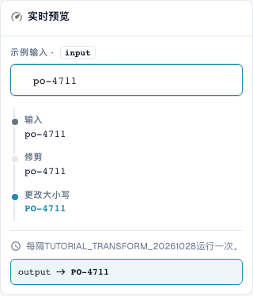
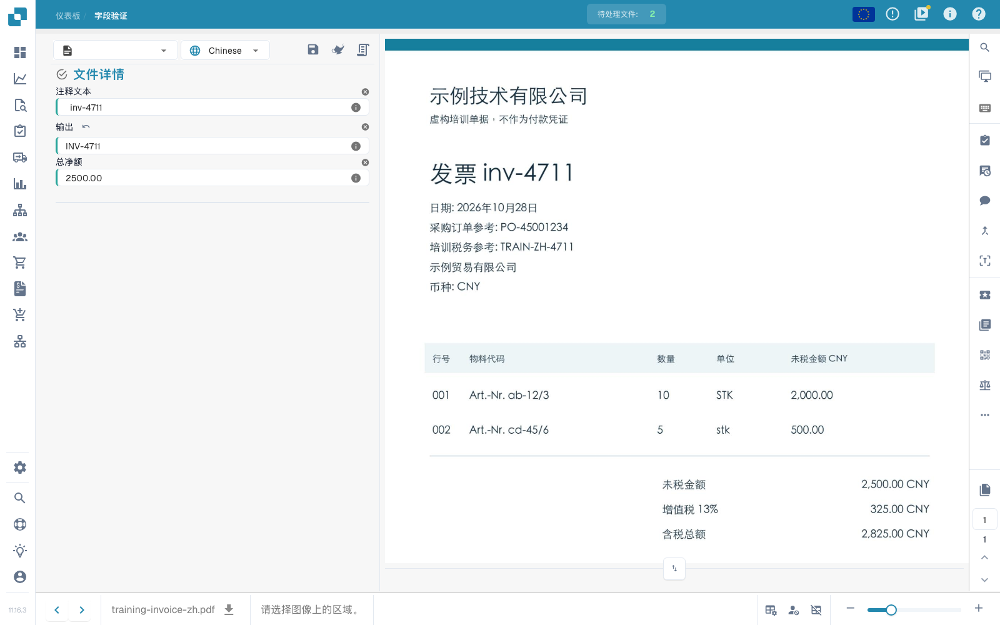

# 基础、作用范围与安全测试

[返回完整实践概览](complete-practical-guide.md)

单据头字段 · 目标结果 · 来源原始文本 · 修剪 → 大写 → 前缀 INV-。

## 编辑器中的实际标签

当前界面的部分标签翻译不够准确。下表列出实际显示的文字，便于找到正确步骤；功能说明使用技术术语。截图保留真实界面，未修改其中的文字。

| 操作 | 实际显示的标签 |
| --- | --- |
| trim | 修剪 |
| case | 更改大小写 |

## 编辑器中的操作步骤

1. 在隔离的培训文档类型中，为**单据头字段**新建一条规则。选择目标 `output`，选择单独的来源 `header.input`；您所在组织的实际字段名称可能有所不同。
2. 依次添加**修剪**步骤，侧边选择两侧，字符字段留空，然后添加**更改大小写**步骤，模式选择 upper。顺序必须是 修剪 → 大写。
3. 输入测试值 `  inv-4711  `。最后一个预览值必须为 `INV-4711`；中间值首先显示 `inv-4711`。
4. 仅针对培训范围激活并保存该规则。重新打开条目，检查来源、目标和两个步骤。
5. 保存练习凭证，重新加载并检查两个字段：来源仍包含原始空格，输出为 `INV-4711`。再次保存并重复相同检查。

<figure><figcaption>
步骤配置。实际界面为简体中文。预览不会更改已存储的文档。
</figcaption></figure>


步骤配置。实际界面为简体中文。预览不会更改已存储的文档。


<figure><figcaption>
使用训练值的实时预览。实际界面为简体中文。预览不会更改已存储的文档。
</figcaption></figure>


使用训练值的实时预览。实际界面为简体中文。预览不会更改已存储的文档。


## 1. 作用范围

转换会修改已提取的数据。它不会替代文本识别。在编辑器中，我首先选择作用范围。单据头字段 每个文档处理一次。表格列 为每一行处理。表格行 规则会修改整行项目。路由 将文档分配给子组织。这四项任务有不同的目标和不同的步骤。我在单独的测试文档类型上创建示例，以免更改生产发票。

## 2. 来源与处理

然后我选择目标字段。来源可以是该字段本身，也可以是其他字段。步骤从上到下运行。每个中间值都会成为下一步的输入。我的示例读取发票编号，去除外部空格并转换为大写字母。小写字母变为大写。我使用条件将规则限制为匹配的供应商。对于 表格列，条件还可以检查当前行的值。多个条件可以通过 与、或 和 分组 进行组合。

## 3. 效果验证

实时预览不会保存任何内容。我检查一个匹配值、一个反例和一个已修正的结果。随后保存规则，重新打开并检查保存的设置。对于实际的文档效果，我还需要测试文档、保存操作和重新加载的结果。预览既不能证明导出成功，也不能证明订单匹配成功。执行日志帮助我区分已应用和已跳过的条件。在接下来的章节中，我们将逐一介绍各种转换及其限制。

## 已验证的示例与反例

这些值已在服务器端作为 dry test 进行验证。此类测试不会更改已保存的文档。

| 案例 | 输入 | 服务器结果 |
| --- | --- | --- |
| copy | `  po-4711  ` | `PO-4711` |

## 验收检查

检查一个匹配案例、一个反例、一个空值和一个已处理的结果。重复文档保存操作。如果属于业务目标，请额外检查 PO 匹配和 ERP 接收。

## 练习凭证上的保存效果

<figure><figcaption>
保留准备好的原始值；输出显示 INV-4711。两次原生保存操作、重新加载和单独的服务器查询确认了稳定的结果。这证明了规则在准备好的测试值上的效果，而非自动提取的准确性。
</figcaption></figure>


保留准备好的原始值；输出显示 INV-4711。两次原生保存操作、重新加载和单独的服务器查询确认了稳定的结果。这证明了规则在准备好的测试值上的效果，而非自动提取的准确性。


## 视频教程


配置、实际示例与反例。


[打开带中文字幕和章节的视频](https://docbits-videos.fra1.cdn.digitaloceanspaces.com/settings-assistant/transformation-rules-01-foundations-preview-admin/v1/zh.html). 此审阅版本尚待业务内容审核和完整试听。
