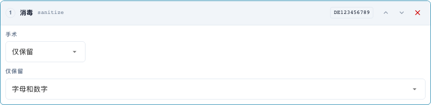
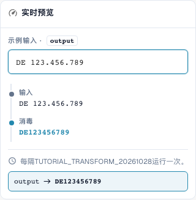

# 文本清理：大小写、修剪和字符

[返回完整实践概览](complete-practical-guide.md)

单据头字段 · 目标结果 · 分步单独测试：case、trim、sanitize。

## 编辑器中的实际标签

当前界面的部分标签翻译不够准确。下表列出实际显示的文字，便于找到正确步骤；功能说明使用技术术语。截图保留真实界面，未修改其中的文字。

| 操作 | 实际显示的标签 |
| --- | --- |
| case | 更改大小写 |
| trim | 修剪 |
| sanitize | 消毒 |

## 编辑器中的操作步骤

1. 为培训单据头字段创建一个单独的步骤**更改大小写**。使用表格中的示例依次检查 upper、lower、title 和 capitalize 模式。
2. 为发票编号新建一个以**修剪**开头的流水线。两侧以及一个空字符字段均去除外部空白；`47 11` 必须保留其内部空格。
3. 作为修剪的独立对照测试，将左侧和字符 `0` 设置为：`004711` 变为 `4711`，`000` 变为空。请勿未经检验即将此步骤用于真实标识。
4. 对于税务识别号，使用**清理字符**并选择保留字母数字。`DE 123.456.789` 必须得到 `DE123456789`。使用 `DE-123` 和 `ACME GmbH!` 检查其余保留模式。
5. 对于 capitalize，明确比较预览和服务器：对于经检验的 `aCME GMBH`，这些结果不同。服务器结果为 `Acme gmbh`；仅合适的浏览器显示并不足够。

<figure><figcaption>
步骤配置。实际界面为简体中文。预览不会更改已存储的文档。
</figcaption></figure>


步骤配置。实际界面为简体中文。预览不会更改已存储的文档。


<figure><figcaption>
使用训练值的实时预览。实际界面为简体中文。预览不会更改已存储的文档。
</figcaption></figure>


使用训练值的实时预览。实际界面为简体中文。预览不会更改已存储的文档。


## 1. 大小写

大写统一例如发票编号。小写可以统一技术比较键。Title Case 和首字母大写也可能改变单词的其余部分。因此，公司缩写可能变成另一种写法。对于专有名词，我仅在有明确业务规范时使用这些变体。在 Capitalise first 模式下，经检验的状态存在偏差：浏览器预览保持其余写法不变，而服务器会将其余部分转为小写。因此，我不仅依赖预览，还会明确比较服务器值。

## 2. 修剪

修剪去除边缘字符。两侧去除外部空格，但不去除编号中间的空格。左侧配合字符零去除所有前导零。仅由零组成的值将因此变为空。右侧在末尾相应工作。字符字段是一组单个字符，而非完整前缀。因此，我使用 Affix 去除固定物料编号前缀。填充和截断我们将在下一部分处理。

## 3. 清理字符

清理时，我可以仅保留字母和数字、仅保留字母、仅保留数字或额外保留空格。带有空格和句点的德国税务识别号将因此变为连续键。但对于物料编号，连字符在业务上可能很重要。去除此类字符必须与目标系统的写法匹配。替代字符去除使用正则表达式字符类。其中的连字符需要特别注意。因此，对于我的示例，我除预览外还检验实际服务器值。已清理的值和空输入都应包含在每个测试中。

## 已检验示例和对照案例

这些值已在服务器端作为不保存数据的测试进行检验。此类测试不会更改已保存的文档。

| 案例 | 输入 | 服务器结果 |
| --- | --- | --- |
| case-upper | `inv-4711` | `INV-4711` |
| case-upper | `INV-4711` | `INV-4711` |
| case-lower | `INFO@BEISPIEL.DE` | `info@beispiel.de` |
| case-title | `acme gmbh` | `Acme Gmbh` |
| case-capitalize | `aCME GMBH` | `Acme gmbh` |
| trim | `  4711  ` | `4711` |
| trim | `47 11` | `47 11` |
| trim-zero | `004711` | `4711` |
| trim-zero | `000` | `` |
| sanitize | `DE 123.456.789` | `DE123456789` |
| sanitize-alpha | `DE-123` | `DE` |
| sanitize-numeric | `DE-123` | `123` |
| sanitize-space | `ACME GmbH!` | `ACME GmbH` |
| sanitize-strip | `ab-12/3.` | `ab123` |

## 验收

检验一个合适的案例、一个对照案例、一个空值和一个已处理的结果。重复文档保存操作。如果 PO 对账和 ERP 接收属于业务目标，请额外进行检验。

## 视频教程


配置、实际示例与反例。


[打开带中文字幕和章节的视频](https://docbits-videos.fra1.cdn.digitaloceanspaces.com/settings-assistant/transformation-rules-02-text-cleaning-preview-admin/v1/zh.html). 此审阅版本尚待业务内容审核和完整试听。
