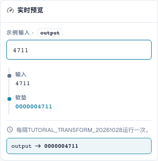

# 数字格式化：填充、截断、前缀与后缀

> 已知预览限制（于2026年10月29日验证，版本11.15.2）：添加前缀 `INV-` 时，预览错误地将 `INV-4711` 变为 `INV-INV-4711`。独立验证的服务器测试仍返回 `INV-4711`。因此还应通过服务器测试检查重复执行；仅有正确的预览结果并不能证明保存时的完整执行。

[返回完整实践概览](complete-practical-guide.md)

单据头字段 · pad: 长度 10, 字符 0, 左侧; truncate: 长度 10; affix: 精确前缀/后缀操作。

## 编辑器中的实际标签

当前界面的部分标签翻译不够准确。下表列出实际显示的文字，便于找到正确步骤；功能说明使用技术术语。截图保留真实界面，未修改其中的文字。

| 操作 | 实际显示的标签 |
| --- | --- |
| pad | 软垫 |
| truncate | 截短 |
| affix | 词缀 |

## 编辑器中的操作步骤

1. 选择数字的填充步骤。设置最小长度 10，填充字符 `0`，方向为左侧。`4711` 必须变为 `0000004711`。
2. 用已有十一位的输入进行验证：填充不得截断任何内容。对于右侧补充，单独测试长度 6，字符 `_` 和输入 `ABC`。
3. 在独立规则中设置**截断**，最大长度 10。`ABCDEFGHIJKL` 变为 `ABCDEFGHIJ`，`ABC` 保持不变。检查不同输入是否可能因此产生相同标识。
4. 测试添加前缀 `INV-` 的 **Affix**。随后检查输入 `INV-4711`：已存在的确切前缀不得再次补充。
5. 分别配置其他 Affix 变体：添加后缀 `-DE`、移除前缀 `Art.-Nr. ` 和移除后缀 ` EUR`。移除时还需测试不匹配的边缘情况以及不同的大小写。
6. 再次将输出用作输入。特别是在移除多次出现的前缀/后缀时，第二次运行可能会进一步改变结果。

<figure><figcaption>
步骤配置。实际界面为简体中文。预览不会更改已存储的文档。
</figcaption></figure>


步骤配置。实际界面为简体中文。预览不会更改已存储的文档。


<figure><figcaption>
使用训练值的实时预览。实际界面为简体中文。预览不会更改已存储的文档。
</figcaption></figure>


使用训练值的实时预览。实际界面为简体中文。预览不会更改已存储的文档。


## 1. 长度

填充在左侧或右侧补充单个填充字符，直至达到最小长度。以十位且左侧补零为例，四位编号将变为十位标识。已更长的编号保持更长。因此填充并非长度校验。截断则仅保留前若干个字符至所选最大长度。此信息将丢失。在 ERP 部署前，我会检查不同编号截断后是否可能变得相同。较短值保持不变。

## 2. 前缀和后缀

以下前后缀操作结果描述的是已验证的服务器执行行为。

Affix 提供四种变体：添加前缀、添加后缀、移除前缀和移除后缀。若值已恰好以此开头，则已添加的前缀不会再次补充。后缀同理。移除则精确检查开头或结尾。不同的大小写不会自动等同。若文本位于值中间，则保持不变。对于任意位置的查找，我使用查找和替换。

## 3. 重复应用

即使简单的流水线也需要重复测试。若从双重前置的前缀中移除一个，第一次运行后仍剩余一个。下一次运行时，这一个也将消失。因此我检查整条规则，而非仅单独检查每个步骤。典型的发票编号流水线为：Trim、大写转换、补充前缀。我测试原始编号、已完成编号以及不同的供应商。条件确保仅约定的情况被修改。

## 已验证示例及反面案例

这些值已在服务器端作为不保存数据的测试进行验证。此类测试不会更改已保存的文档。

| 案例 | 输入 | 服务器结果 |
| --- | --- | --- |
| pad | `4711` | `0000004711` |
| pad | `12345678901` | `12345678901` |
| pad-right | `ABC` | `ABC___` |
| truncate | `ABCDEFGHIJKL` | `ABCDEFGHIJ` |
| truncate | `ABC` | `ABC` |
| prefix-add | `4711` | `INV-4711` |
| prefix-add | `INV-4711` | `INV-4711` |
| suffix-add | `4711` | `4711-DE` |
| suffix-add | `4711-DE` | `4711-DE` |
| prefix-strip | `Art.-Nr. 4711` | `4711` |
| prefix-strip | `ART.-NR. 4711` | `ART.-NR. 4711` |
| prefix-strip | `Art.-Nr. Art.-Nr. 4711` | `Art.-Nr. 4711` |
| suffix-strip | `123 EUR` | `123` |
| suffix-strip | `123 EUR netto` | `123 EUR netto` |

## 验收

检查一个匹配案例、一个反面案例、一个空值和一个已处理结果。重复文档保存操作。若属于业务目标，额外检查 PO 匹配和 ERP 接收。

## 视频教程


配置、实际示例与反例。


[打开带中文字幕和章节的视频](https://docbits-videos.fra1.cdn.digitaloceanspaces.com/settings-assistant/transformation-rules-03-numbers-and-affixes-preview-admin/v1/zh.html). 此审阅版本尚待业务内容审核和完整试听。
