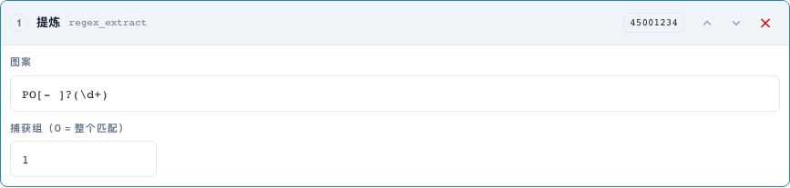
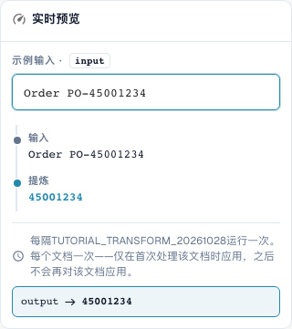

# 片段与模式：剪切、提取、替换

[返回完整实践概览](complete-practical-guide.md)

单据头字段 · 源 header.input · 目标 output · regex_extract: PO[- ]?(\d+)，捕获组 1。源与目标保持分离。

## 编辑器中的实际标签

当前界面的部分标签翻译不够准确。下表列出实际显示的文字，便于找到正确步骤；功能说明使用技术术语。截图保留真实界面，未修改其中的文字。

| 操作 | 实际显示的标签 |
| --- | --- |
| substring | 切一块 |
| regex_extract | 提炼 |
| regex_replace | 查找和替换 |

## 编辑器中的操作步骤

1. 对于所有三个步骤，选择一个目标如 `output` 和一个**分离的原始源**如 `header.input`。即使"仅执行一次"也不允许使用自身作为源。
2. 对于**片段**，首先设置起始位置 0 和长度 4：`2026-10-28` 得到 `2026`。然后测试起始位置 3 和结束位置 7，使用 `DE-4711-X`；结束位置不包含在结果中。
3. 作为独立变体，测试起始位置 −4 且不设置长度/结束位置：`INV-4711` 得到 `4711`。较短的输入是一个必要的反例。
4. 对于**提取**，使用模式 `PO[- ]?(\d+)` 和捕获组 1。`Order PO-45001234` 得到 `45001234`；`Invoice 4711` 得到空结果。组 0 则返回完整匹配项。
5. 对于**查找和替换**，配置模式 `\s+`，替换为一个空格，数量 0。`ACME    GmbH` 必须得到 `ACME GmbH`。然后测试模式 `-`，替换 `/`，数量 1，使用 `AB-CD-EF`：仅替换第一个连字符。
6. 具体模式也需在服务器端测试。仅浏览器端模式成功，对于复杂表达式不能证明服务器端处理完全一致。

<figure><figcaption>
步骤配置。实际界面为简体中文。预览不会更改已存储的文档。
</figcaption></figure>


步骤配置。实际界面为简体中文。预览不会更改已存储的文档。


<figure><figcaption>
使用训练值的实时预览。实际界面为简体中文。预览不会更改已存储的文档。
</figcaption></figure>


使用训练值的实时预览。实际界面为简体中文。预览不会更改已存储的文档。


## 1. 片段

片段通过起始位置和长度，或起始位置和结束位置来确定。第一个索引为零。结束位置不再属于结果。负起始位置从右侧边缘计数。对于最后四个字符，我使用起始位置为负四且不设置结束位置。我选择与目标不同的源。这样每次运行都会重新读取原始文本。服务器拒绝在自身目标字段上执行这些步骤，否则值在重复处理时会被不断更改。仅执行一次在此处不能替代这种分离的源。

## 2. 提取

提取查找正则表达式的第一个匹配项。我的模式识别字母 P 和 O，可选的连字符或空格，以及随后的数字。组 1 仅返回数字，组 0 返回完整匹配项。无匹配时返回空字符串。因此我设置适当的条件，或有意识地检查空目标值在此情况下是否为预期结果。文本中的多个订单号不会自动产生多个结果。

## 3. 替换

查找和替换处理模式的匹配项。数量为零时替换所有匹配项。数量为一仅更改第一个匹配项。我可以将多个空格替换为单个空格。此处我也使用单独的原始源。浏览器中的预览和服务器上的处理，对于复杂的正则表达式可能使用不同的规则。因此我先测试简单模式，随后比较实际的服务器值。一个匹配案例、无匹配和多个匹配构成我的最低限度检查。

## 已验证的示例和反例

这些值已在服务器端作为纯测试进行验证。此类测试不会更改已保存的文档。

| 案例 | 输入 | 服务器结果 |
| --- | --- | --- |
| substring | `2026-10-28` | `2026` |
| substring | `AB` | `AB` |
| substring-end | `DE-4711-X` | `4711` |
| substring-negative | `INV-4711` | `4711` |
| regex-extract | `Order PO-45001234` | `45001234` |
| regex-extract | `Invoice 4711` | `` |
| regex-replace | `ACME    GmbH` | `ACME GmbH` |
| regex-count | `AB-CD-EF` | `AB/CD-EF` |

## 验收

检查一个匹配案例、一个反例、一个空值和一个已处理的结果。重复文档保存操作。如属于业务目标，额外检查 PO 匹配和 ERP 接收。

## 视频教程


配置、实际示例与反例。


[打开带中文字幕和章节的视频](https://docbits-videos.fra1.cdn.digitaloceanspaces.com/settings-assistant/transformation-rules-04-substrings-and-patterns-preview-admin/v1/zh.html). 此审阅版本尚待业务内容审核和完整试听。
