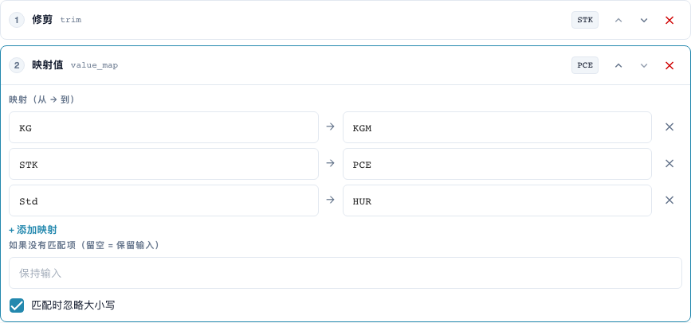
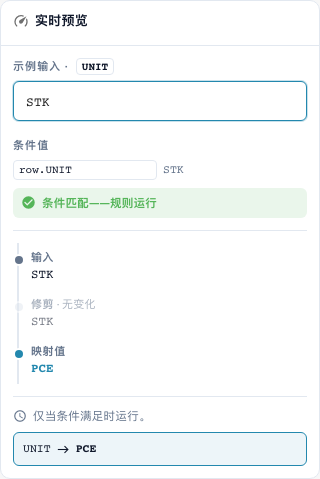

# 每表格行的值映射与规则

[返回完整实践概览](complete-practical-guide.md)

表格列 UNIT · 修剪 → value_map: STK→PCE, KG→KGM, Std→HUR · 忽略大小写。

## 编辑器中的实际标签

当前界面的部分标签翻译不够准确。下表列出实际显示的文字，便于找到正确步骤；功能说明使用技术术语。截图保留真实界面，未修改其中的文字。

| 操作 | 实际显示的标签 |
| --- | --- |
| trim | 修剪 |
| value_map | 映射值 |

## 编辑器中的操作步骤

1. 选择适用范围**表格列**，表格 `INVOICE_TABLE` 和目标列 `UNIT`。此处逐行处理每条表格行。
2. 将**修剪**置于**值映射**之前。录入配对 `STK→PCE`、`KG→KGM` 和 `Std→HUR`，并启用忽略大小写。
3. 将无匹配时的替换字段留空，以便未知代码保留原样。`stk` 必须产生 `PCE`，`BOX` 必须保持为 `BOX`。
4. 使用匹配的行条件和不匹配的条件进行预览检查。该条件不得意外捕获其他行。
5. 为真实的多行测试准备原始值 `STK`、`STK`、`BOX`。在已检查的服务器测试中生成 `PCE`、`PCE`、`BOX`；数量和价格需另行进行业务验证。
6. 将每个目标代码再次作为输入进行验证。笼统替换如 `C62` 以及串联映射可能掩盖未知值，或在后续运行中继续更改。

<figure><figcaption>
步骤配置。实际界面为简体中文。预览不会更改已存储的文档。
</figcaption></figure>


步骤配置。实际界面为简体中文。预览不会更改已存储的文档。


<figure><figcaption>
使用训练值的实时预览。实际界面为简体中文。预览不会更改已存储的文档。
</figcaption></figure>


使用训练值的实时预览。实际界面为简体中文。预览不会更改已存储的文档。


## 1. 值配对

值映射转换完整的输入值。我的示例将“件”映射为代码 P C E，“千克”映射为代码 K G M，“小时”映射为代码 H U R。我成对录入实际的供应商代码和预期的目标代码。启用忽略大小写后，小写代码也能被识别。这还不会移除空格。因此我在映射前设置一个修剪步骤。我会明确测试未知代码。

## 2. 无匹配时

无匹配时的值字段留空意味着：保留输入。这不意味着：删除输入。相反，固定的替换值会替换每个未知代码。这可能掩盖错误。对于业务上不同的单位，我不会分配笼统的替换代码。映射在每种组合下也并非自动可重复执行。如果某配对的输出同时是另一配对的输入，后续运行可能继续映射。因此我也会将每个目标代码作为新输入进行测试。

## 3. 按表格行处理

对于表格，我选择具体的表格和目标列。随后管道为每行运行。条件可将当前行的单位代码与单据头的供应商特征关联。示例中修改了两条匹配行，而未知单位代码保留不变。这不会通过单位换算更改数量或价格。重命名字符串不是数学换算。我单独验证实际的订单比对和导出，与转换分开进行。

## 已验证的示例及反面案例

以下值已在服务器端作为不保存数据的测试验证。此类测试不会更改已保存的文档。

| 案例 | 输入 | 服务器结果 |
| --- | --- | --- |
| map | `stk` | `PCE` |
| map | `PCE` | `PCE` |
| map | `BOX` | `BOX` |
| map-fallback | `BOX` | `C62` |
| item-pipeline | `Art.-Nr. ab-12/3` | `AB123` |

## 验收

请验证一个匹配案例、一个反面案例、一个空值以及一个已处理的结果。重复执行文档保存操作。如订单比对和 ERP 接收属于业务目标，请额外验证。

## 视频教程


配置、实际示例与反例。


[打开带中文字幕和章节的视频](https://docbits-videos.fra1.cdn.digitaloceanspaces.com/settings-assistant/transformation-rules-05-value-mapping-preview-admin/v1/zh.html). 此审阅版本尚待业务内容审核和完整试听。
