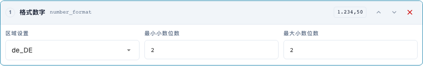
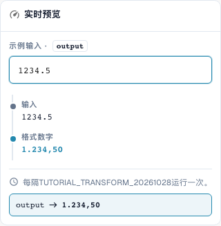

# 正确格式化日期和数字

[返回完整实践概览](complete-practical-guide.md)

文本目标 · date_format: %d.%m.%Y; number_format: de_DE, 最少 2 位、最多 2 位小数。

## 编辑器中的实际标签

当前界面的部分标签翻译不够准确。下表列出实际显示的文字，便于找到正确步骤；功能说明使用技术术语。截图保留真实界面，未修改其中的文字。

| 操作 | 实际显示的标签 |
| --- | --- |
| date_format | 重新格式化日期 |
| number_format | 格式数字 |

## 编辑器中的操作步骤

1. 为获得清晰可读的首次尝试，使用**文本目标**和**格式化日期**步骤。设置输出模式 `%d.%m.%Y` 和输入 `2026-10-28`；预期结果为 `28.10.2026`。
2. 分别使用相同的明确输入比较变体 `%m/%d/%Y`、`%Y-%m-%d` 和 `%d %b %Y`。这些模式无法可靠识别任意日期格式。
3. 使用 `kein Datum` 以及一个歧义输入进行复核。对于真实的 DATE 单据头字段，需额外分别检查存储的 ISO 值和可见显示。
4. 在单独规则中选择**格式化数字**，区域设置 `de_DE`，最小和最大小数位数均选择 2。服务器输入 `1234.5` 必须得到 `1234,50`。
5. 使用 `en_US` 检查相同输入：服务器结果 `1234.50`。经检查的浏览器预览中的千位分隔符在服务器端不会被写入。
6. 检查零、负金额和额外小数位。随后重新处理输出并检查实际存储的值。

<figure><figcaption>
步骤配置。实际界面为简体中文。预览不会更改已存储的文档。
</figcaption></figure>


步骤配置。实际界面为简体中文。预览不会更改已存储的文档。


<figure><figcaption>
使用训练值的实时预览。实际界面为简体中文。预览不会更改已存储的文档。 可见的千位分隔符属于浏览器预览；已验证的服务器结果为 1234,50。
</figcaption></figure>


使用训练值的实时预览。实际界面为简体中文。预览不会更改已存储的文档。 可见的千位分隔符属于浏览器预览；已验证的服务器结果为 1234,50。


## 1. 日期和数据类型

重新格式化日期按照选定模式写入日期。一个明确的 ISO 日期是良好的测试输入。例如，可以用点号输出日、月和年。对于真实的日期单据头字段，内部值可以保持 ISO 格式，而显示会发生变化。相反，文本字段或表格单元格可以包含格式化后的文本。因此，我不仅比较可见字段，还比较存储的值和后续使用。

## 2. 不可读和歧义数据

不可读的日期不会被随意编造。在我的服务器测试中，文本保持不变，结果会说明原因。歧义数据（如日和月都是较小数字）需要明确约定的上下文。格式化后的日期在下次保存时不应被读取为另一个日期。因此我检查第二次运行。对于不含有效日期的任意文本，此转换无法生成可靠的日期。

## 3. 数字格式

格式化数字使用区域设置以及最小和最大小数位数。这会改变显示和可能的舍入，但不会改变汇率和计量单位。对于我的输入"一千二百三十四点五"，当前服务器使用两位小数输出德语逗号写法或英语点号写法。经检查的服务器结果中不包含千位分隔符。因此我不会将更美观的浏览器显示作为导出的证据。零、负金额、额外小数位和存储的结果值需要单独测试。

## 已检查的示例和反面案例

这些值已在服务器端作为纯测试进行检查。此类测试不会更改已保存的文档。

| 案例 | 输入 | 服务器结果 |
| --- | --- | --- |
| date | `2026-10-28` | `28.10.2026` |
| date | `kein Datum` | `kein Datum` |
| number-de | `1234.5` | `1234,50` |
| number-us | `1234.5` | `1234.50` |

## 验收

检查一个适用案例、一个反面案例、一个空值和一个已处理的结果。重复文档保存操作。如果属于业务目标，请额外检查采购订单对账和 ERP 接收。

在经检查的版本中，数字预览和服务器在千位分隔符方面存在差异。表格列出的是实际服务器值。

## 视频教程


配置、实际示例与反例。


[打开带中文字幕和章节的视频](https://docbits-videos.fra1.cdn.digitaloceanspaces.com/settings-assistant/transformation-rules-06-dates-and-numbers-preview-admin/v1/zh.html). 此审阅版本尚待业务内容审核和完整试听。
