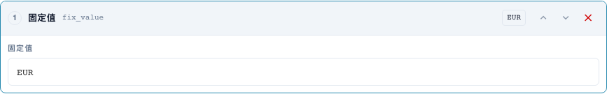
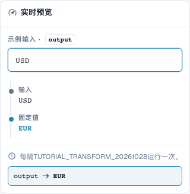
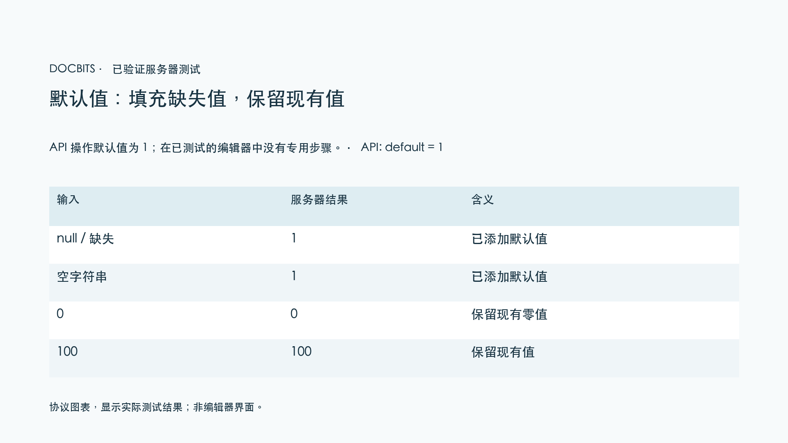

# 字段复制、固定值、清空与默认值

[返回完整实践概览](complete-practical-guide.md)

目标结果 · 源字段复制的原始文本；固定值仅在严格条件下使用；清空需单独测试。

## 编辑器中的实际标签

当前界面的部分标签翻译不够准确。下表列出实际显示的文字，便于找到正确步骤；功能说明使用技术术语。截图保留真实界面，未修改其中的文字。

| 操作 | 实际显示的标签 |
| --- | --- |
| trim | 修剪 |
| case | 更改大小写 |
| fix_value | 固定值 |
| clear | 清除 |

## 编辑器中的操作步骤

1. 对于**字段复制**，选择一个与目标字段不同的源字段。在练习范围内，目标是 `output`，源是 `header.input`。
2. 配置修剪 → 大写转换步骤并测试 `  po-4711  `。输出将为 `PO-4711`；在此过程中原始源字段不得被清空。
3. 对于生产环境中的订单号，使用仅在目标为空时才生效的附加条件。测试一个已存在的正确目标值作为反例。
4. 在单独规则中使用 `EUR` 创建**固定值**。即使输入 `USD` 也会被覆盖；这不是货币转换。
5. 使用 `Altwert` 单独测试**清空**。输出为空字符串。注意故意清空与缺失输出值之间的业务区别。
6. 仅通过指定的 API 契约测试接口步骤 `default`；在已验证的普通步骤菜单中没有单独的条目。协议图显示：缺失和空值会被补充，`0` 和 `100` 保留不变。

<figure><figcaption>
步骤配置。实际界面为简体中文。预览不会更改已存储的文档。
</figcaption></figure>


步骤配置。实际界面为简体中文。预览不会更改已存储的文档。


<figure><figcaption>
使用训练值的实时预览。实际界面为简体中文。预览不会更改已存储的文档。
</figcaption></figure>


使用训练值的实时预览。实际界面为简体中文。预览不会更改已存储的文档。


## 1. 字段复制

对于字段复制，我先选择目标字段，然后选择另一个源字段。如果订单号位于错误的字段中，我可以从该字段读取、修剪并保存到正确的目标字段中。条件"目标为空"可保护已存在的订单号。源字段保持不变。这是经过处理的复制，而非移动。我测试空目标、已填充目标和空源。

## 2. 固定值与清空

固定值会忽略先前内容。如果我将货币设置为欧元，该规则也会覆盖已存在的其他货币。为此我需要一个严格的业务条件。清空会向目标字段写入空字符串。这不是删除整个字段或文档。在预览中，我主要测试反例，以确保规则不会移除有效值。仅保存规则并不能证明文档已被更改。

## 3. 默认值

服务器接口额外支持默认值操作。它仅在输入缺失或为空时补充值。已存在的零值保持为零。此操作在已验证的普通编辑器步骤选择中不作为独立步骤存在。在编辑器中，我通常可以用"目标为空"条件加固定值来表示所需的默认情况。我明确展示这种区别，不声称存在额外的菜单项。默认值始终是一个业务决策，尤其在价格基准、数量或货币方面。

## 已验证的示例与反例

这些值已在服务器端作为不保存数据的测试进行验证。此类测试不会更改已保存的文档。

| 情况 | 输入 | 服务器结果 |
| --- | --- | --- |
| fixed | `USD` | `EUR` |
| fixed | `null` | `EUR` |
| clear | `Altwert` | `` |
| clear | `` | `` |
| default-api | `null` | `1` |
| default-api | `` | `1` |
| default-api | `0` | `0` |
| default-api | `100` | `100` |
| copy | `  po-4711  ` | `PO-4711` |

## 验收

检查一个适用情况、一个反例、一个空值和一个已处理的结果。重复文档保存操作。如属于业务目标，额外检查 PO 对账和 ERP 接收。

<figure><figcaption>
实际服务器和持久化测试结果以协议图表形式显示。这不是重新创建的编辑器界面。
</figcaption></figure>


实际服务器和持久化测试结果以协议图表形式显示。这不是重新创建的编辑器界面。


## 视频教程


配置、实际示例与反例。


[打开带中文字幕和章节的视频](https://docbits-videos.fra1.cdn.digitaloceanspaces.com/settings-assistant/transformation-rules-07-field-copy-and-defaults-preview-admin/v1/zh.html). 此审阅版本尚待业务内容审核和完整试听。
