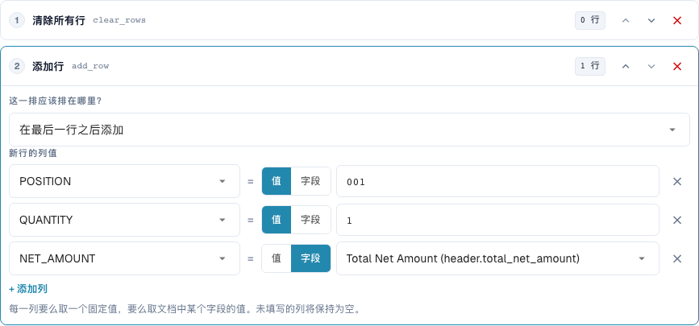
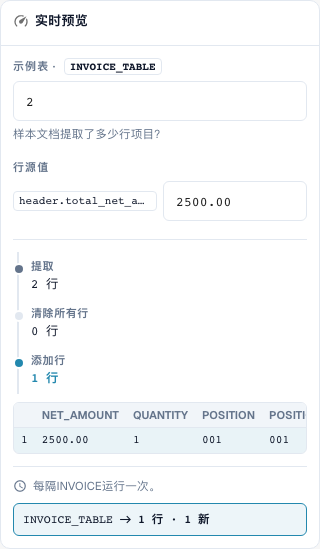

# 重建表格行

[返回完整实践概览](complete-practical-guide.md)

表格 INVOICE_TABLE · clear_rows → 在末尾 add_row · POSITION=001, QUANTITY=1, NET_AMOUNT 来自 header.total_net_amount。

## 编辑器中的实际标签

当前界面的部分标签翻译不够准确。下表列出实际显示的文字，便于找到正确步骤；功能说明使用技术术语。截图保留真实界面，未修改其中的文字。

| 操作 | 实际显示的标签 |
| --- | --- |
| clear_rows | 清除所有行 |
| add_row | 添加行 |

## 编辑器中的操作步骤

1. 选择适用范围**表格行**和具体表格 `INVOICE_TABLE`。一个合适的供应商条件可限制完全重建的范围。
2. 先配置**删除所有行**，之后配置**添加行**。对于新行，设置固定值 `POSITION=001`、`QUANTITY=1`，并为 `NET_AMOUNT` 设置来源 `header.total_net_amount`。
3. 使用单据头金额 `2500.00` 和两行现有数据进行测试：结果仅保留新定义的总计行。在规则激活前，还需检查单据头金额缺失的情况。
4. 添加时比较在第一行之前或最后一行之后的位置。对于此位置测试，需移除之前的删除操作或单独测试，否则没有现有行作为参照。
5. 故意检查反向步骤顺序**添加 → 删除**作为反面案例：结果为空。之后恢复预期的顺序。
6. 检查两次保存。不先删除而直接添加可能会使行重复；重建可能会从工作结果中不可恢复地移除供应商行。请单独验收采购订单匹配。

<figure><figcaption>
步骤配置。实际界面为简体中文。预览不会更改已存储的文档。
</figcaption></figure>


步骤配置。实际界面为简体中文。预览不会更改已存储的文档。


<figure><figcaption>
使用训练值的实时预览。实际界面为简体中文。预览不会更改已存储的文档。
</figcaption></figure>


使用训练值的实时预览。实际界面为简体中文。预览不会更改已存储的文档。


## 1. 构建行

删除所有行会移除所选表格的现有行。随后添加行会构建一个新行。对于每一列，我选择固定值或单据头字段的值。在我的示例中，会生成一个总计项，数量为1，净额来自发票单据头。未填充的列保持为空。新行可以位于开头或末尾。这不是对现有选定项的自动分组或汇总。

## 2. 步骤顺序

顺序至关重要。先删除再添加会得到所需的新行。先添加再删除也会移除刚生成的行。如果没有预先删除，再次运行还会追加一行。因此规则需要合适的一次性执行。带有行数的预览可检查结构，但还不能替代使用真实提取表格的测试。我在保存后检查列值和行数。

## 3. 单独检查采购订单匹配

表格规则在列规则之前运行。因此后续的列规则也可以清理新添加的行。重建项可能会改变现有行标识和采购订单分配。对于有意按总金额匹配的发票，我还需要合适的采购订单匹配规则。仅转换本身不能确认完整的匹配。我只使用隔离的单据进行测试，并在再次保存后单独检查行数和匹配状态。

## 验收

检查一个合适的案例、一个反面案例、一个空值和一个已处理的结果。重复文档保存操作。如果采购订单匹配和ERP接收属于业务目标，请额外检查。

## 视频教程


配置、实际示例与反例。


[打开带中文字幕和章节的视频](https://docbits-videos.fra1.cdn.digitaloceanspaces.com/settings-assistant/transformation-rules-08-table-rows-preview-admin/v1/zh.html). 此审阅版本尚待业务内容审核和完整试听。
