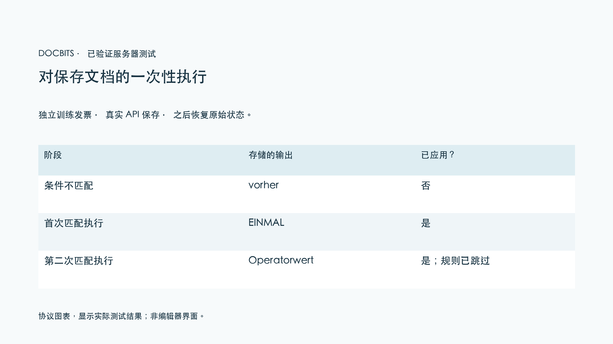
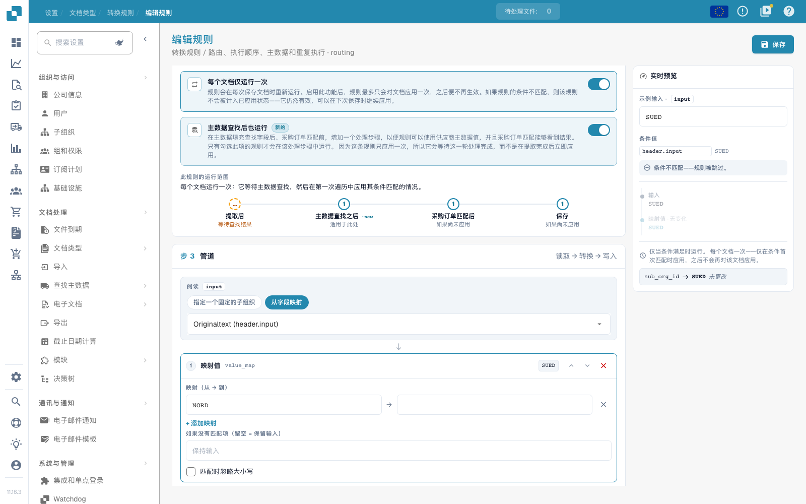

# 路由、顺序、主数据和重复执行

[返回完整实践概览](complete-practical-guide.md)

路由 · 目标子组织 · 使用现有目标；条件、执行阶段和重复执行需单独检查。

视频录制中隐藏了现有路由目标的名称和内部标识。对于您自己的配置，目标必须来自实际存在的子组织选择。

## 编辑器中的操作步骤

1. 对于**路由**，选择提供的文档属性 `sub_org_id`。仅使用实际存在的子组织作为固定目标或作为值映射的结果。
2. 补充合适的供应商或标识条件。在练习示例中，`NORD` 必须满足条件，`SUED` 则跳过该条件。录制仅显示预览，不会移动生产文档。
3. 将阶段指示器与流程 单据头字段 → 路由 → 表格行 → 表格列 进行比较。优先级和规则键仅在同一范围内排序。
4. 启用**主数据搜索后也执行**，并注意采购订单匹配前的附加阶段。来自主数据的源需要合适的执行轮次。
5. **每个文档仅执行一次**：首先使用不匹配的条件进行测试，然后首次匹配执行。在已验证的培训案例中，首次跳过的执行轮次不会消耗该应用。
6. 首次匹配应用后，插入一个操作人员输入的值并再次保存。测试必须证明一次性规则不会再次覆盖该值；在日志中检查条件、结果、阶段和应用证明。

## 1. 子组织

路由目前写入文档的子组织。我可以从现有选择中设置固定目标，或将源值映射到子组织。合适的供应商条件限制该映射。这既不是用户权限也不是审批决策。我仅使用有效的现有子组织，并检查相反情况。在本系列中，路由示例保持为预览；它不会移动生产文档。

## 2. 执行阶段

作用范围按以下顺序运行：单据头字段、路由、表格行和表格列。在单个范围内，优先级和规则键生效。因此，已清理的单据头源可以被路由读取。通过主数据查找后的附加执行，规则可以使用刚从主数据补充的值。此选项在采购订单匹配前添加一个执行轮次。它不会将所有其他执行移至该位置。

## 3. 一次性规则和证明

每个文档仅执行一次限制实际应用的规则。未满足的条件不会消耗此次执行。与查找选项结合，规则在首次提取轮次时等待后续阶段。对于片段和正则表达式，单独的源仍然是必需的。我检查首次应用、不匹配情况和重新保存。在日志中查找条件、结果和执行阶段。只有重新加载的文档才能证明已保存的效果。ERP 接收和采购订单匹配各自需要自己的证明。

## 验收

检查匹配情况、相反情况、空值和已处理结果。重复文档保存操作。如果采购订单匹配和 ERP 接收属于业务目标，请额外检查。

<figure><figcaption>
实际服务器和持久化测试结果以协议图表形式显示。这不是重新创建的编辑器界面。
</figcaption></figure>


实际服务器和持久化测试结果以协议图表形式显示。这不是重新创建的编辑器界面。


在已保存的集成测试中，不匹配的条件不会消耗一次性执行。首次匹配保存时写入了 EINMAL。第二次匹配保存时，准备的操作人员输入的值得以保留，且已保存的应用证明仍然设置。测试凭证随后被恢复。不保存数据的服务器测试仍可能计算假设结果；因此请额外检查其提示 `already_applied` 和实际保存的文档。

<figure><figcaption>
一次性执行以及实际编辑器中的额外查找阶段。不匹配的条件示例被跳过；内部路由目标标识符已隐藏。这些选项为未保存的预览。
</figcaption></figure>


一次性执行以及实际编辑器中的额外查找阶段。不匹配的条件示例被跳过；内部路由目标标识符已隐藏。这些选项为未保存的预览。


## 视频教程


配置、实际示例与反例。


[打开带中文字幕和章节的视频](https://docbits-videos.fra1.cdn.digitaloceanspaces.com/settings-assistant/transformation-rules-09-routing-and-execution-preview-admin/v1/zh.html). 此审阅版本尚待业务内容审核和完整试听。
