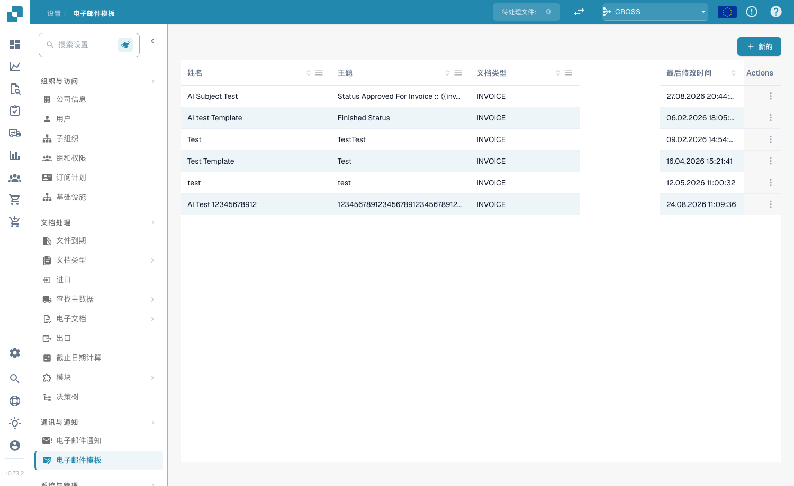
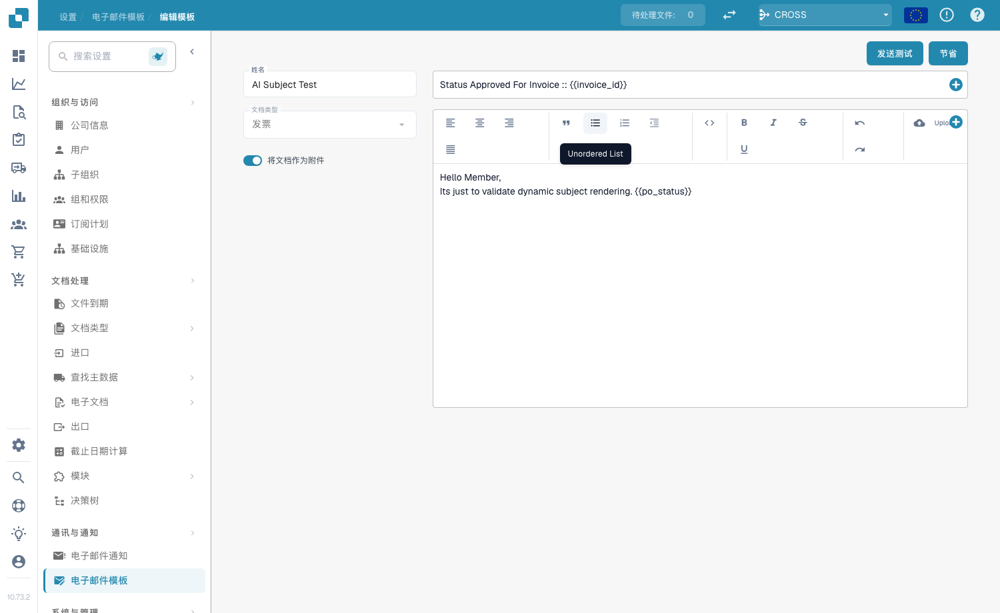
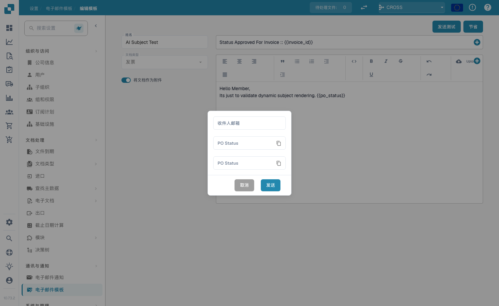

# 电子邮件模板

## **概述**

电子邮件模板可让您自定义 DocBits 自动发送的电子邮件，例如审批提醒或错误通知。模板定义主题行和正文，并可包含动态字段（例如 `{{InvoiceNumber}}`）、图片和富文本格式。

## **访问电子邮件模板**

前往 **Settings → Communication & Notifications → Email Templates**。列表显示每个模板的 **Name**、**Subject**、**Document Type**、**Last Modified** 日期和 **Actions**（编辑或删除）。

<figure><figcaption>
电子邮件模板列表
</figcaption></figure>

## **创建模板**

1. 点击右上角的 **+ New**。
2. 填写以下字段：
   * **Name** — 描述性标识（例如“文档错误通知”）。
   * **Document Type** — 此模板适用的文档类型（例如 `INVOICE`）。
   * **Include Document As Attachment** — 启用此开关，将源文档作为附件添加到电子邮件中。
   * **Subject** — 电子邮件主题行。点击字段旁边的 **+** 按钮可插入动态字段，也可以直接输入 `{{FieldID}}`。
3. 在富文本编辑器中设计正文 — 设置文本格式（粗体、斜体、列表、对齐方式），使用 **Upload** 插入图片，使用 `<>` 按钮编辑原始 HTML，并使用 **+** 按钮插入动态字段。
4. 点击 **Save**。

<figure><figcaption>
模板编辑器 — 名称、文档类型、附件开关、主题和富文本正文
</figcaption></figure>

## **动态字段**

发送电子邮件时，动态字段会替换为文档数据。使用 **+** 按钮插入字段，也可以手动输入双大括号格式：

* `{{invoice_id}}` — 发票编号
* `{{supplier_name}}` — 供应商名称
* `{{total_amount}}` — 总金额
* `{{status}}` — 当前文档状态

## **发送测试电子邮件**

在编辑器中点击 **Send Test**，输入 **Receiver Email** 地址，然后点击 **Send**。DocBits 会发送模板预览，以便您在保存前检查布局并确认动态字段能正确解析。

<figure><figcaption>
Send Test 对话框
</figcaption></figure>

## **在通知中使用模板**

已保存的模板可以关联到 [**Email Notification**](email-notification/) 工作流中，例如审批提醒或状态变更更新。

</final>
