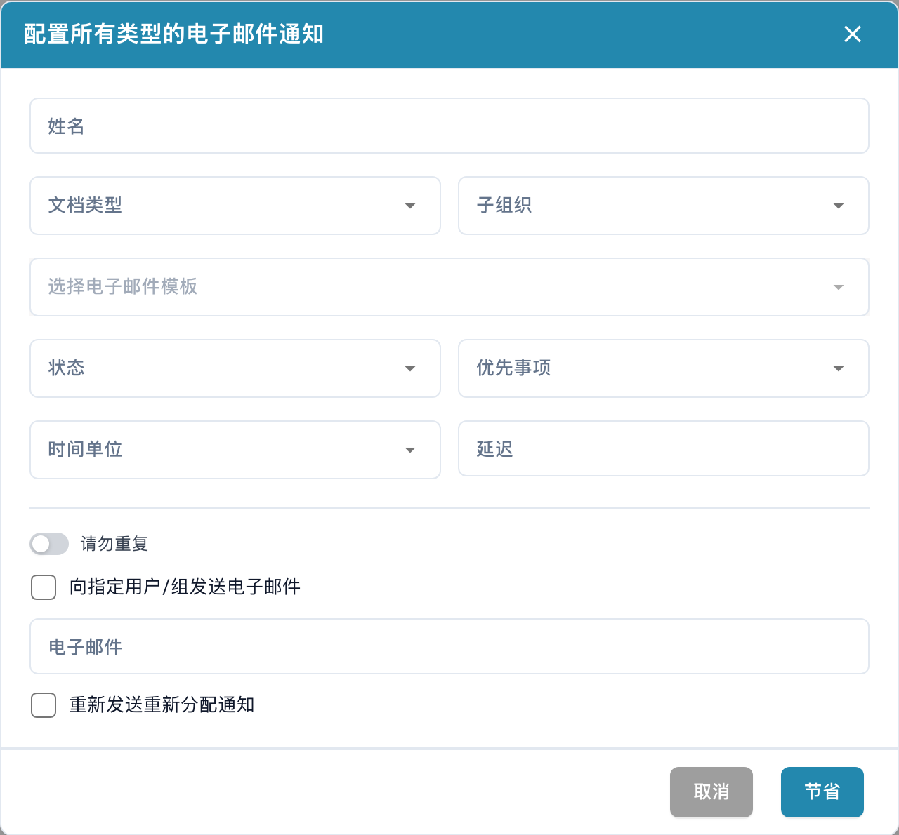

# 配置电子邮件通知

邮件通知配置用于指定收件人、主题和内容。打开通知配置窗口。

<figure><figcaption>
电子邮件通知配置窗口。 界面中的“姓名”实际表示通知名称，“节省”表示保存；本例未保存通知。
</figcaption></figure>

检查收件人及可用字段，按业务目的填写模板。变量和技术占位符应保持系统要求的格式。

保存前检查内容及收件范围，并按组织流程测试。图片展示未保存的配置窗口，没有发送邮件。
