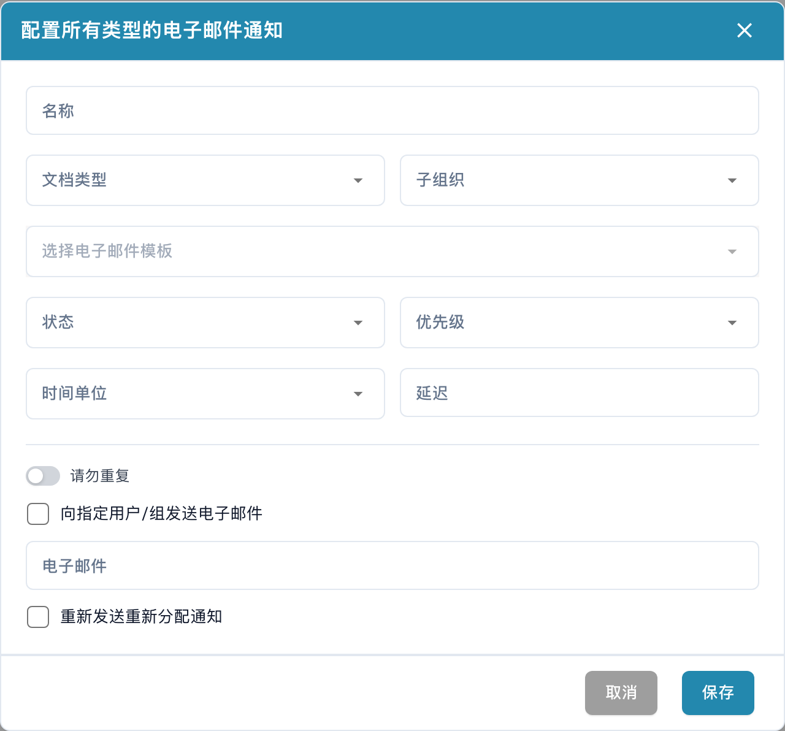

# 管理通知

打开 **Settings → Email Notification** 查看您所在组织的规则。一条规则将文档状态与电子邮件模板及收件人关联起来。以下内容是一条假设的发票通知规则配置示例。截图展示当前中文空白表单，没有创建或激活该规则。

## 示例：发票已准备好进行验证

创建规则前，请先在 **Settings → Email Templates** 下为 **Invoice** 准备电子邮件模板。本例中的模板名为 **Docs Demo Invoice Notification**。该模板提供电子邮件主题和正文。

1. 在 **Email Notification** 页面上选择 **+ New**。
2. 输入 **Docs Demo Invoice Validation** 作为名称，选择 **Invoice** 作为文档类型，然后选择准备好的电子邮件模板。
3. 将状态设为 **Ready for validation**，优先级设为 **Medium**。将 **Time Unit** 设为 **MINUTES**，将 **Delay** 设为 **10**。分钟的最短延迟为五分钟。
4. 选择 **Send Email to Assigned User/Group**。如果只需发送一次消息，请开启 **Do not Repeat**。检查收件人和发送时间，然后选择 **Save**。

<figure><figcaption>
当前中文通知规则空白表单。名称、模板和收件人尚未填写，未保存或激活通知；下文规则名称与时间只是配置示例。
</figcaption></figure>

保存成功后，规则应显示在列表中。请检查其实际启用状态；未启用规则的操作菜单可提供激活入口。激活前，请检查名称、文档类型、状态、延迟时间和收件人。

<!-- Obsolete illustration retired: Obsolete English menu/example illustration retired; instructions remain, and no unsafely opened menu, saved rule, or completed operation is claimed. -->

## 编辑、激活或删除规则

打开该行的 **Actions** 菜单。选择 **Edit** 可打开规则并查看其当前值。选择 **Activate** 可启用此未激活的示例；规则处于激活状态时，则会显示 **Deactivate**。选择 **Logs** 可打开通知历史记录。选择 **Delete** 后，确认即可删除规则。激活或更改规则前，请检查收件人和发送时间。

<!-- Obsolete illustration retired: Obsolete English menu/example illustration retired; instructions remain, and no unsafely opened menu, saved rule, or completed operation is claimed. -->

如果列表显示 **No Record Found!**，请先创建规则。如果 **Document Type** 或电子邮件模板列表为空，请先配置已激活的文档类型和匹配的模板，然后再返回此表单。

有关初始设置的更多信息，请参阅[配置通知](configuring-notifications.md)。如果电子邮件未按预期送达，请参阅[故障排除](troubleshooting.md)。
