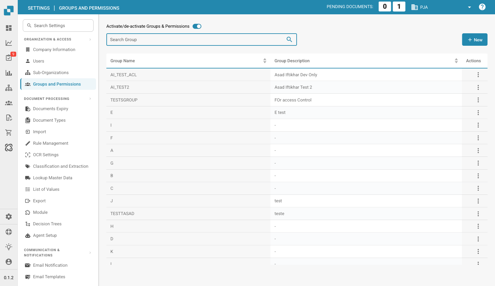

# 用户组与权限


DocBits 用户组与权限教程：设置用户角色、访问权限并保护您的工作区


<figure><figcaption>
用户组与权限页面
</figcaption></figure>

用户组与权限功能可用于控制哪些用户可以访问特定文档类型，以及他们可以执行哪些操作。

## 启用/停用用户组与权限

使用页面顶部的切换开关启用或停用用户组与权限系统。停用后，系统将使用更简单的访问模型，不再基于用户组进行限制。

## 用户组列表

该表格显示所有已配置的用户组，包括：

| 列 | 描述 |
|--------|-------------|
| **用户组名称** | 用户组的名称。 |
| **用户组描述** | 对用户组用途的简要说明。 |
| **操作** | 包含编辑或删除用户组选项的菜单。 |

使用**搜索**栏按名称查找用户组。点击**+ 新建**即可创建用户组。

## 配置用户组权限

选择一个用户组（通过“操作”菜单 →“编辑”）后，会显示权限表格，您可以在其中按文档类型配置访问权限：

| 权限 | 描述 |
|------------|-------------|
| **查看** | 查看此类型文档的权限。 |
| **更新** | 修改此类型文档的权限。 |
| **删除** | 移除此类型文档的权限。 |
| **首次审批** | 执行首次审批的权限。 |
| **二次审批** | 执行第二级审批的权限（如适用）。 |

权限表格中的每一行代表一种文档类型（例如：发票、贷项通知单、交货单）。勾选或取消勾选复选框，即可为该用户组授予或撤销相应权限。

## 创建新用户组

1. 点击右上角的**+ 新建**。
2. 输入**用户组名称**和可选的**描述**。
3. 为每种文档类型配置权限。
4. 将用户分配到该用户组。
5. 点击**保存**以应用更改。
