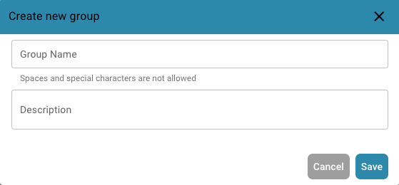
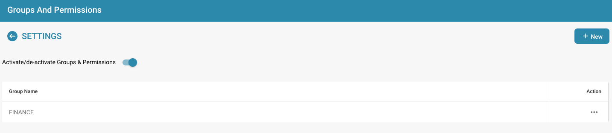
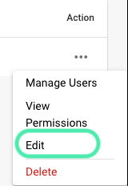

# 添加/编辑组


DocBits 组与权限教程：设置用户角色、访问权限并保护您的工作区


## 要添加新组或更改现有组的权限，请按以下步骤操作：

* **前往组设置：** 使用管理员帐户登录，然后在管理面板中打开 Group Settings。

<figure><figcaption></figcaption></figure>

此时会打开以下窗口：

<figure><figcaption></figcaption></figure>

* **点击 + New 按钮：** 如果要添加新组，请点击 + New 按钮以开始创建新组。

<figure><figcaption></figcaption></figure>

* **填写表格：** 输入组名和组的描述。
* **保存详细信息：** 填写组名和描述后，点击 "Save" 按钮。

<figure><figcaption></figcaption></figure>

## 编辑组：

* **编辑组：** 要编辑组，请点击 "edit"，然后即可更改组名。

<figure><figcaption></figcaption></figure>

<figure><figcaption></figcaption></figure>

* **启用组与权限：** 要使组可见，必须启用 "Groups & permissions"。

<figure><figcaption></figcaption></figure>

* **检查结果：** 保存后，请检查结果，确认组已成功添加、编辑或更新。
