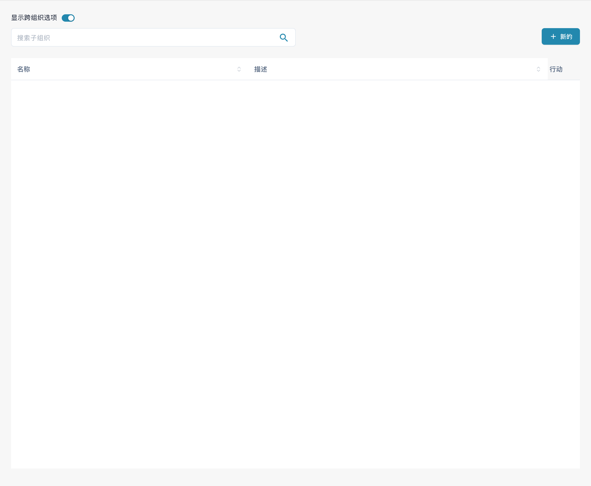
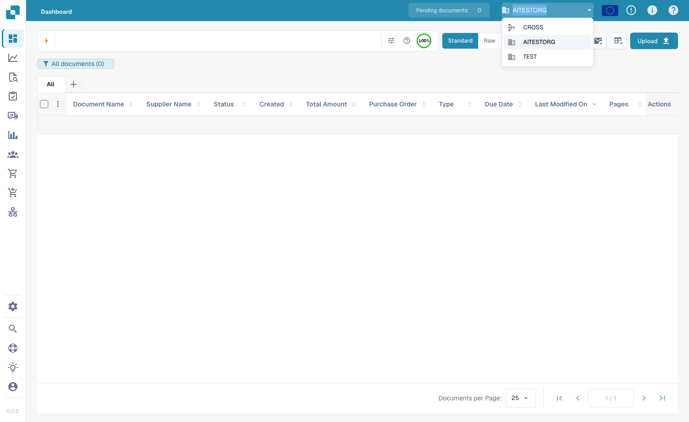

# 子组织



<figure><figcaption>
中文子组织列表及搜索入口；组织数据已隐藏。顶部开关用于显示跨子组织选项，本图未切换该设置。
</figcaption></figure>

子组织可帮助您在 DocBits 中创建层级结构，以便跨不同部门、团队或实体管理文档、用户和工作流。

## 主要优势

* **结构化组织**：按部门、地点或业务部门对用户和文档进行分组。
* **细粒度权限**：控制哪些用户可以访问各子组织中的文档。
* **独立工作流**：每个子组织都可以拥有自己的文档处理规则和配置。
* **报告**：按子组织生成报告和分析数据。

## 子组织列表

此表显示所有现有子组织，包含：

| 列 | 描述 |
|--------|-------------|
| **名称** | 子组织的名称。 |
| **描述** | 对子组织用途的简要说明。 |
| **操作** | 提供编辑或删除子组织选项的菜单。 |

使用 **Search** 搜索栏可按名称快速查找子组织。

## 创建新子组织

1. 点击右上角的 **+ New** 按钮。
2. 输入 **Name**，并可选填 **Description**。
3. 点击 **Save** 创建子组织。

## 显示跨组织选项

启用此选项（使用页面顶部的切换开关）后，用户可以在一个合并视图中查看所有子组织的文档，而不再局限于单个子组织的文档。

### 如何使用跨子组织视图 

1. 前往 **Dashboard**。
2. 在右上角的子组织切换器中选择 **Cross**。
3. 页面重新加载后，会显示所有子组织的文档。
4. 如需返回单个子组织视图，请取消选择 **Cross** 选项。

<figure><figcaption>
在右上角的组织切换器中选择 Cross
</figcaption></figure>

这对于需要集中查看组织内所有文档的管理员很有用。
