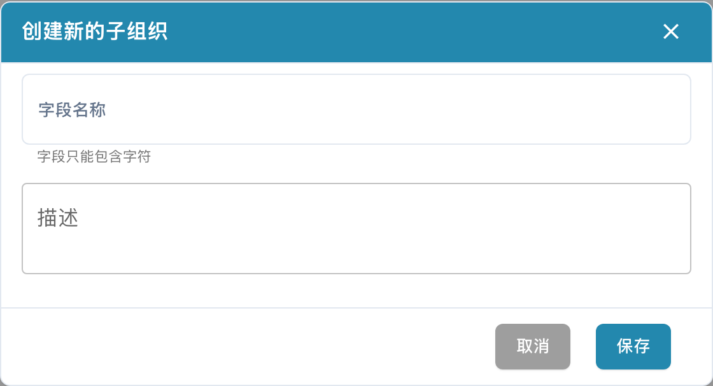
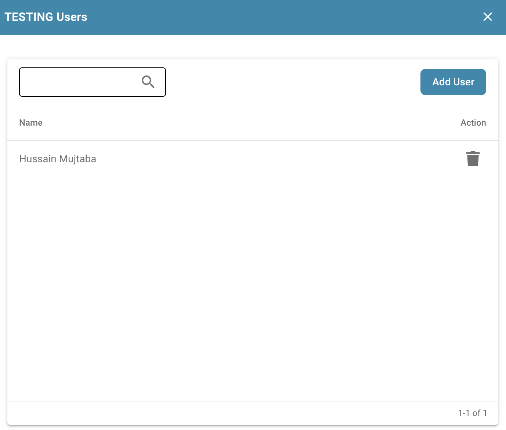
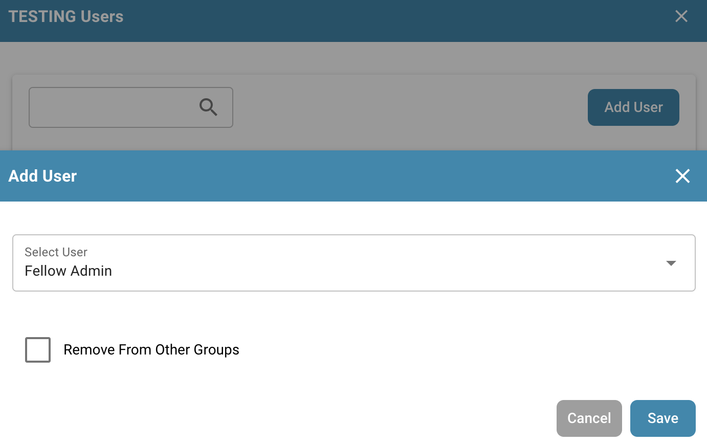

# 如何创建子组织

## 创建新的子组织：

<figure><figcaption>
中文子组织列表及搜索入口；组织数据已隐藏。顶部开关用于显示跨子组织选项，本图未切换该设置。
</figcaption></figure>

点击**新的**按钮

<!-- Obsolete illustration retired: Retire obsolete English New-button crop; current Chinese list above already includes the actual New entry and the native empty dialog is shown below. -->

系统将显示以下菜单：

<figure><figcaption>
当前中文创建子组织空白表单；“字段名称”在此为子组织名称。未填写名称、未保存，也未添加用户。
</figcaption></figure>

输入子组织名称和描述等详细信息，检查后点击**保存**。保存成功后，使用列表或搜索查找新子组织；其位置取决于当前排序和筛选条件。截图中“字段名称”实际指子组织名称。

## 编辑子组织

<figure><figcaption></figcaption></figure>

**管理用户：**

<figure><figcaption></figcaption></figure>

* **添加用户：**管理员可以创建新的用户账户，并将其分配到相应的子组织。
* **分配角色和权限：**管理员可以设置子组织内用户的角色和权限。这通常包括为用户分配对文档管理系统中特定文档、文件夹或功能的访问权限。
* **管理个人资料详情：**管理员可以编辑子组织内用户的个人资料详情，例如联系信息或所属部门，以便及时、准确地管理用户数据。

<figure><figcaption></figcaption></figure>

您可以向组织添加新用户，并选择是否将该用户从其他组中移除。

**编辑用户：**

* **编辑子组织设置：**管理员可以编辑子组织的设置和属性，包括名称、描述或其在系统中的层级。
* **编辑用户详情：**管理员可以编辑各个子组织中用户的详细信息，例如调整其访问权限或更新联系信息。

**删除用户：**

* **删除子组织：**如果不再需要某个子组织，或者需要调整组织结构，管理员也可以将其删除。删除子组织时，管理员必须确保妥善处理与其关联的所有用户和数据。

这些管理功能使管理员能够有效管理和调整文档管理系统中的用户账户和组织结构，以满足公司不断变化的需求和流程。
