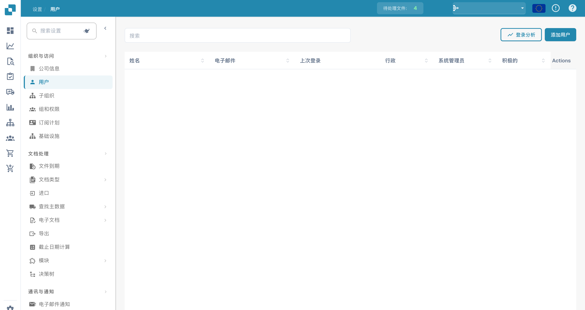

# 用户



<figure><figcaption>
用户视图；姓名和账户已隐藏。 “Actions”列尚未翻译；用户身份和数据行已隐藏。
</figcaption></figure>

“用户”页面允许管理员管理 DocBits 组织中的所有用户账户。您可以在此添加新用户、分配角色并控制访问权限。

## 用户列表

用户表格显示以下列：

| 列 | 说明 |
|--------|-------------|
| **姓名** | 用户的全名。 |
| **电子邮件** | 用户的电子邮件地址，用作其登录标识。 |
| **上次登录** | 用户最近一次登录的日期和时间。 |
| **管理员** | 复选框，表示用户是否拥有管理员权限。管理员可以访问所有设置并管理其他用户。 |
| **系统管理员** | 复选框，表示组织唯一的系统管理员账户；DocBits 使用该账户执行自动化的后台操作（例如自动导入和导出）。系统管理员始终也拥有管理员权限。有关管理员与系统管理员之间的区别，请参阅[管理员权限](admin-privileges.md#admin-vs-system-admin)。 |
| **启用** | 复选框，显示用户账户当前是否处于启用状态。停用的用户无法登录。 |
| **操作** | 菜单，提供编辑用户详细信息、重置密码或停用账户等选项。 |

使用顶部的**搜索**栏，按姓名或 ID 快速查找用户。

## 登录分析

点击**登录分析**可查看组织中的登录活动数据，包括登录频率和模式。完整说明请参阅[登录分析](login-analytics.md)。

## 添加新用户

1. 点击右上角的**添加用户**按钮。
2. 填写必填信息：
   * **用户名**：用户的唯一名称。
   * **名字**和**姓氏**：用户的全名。
   * **电子邮件地址**：用于登录和接收通知。
   * **密码**：必须符合组织的安全策略。
   * **用户角色**：分配适当的角色（标准用户、管理员或系统管理员）。
3. 点击**保存**以创建用户账户。新用户将收到一封电子邮件通知，其中包含其登录信息，以及用于在“设置密码”页面设置初始密码的链接。请参阅[获取访问权限并登录](../../../../../end-user-and-partner-section/end-user-section/getting-access-and-signing-in.md#first-password-for-admin-created-accounts)。

> **注意：** **系统管理员**角色只能在创建用户时选择，之后无法添加或移除。每个组织只能有一名系统管理员，选择该角色也会自动授予管理员权限。有关何时使用该角色的信息，请参阅[管理员权限](admin-privileges.md#admin-vs-system-admin)。
