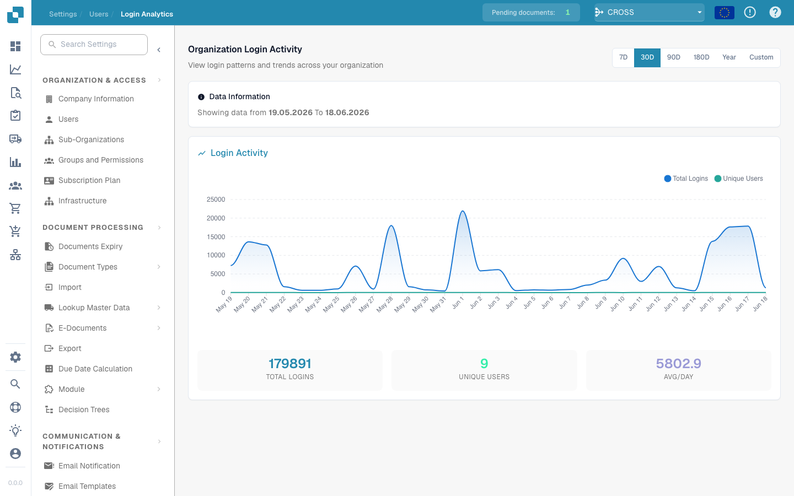

# 登录分析

**登录分析**为管理员提供一个只读的组织级视图，展示用户*何时*以及*多久*登录一次 DocBits。它可以回答“登录量是否在增长？”“本月有多少位不同的用户处于活跃状态？”以及“使用高峰出现在什么时候？”等问题，同时不会暴露任何用户的凭据或个人数据。

> **访问方式：**打开 **设置 → 组织与访问权限 → 用户**，然后点击右上角的 **登录分析** 按钮（`/settings/login-analytics`）。

<figure><figcaption>
所选时间段内的组织登录活动
</figcaption></figure>

## 时间范围

使用右上角的选择器选择要分析的时间段：**7D**、**30D**、**90D**、**180D**、**Year** 或 **Custom**（可自由选择日期范围）。页面上的所有内容——图表和摘要卡片——都会根据所选时间段重新计算。

**数据信息**横幅会显示当前查看的确切时间范围（例如 *显示 19.05.2026 至 18.06.2026 的数据*），让您始终清楚这些数字涵盖哪些日期。

## 登录活动图表

图表展示所选时间段内的两个数据系列：

| 数据系列 | 含义 |
|--------|---------|
| **总登录次数** | 每天的登录次数，包括同一用户的重复登录。 |
| **独立用户数** | 当天登录的*不同*用户数量。 |

将鼠标悬停在任意数据点上，即可查看当天的确切数值。峰值表示最繁忙的日期；如果**独立用户数**曲线较平稳，而**总登录次数**曲线波动明显，则表示少数用户进行了多次登录。

## 摘要卡片

图表下方的三张卡片汇总了整个所选时间段的数据：

| 卡片 | 含义 |
|------|---------|
| **总登录次数** | 此时间段内的所有登录次数。 |
| **独立用户数** | 至少登录过一次的不同用户数量。 |
| **日均登录次数** | 此时间段内每天的平均登录次数。 |

## 隐私

登录分析仅报告**汇总**数据——组织整体的次数和趋势。它不会列出单个用户、电子邮件地址或 IP 地址。若要查看或编辑某个人的账户，请改用[用户](README.md)页面。
