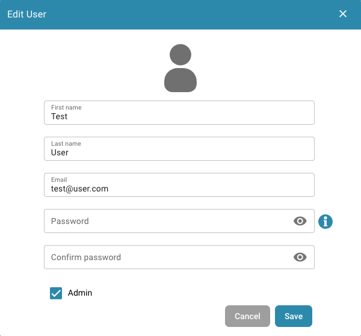
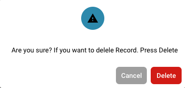

# 修改用户详细信息

<figure><figcaption>
用户设置
</figcaption></figure>

* **以管理员身份登录：** 使用管理员权限登录。
* **访问用户管理：** 导航至用户设置，在此可以编辑现有用户。
* **选择用户：** 找到并选择要修改详细信息的用户。可以点击用户名或用户旁边的编辑按钮。

<figure><figcaption></figcaption></figure>

*   **编辑用户详细信息：** 系统会显示一个表单，其中包含用户当前的详细信息。根据需要进行修改。通常需要编辑的详细信息包括：

    * 名字和姓氏
    * 电子邮件地址
    * 用户角色或权限级别

    <figure><figcaption></figcaption></figure>
* **保存更改：** 检查所做的更改，然后点击 Save 保存新的用户详细信息。

<figure><figcaption></figcaption></figure>

* **检查角色变更的影响：** 如果更改了用户角色，请检查此变更对安全访问级别的影响。确保角色变更后，用户仍拥有继续履行职责所需的权限。
* **发送通知（可选）：** 可以向用户发送通知，告知其所做的更改。

完成这些步骤后，用户详细信息即已成功更新，用户将获得根据所做更改更新后的信息和权限。

## 移除用户：

* **选择用户：** 找到并选择要移除其访问权限的用户。可以点击用户名或用户旁边的编辑按钮。

<figure><figcaption></figcaption></figure>

* **移除访问权限：** 点击 "delete" 移除该用户。

<figure><figcaption></figcaption></figure>

* **确认：** 系统会要求你确认移除该用户。

<figure><figcaption></figcaption></figure>

* **可选通知：** 可以向用户发送通知，告知其访问权限已被移除。
* **检查任务和文档：** 移除用户之前，请检查分配给该用户的任务或文档。将这些任务或文档的责任转交给其他用户，确保没有任何内容丢失或未完成。
* **保存更改：** 确认移除该用户并保存更改。

按照这些步骤操作，可以安全地移除用户的访问权限，同时妥善管理所有相关任务和文档。
