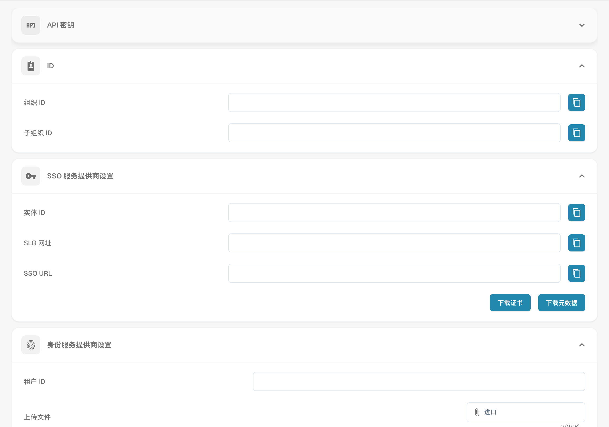

# 集成与 SSO

<figure><figcaption>
集成和 SSO 提供商配置。
</figcaption></figure>

“集成与 SSO”页面用于管理编程访问所需的 API 密钥、组织 ID 和单点登录（SSO）配置。

## API 密钥

管理用于以编程方式访问 DocBits 的 API 密钥。

| 列 | 描述 |
|--------|-------------|
| **密钥** | 经过遮蔽的 API 密钥值。点击复制图标可复制完整密钥。 |
| **名称** | 密钥的描述性名称。 |
| **过期时间** | 过期日期（或“永不过期”）。 |
| **最近使用时间** | 密钥上次使用的时间。 |
| **状态** | 已启用或未启用。 |
| **操作** | 三点菜单，可撤销或删除密钥。 |

点击 **+ Create API Key** 可生成新密钥。

## ID

显示您的组织标识符：

| 字段 | 描述 |
|-------|-------------|
| **组织 ID** | 您组织的唯一标识符。 |
| **子组织 ID** | 当前所选子组织的 ID。 |

## SSO 服务提供商设置

配置身份提供商时所需的 DocBits SSO 配置值：

| 字段 | 描述 |
|-------|-------------|
| **实体 ID** | DocBits 的 SAML 元数据 URL。 |
| **SLO URL** | 单点注销 URL。 |
| **SSO URL** | 断言使用者服务 URL。 |

您还可以为 IdP 配置**下载证书**和**下载元数据**。

## 身份服务提供商设置

配置您的外部身份提供商（IdP）：

| 字段 | 描述 |
|-------|-------------|
| **租户 ID** | 您的 IdP 租户标识符。 |
| **上传文件** | 上传 IdP 元数据 XML 文件。 |

点击 **配置** 保存 IdP 设置。

* **提高效率：** 与其他工具和服务集成可以简化工作流并提高效率。例如，文档可以在 Docbits 与 CRM 系统之间自动交换，从而减少手动录入并提高生产力
* **数据一致性：** 集成可在不同系统之间无缝交换数据，从而提升数据的一致性和准确性。这可以避免数据不一致或重复录入导致的错误。
* **实时更新**：集成可在不同平台之间实现实时更新，让用户始终掌握最新信息。这对于需要实时信息的关键业务流程尤其重要。
* **任务自动化：** 集成可以自动执行日常任务，节省时间和资源。例如，另一个系统发生特定事件时，可以自动触发通知，无需人工干预。
* **改善用户体验：** 配置良好的集成可确保用户体验流畅，因为用户无需在不同系统之间切换即可访问相关信息。这能提升用户满意度并提高效率。

要正确配置集成设置，必须了解组织的需求，并确保集成能够与现有工作流和流程无缝衔接。这需要对集成进行充分规划、配置和监控，以确保其运行顺畅并带来预期价值。
