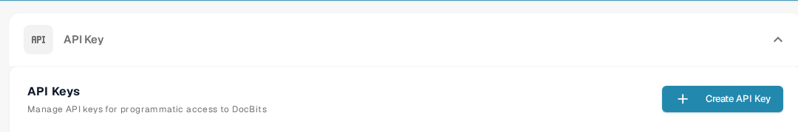

# API 调用与示例

API 请求允许其他程序读取或更新 DocBits 中的信息。请先发送只读请求，以便在不更改文档的情况下检查连接。

## 发送请求前

1. 请组织管理员授予访问权限，并为该集成[创建 API 密钥](api-key-management.md)。将密钥保存在密钥存储中；不要将其放入屏幕截图、文档或源文件。
2. 打开[当前 Sandbox API 参考](https://sandbox.api.docbits.com/docs)。其中列出了此环境中可用的操作、必填值和响应示例。离开 Sandbox 后，请使用适用于你所在环境的 API 参考。

<figure><figcaption><p>在“设置” → “Integration &amp; SSO”下查找 API 密钥。图中未包含密钥值。</p></figcaption></figure>

## 示例：读取文档类型

Sandbox 参考中列出了 **GET `/document_type/get_document_types`**。它会返回组织可用的文档类型。`GET` 用于读取信息；不会创建或更改文档。

将 API 密钥设为本地环境变量，然后发送请求：

```sh
curl --fail-with-body \
  -H "X-API-KEY: ${DOCBITS_API_KEY}" \
  "https://sandbox.api.docbits.com/sandbox-api/document_type/get_document_types"
```

成功的响应包含 `success: true` 和一个由文档类型组成的 `data` 列表。`401` 响应表示请求未通过身份验证；请检查密钥和环境后再重试。上面的 URL 仅适用于 Sandbox。

## 查找下一个操作

在 API 参考中搜索你要执行的操作，阅读该操作的说明和必填字段，并确认它使用的是 `GET`、`POST` 还是其他方法。使用参考中的响应示例确认结果。如需查看 Postman 操作指南，请参阅 [DocBits 的 Postman](../../../../advanced-functions-and-tools/postman-for-docbits/README.md)；发送请求前，请对照当前 API 参考核实其中较早的示例 URL。

本页之前的四张图片介绍了通用 OCR、NLP、文件转换和文档管理 API，但没有展示经过验证的 DocBits 端点。这些图片已移除；这里只将上述有文档说明的 DocBits 操作作为可执行示例。
