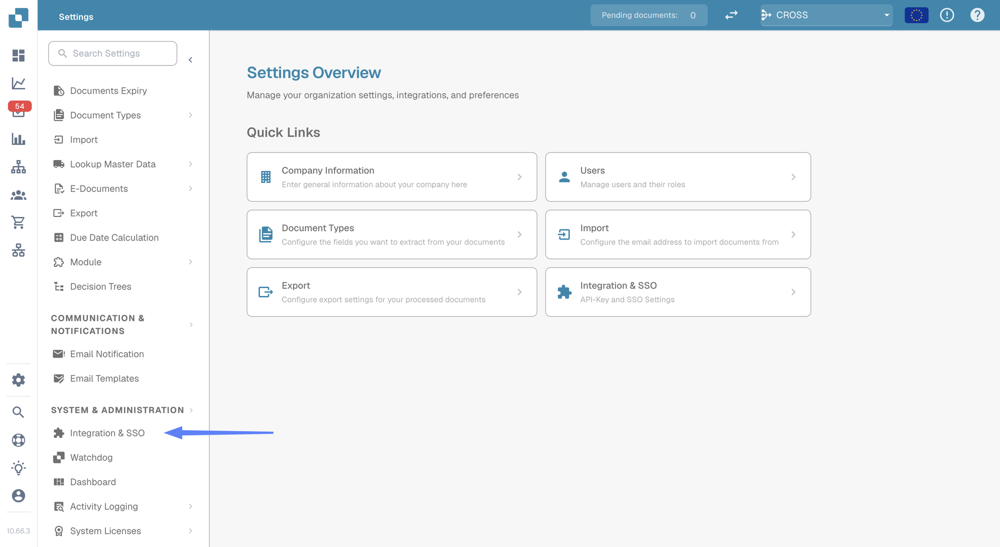
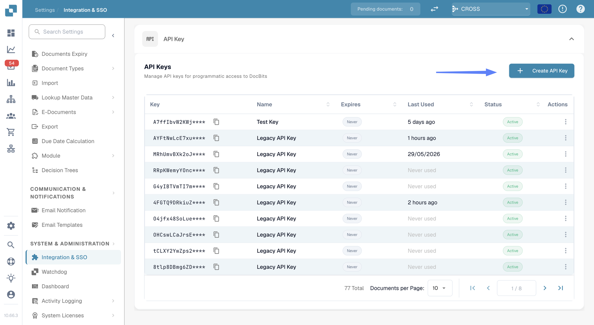
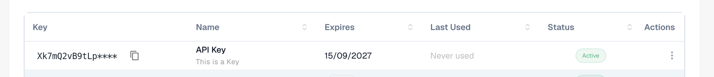
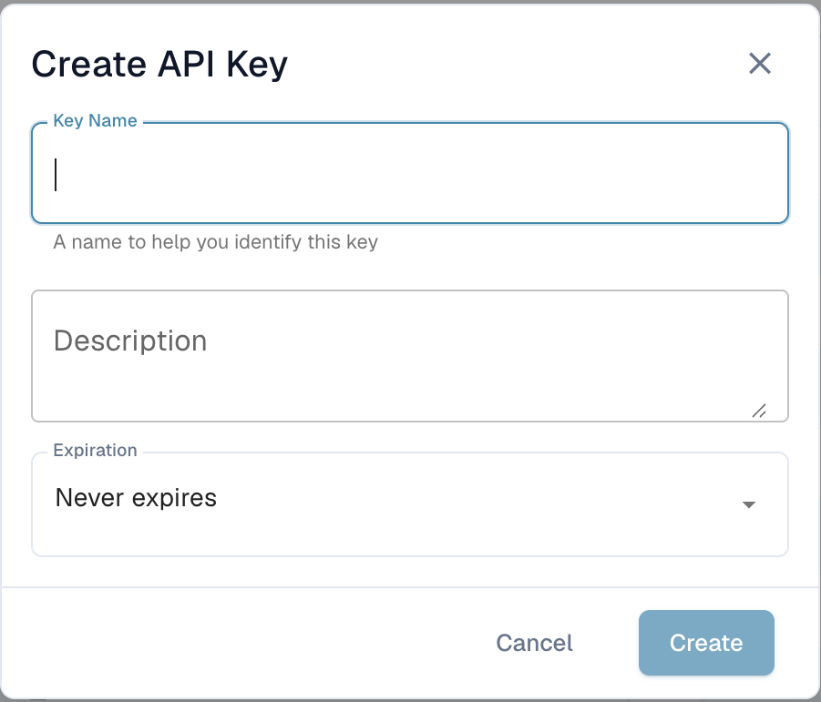
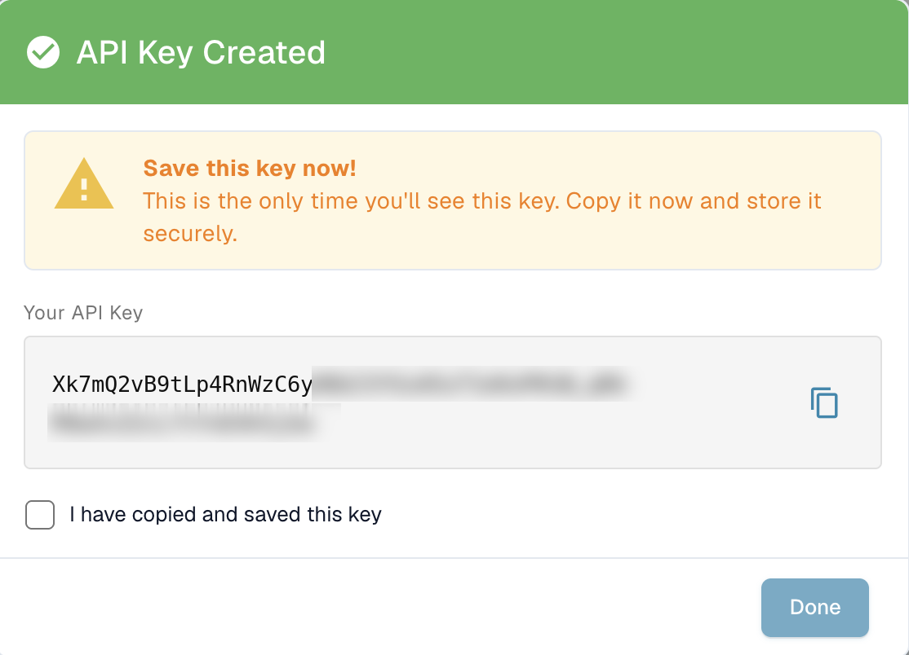

# API 密钥管理

API 密钥可让其他系统（例如 ERP、脚本或合作伙伴应用程序）无需用户登录即可与 DocBits 通信。您的组织可以根据需要创建任意数量的密钥，并分别管理每个密钥：为密钥命名、决定是否设置有效期，以及在密钥泄露时单独撤销。

每个集成都可以使用自己的密钥，因此您可以单独停用某个密钥，而不影响其他密钥。

## 打开 API 密钥管理

前往 **Settings**，然后在 **System & Administration** 下选择 **Integration & SSO**。

<figure><figcaption>
Settings → Integration &#x26; SSO
</figcaption></figure>

页面顶部的 **API Key** 部分会列出您组织的所有密钥。

<figure><figcaption>
API Keys 列表
</figcaption></figure>

## 了解列表

<figure><figcaption>
每行显示一个密钥
</figcaption></figure>

| 列 | 说明 |
| --- | --- |
| **Key** | 密钥的前几个字符，后接 `****`。创建密钥后，系统不会再次显示其余部分，请参阅[创建 API 密钥](#creating-an-api-key)。 |
| **Name** | 您为密钥指定的名称，下方会显示其描述。 |
| **Expires** | 密钥停止工作的日期；如果未设置有效期，则显示 **Never**。 |
| **Last Used** | 最近一次使用此密钥发送请求的时间。**Never used** 表示尚无系统使用过此密钥，有助于找出可以安全删除的密钥。 |
| **Status** | **Active** 表示密钥可用。已撤销的密钥将被永久停用。 |
| **Actions** | 三点菜单，可在其中撤销密钥。 |

如果密钥数量超过单页显示范围，请使用列表底部的分页控件。


**Last Used** 是查找无人再需要的密钥最快捷的方式。从未使用过或数月未使用的密钥，通常可以考虑撤销。


## 创建 API 密钥 

1. 点击 API Keys 部分右上方的 **+ Create API Key**。
2. 填写对话框：

<figure><figcaption>
创建新密钥
</figcaption></figure>

| 字段 | 填写内容 |
| --- | --- |
| **Key Name** | 必填。请使用将要使用此密钥的系统名称，例如 `M3 Production`、`Invoice Import Script`，以便日后识别密钥对应的集成。 |
| **Description** | 选填。可备注密钥的用途或设置者。 |
| **Expiration** | 选择到期日期，或保留 **Never expires**。设置到期日期更安全：如果日后忘记了该集成，密钥也会自动失效。 |

3. 点击 **Create**。DocBits 会显示新密钥：

<figure><figcaption>
完整密钥仅在此时显示
</figcaption></figure>

4. 点击复制图标复制密钥，然后直接粘贴到将使用该密钥的系统中，或粘贴到密码管理器中。
5. 勾选 **I have copied and saved this key**，然后点击 **Done**。


**完整密钥仅显示一次。** DocBits 只存储密钥的单向哈希值和一小段用于识别的前缀。管理员和 DocBits 支持人员都无法根据该哈希值取回原始完整密钥。如果您丢失了密钥，请撤销该密钥并创建一个新密钥。


请像对待密码一样妥善保管密钥。任何持有密钥的人都可以操作您组织的文档和数据。

有关密码哈希、TLS、供应商可见性，以及 DocBits 密钥与已连接系统凭据之间的区别，请参阅[凭据的安全存储](../../../../security/secure-storage-of-credentials.md)。
