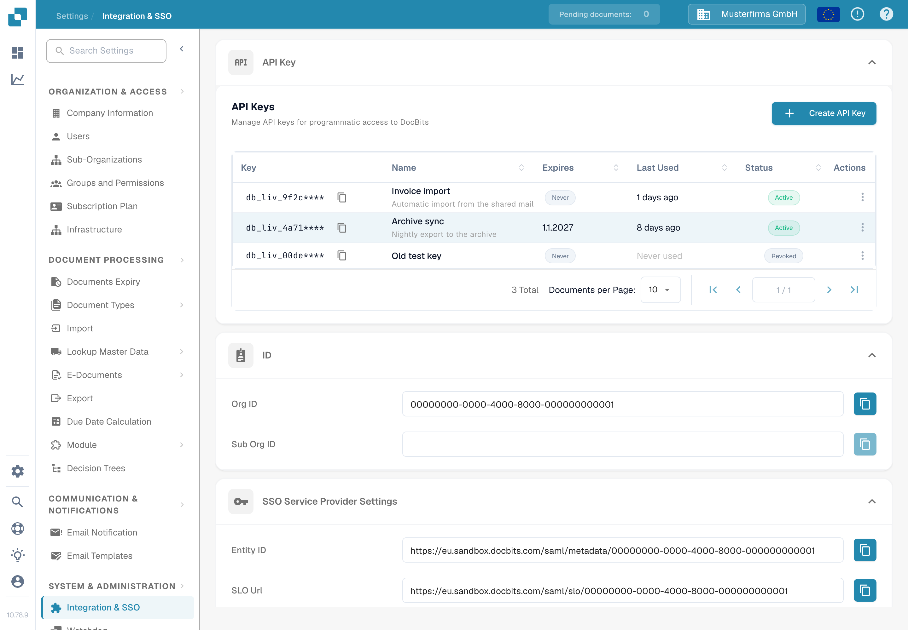

# API 密钥

<figure><figcaption>
设置 → 集成与 SSO → API 密钥。此截图中隐藏了密钥前缀。
</figcaption></figure>

集成与 SSO 页面顶部的 **API 密钥** 部分会列出组织创建的所有 API 密钥。API 密钥允许其他系统（例如 ERP、脚本或合作伙伴应用程序）在无需用户登录的情况下访问 DocBits。有关分步说明，请参阅 [API 密钥管理](api-key-management.md)。

### API 密钥列表

* **密钥：**显示密钥的前几个字符，后接 `****`。完整密钥仅在创建时显示一次，之后无法再次查看。密钥旁的复制图标会将可见的前缀复制到剪贴板。
* **名称 / 过期时间 / 上次使用时间 / 状态：**每行会显示密钥名称、失效时间、上次用于请求的时间，以及密钥是否仍处于启用状态。
* **创建 API 密钥：**打开对话框，为集成创建新密钥。有关字段和一次性密钥显示的说明，请参阅 [API 密钥管理](api-key-management.md)。
* **操作（三点菜单）：**打开密钥的操作菜单，您可以在此编辑名称、撤销密钥，或删除已撤销的密钥。撤销后，密钥将永久停用。

### SSO（单点登录）服务提供商设置

这些值供身份提供商使用，以便用户通过公司的登录方式登录 DocBits。完整设置指南请参阅[配置单点登录（SSO）](configuring-single-sign-on-sso/)。

* **实体 ID：**SSO 配置中 DocBits 作为服务提供商的标识符。复制图标会将此值复制到剪贴板。
* **SLO（单点注销）URL：**用于同时将用户从通过 SSO 连接的所有应用程序中注销的 URL。复制图标会复制此值。
* **SSO URL：**用于发起单点登录流程的 URL。复制图标会复制此值。
* **下载证书：**下载身份提供商信任 DocBits 所需的安全证书。
* **下载元数据：**下载 SAML 元数据文件，该文件可直接导入大多数身份提供商。

### 身份服务提供商设置

配置 DocBits，使其使用外部身份提供商（IdP）进行登录。完整指南请参阅[身份服务提供商配置](identity-service-provider-configuration.md)。

* **租户 ID：**身份提供商的租户标识符；DocBits 与按租户管理访问权限的云服务集成时会使用此标识符。
* **上传文件：**上传从身份提供商处收到的元数据或配置文件。
* **配置：**保存设置并应用已上传的配置。请先输入租户 ID 或上传文件，然后点击 **配置**。
