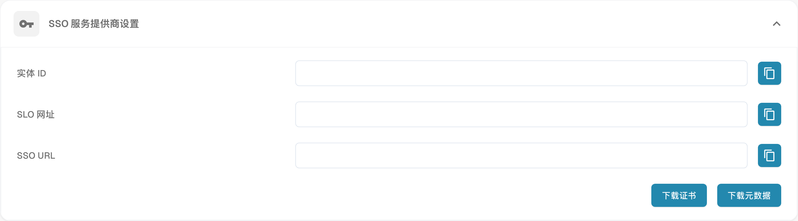

# 配置单点登录（SSO）

将 DocBits 配置为 SAML 服务提供商（SP），并连接您的身份提供商（IdP）。您需要具有两个系统中相关设置的管理员权限。

## 打开 SSO 设置

以管理员身份登录 DocBits，在集成设置中打开单点登录。

<figure><figcaption>
SSO 服务提供方设置；已隐藏组织信息，未保存任何配置。
</figcaption></figure>

## 查看 DocBits 服务提供商的值

DocBits 以只读方式显示 Entity ID、SSO URL 和 SLO URL。配置 IdP 中的 DocBits 应用时，请复制这些值或使用 SP 元数据；不要在 DocBits 的这些字段中填写替代值。Entity ID 用于标识服务提供商。请按照 IdP 的 SAML 配置要求使用所显示的端点。

## 下载 SP 证书和元数据

使用 DocBits 服务提供商设置中的 Download Certificate 和元数据下载功能。这些下载文件描述的是作为 SP 的 DocBits。请向 IdP 提供 SP 元数据，以及在需要时提供下载的 SP 证书。这里下载的证书与随后上传到 DocBits 的 IdP 元数据不同。

## 配置身份提供商

1. 在 IdP 中，使用 DocBits 显示的 SP 值或下载的 SP 元数据配置 DocBits。
2. 如果提供商要求，请使用 DocBits 的 Tenant ID。检查 DocBits 身份提供商设置中的租户和提供商上下文是否正确。
3. 从 IdP 获取已配置应用的 SAML XML 元数据，将这些 IdP XML 元数据上传到 DocBits。不要用先前下载的 DocBits SP 元数据替代它们。
4. 在 DocBits 身份提供商设置中使用 Configure/Save 操作保存配置。

## 测试登录及受支持的单点登出

验证用户能否通过已配置的 IdP 登录 DocBits。只有在 DocBits 和 IdP 均支持 Single Log-Out，且两端均已配置时，才测试此功能。仅从 DocBits 登出并不保证用户也会从所有其他已连接应用中登出。
