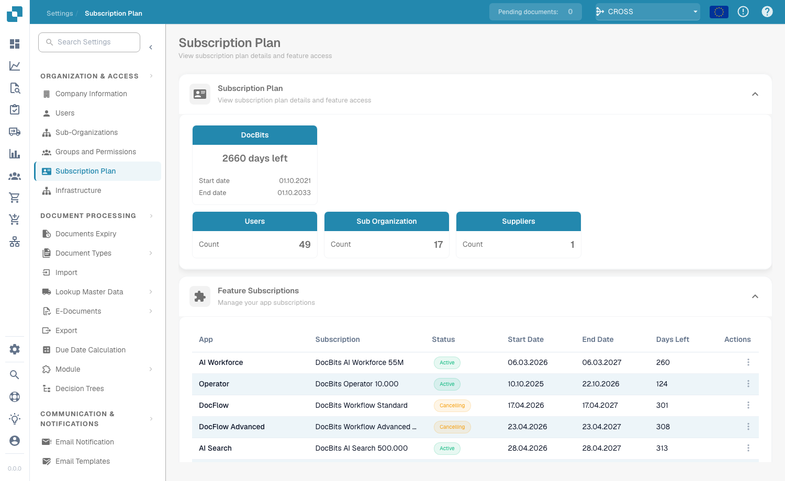
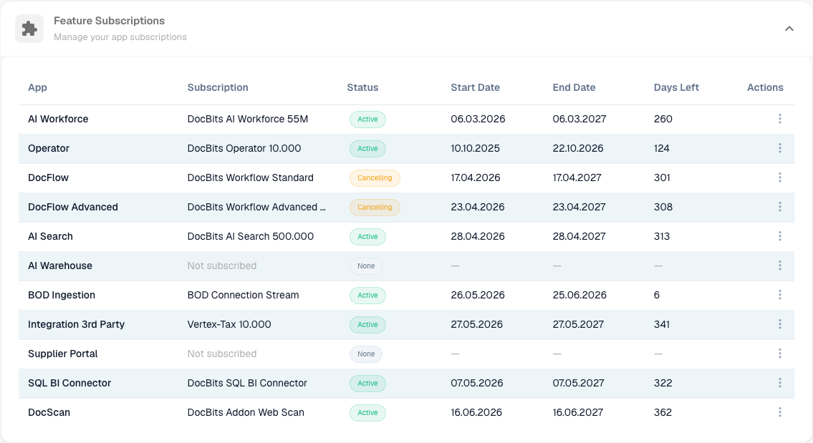
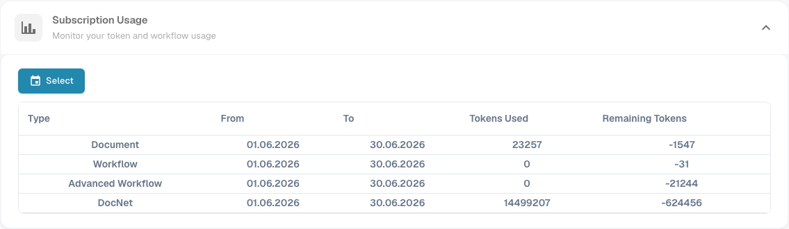

# 订阅计划

<figure><figcaption>
订阅计划页面
</figcaption></figure>

**订阅计划**页面集中展示 DocBits 订阅的完整概览：订阅计划本身、为组织启用的应用和功能订阅，以及令牌使用情况。前往 **设置 → 组织与访问权限 → 订阅计划**即可打开此页面。

## 订阅计划

第一张卡片显示您的 DocBits 订阅信息，包括剩余天数以及开始和结束日期，并同时显示组织的实时统计数据：

| 卡片                 | 说明                                   |
| -------------------- | -------------------------------------- |
| **DocBits**          | 订阅剩余天数以及开始和结束日期。       |
| **用户**             | 您组织中的用户数量。                   |
| **子组织**           | 子组织数量。                           |
| **供应商**           | 供应商数量。                           |

## 功能订阅

<figure><figcaption></figcaption></figure>

此部分列出每个 DocBits 应用和功能，以及它们是否已为您的组织启用。

| 列                        | 说明                                                                                              |
| ------------------------- | ------------------------------------------------------------------------------------------------- |
| **应用**                  | DocBits 应用或功能（例如 AI Workforce、Operator、DocFlow、AI Search、BOD Ingestion、SQL BI Connector）。 |
| **订阅**                  | 此应用订阅的计划。                                                                                |
| **状态**                  | **有效**、**正在取消**（在结束日期前保持有效，之后终止），或未订阅时显示 **无**。                 |
| **开始日期 / 结束日期**   | 订阅期限。                                                                                        |
| **剩余天数**              | 距离结束日期的剩余天数。                                                                          |
| **操作**                  | 每个应用的操作菜单。                                                                              |

## 订阅用量

<figure><figcaption></figcaption></figure>

监控所选期间内的令牌和工作流用量。使用 **选择**按钮选择日期范围。

| 列                  | 说明                              |
| ------------------- | --------------------------------- |
| **类型**            | 用量类别：文档、工作流、高级工作流或 DocNet。 |
| **起始 / 结束**     | 报告用量的期间。                  |
| **已使用令牌**      | 此期间消耗的令牌数。              |
| **剩余令牌**        | 此期间剩余的令牌数。              |
