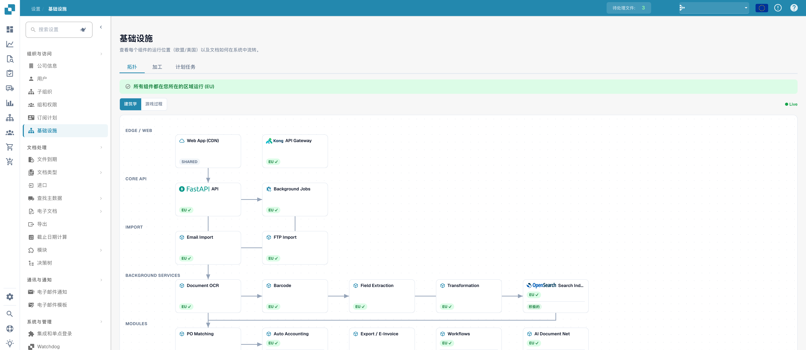
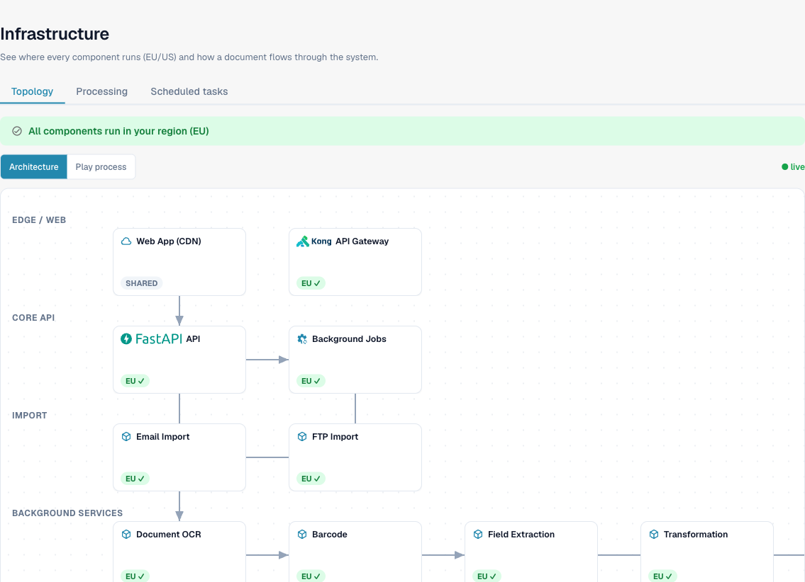
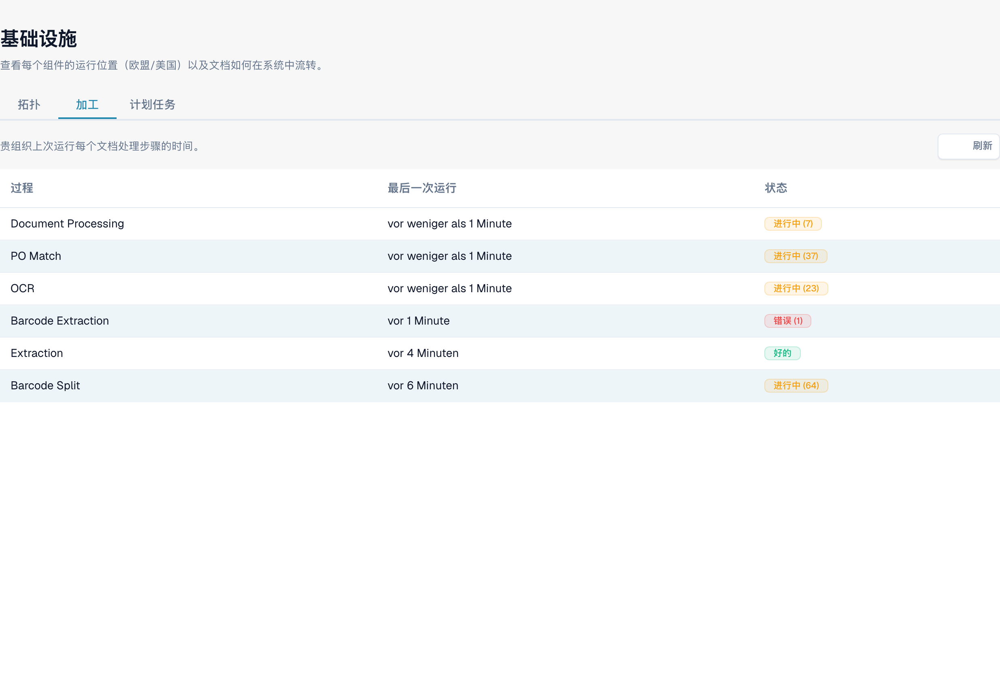
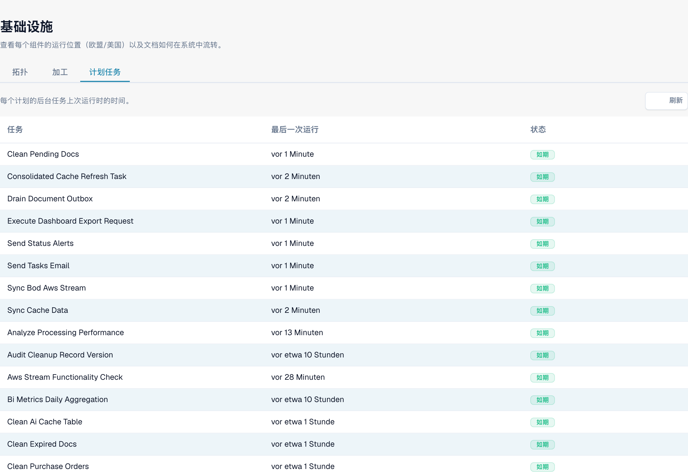

# 基础设施

**基础设施**页面为管理员提供 DocBits 各个部分运行位置（EU 或 US）、文档在系统中的流转方式，以及后台处理运行状况的实时概览。此页面为只读页面——这里不进行任何配置；它用于回答*“一切是否都在运行，我的数据是否留在所在区域？”*

> **访问权限：**基础设施页面仅供管理员访问。打开 **设置 → 组织与访问权限 → 基础设施**。

<figure><figcaption>
基础设施概览。
</figcaption></figure>

页面分为三个选项卡：

| 选项卡 | 可查看的信息 |
|-----|---------|
| **拓扑** | 各组件在哪里运行？它们是否都在我的区域内？ |
| **处理** | 文档处理步骤（OCR、提取、采购订单匹配……）是否正常运行并保持最新？ |
| **计划任务** | 周期性后台作业是否按计划运行？ |

## 拓扑

拓扑选项卡以图表展示整个 DocBits 平台，并按层分组——**边缘 / Web**、**核心 API**、**导入**、**后台服务**、**数据存储**和**身份验证**。每个框代表一个组件（Web App/CDN、API Gateway、OCR worker、数据库等）。

<figure><figcaption>
每个组件都标记了其运行所在的区域
</figcaption></figure>

### 区域感知

每个组件都带有区域标记，便于你一目了然地确认数据驻留情况：

| 标记 | 含义 |
|-------|---------|
| **EU ✓** / **US ✓** | 组件运行在你组织所在的区域。 |
| **SHARED** | 全局组件（例如 CDN），不属于某个特定区域——这是预期情况，不是问题。 |
| **区域不匹配** | 组件运行在与你的组织*不同*的区域。系统会突出显示该组件，方便你联系支持团队。 |

页面顶部的横幅会汇总结果：如果所有组件都匹配，则显示 **“所有组件都在你所在的区域 (EU) 运行”**；如果任何关键组件位于其他区域，则显示警告。

### 架构视图与流程演示

使用图表上方的切换控件选择视图：

- **架构** — 展示所有组件及其连接方式的静态图。
- **流程演示** — 逐步动态展示文档在系统中的流转过程，让你查看涉及各组件的先后顺序。

**● live** 指示器表示图表中的运行状况信息反映的是系统当前状态。

### 可选模块

属于可选模块（Full-Text Search、DocFlow、Auto-Accounting、DocNet、PO Matching）的组件会显示**已激活**或**已停用**标记。点击已停用的模块，即可直接前往启用该模块的页面——大多数模块位于 **设置 → 模块**，PO Matching 则位于 **文档类型**（该功能按文档类型启用）。

## 处理

处理选项卡显示**你组织**的文档处理流水线——每个步骤上次运行的时间，以及工作是否正常流转或出现积压。

<figure><figcaption>
基础设施进程及上次运行情况。 部分相对时间仍为德语；处理服务的技术名称保持原样。
</figcaption></figure>

| 列 | 说明 |
|--------|-------------|
| **流程** | 处理步骤——文档处理、OCR、TR-OCR、条码拆分、条码提取、提取、采购订单匹配。 |
| **上次运行** | 距离该步骤上次运行的时间。将鼠标悬停可查看准确时间戳。*“从未运行”*表示尚无文档到达此步骤。 |
| **状态** | 交通灯样式的标记（见下文）。 |

状态标记：

| 标记 | 含义 |
|-------|---------|
| **正常**（绿色） | 最近没有错误，也没有等待处理的任务——此步骤运行正常。 |
| **处理中 (N)**（琥珀色） | 当前有 `N` 份文档正在由此步骤处理。 |
| **错误 (N)**（红色） | 最近有 `N` 份文档在此步骤处理失败。 |

错误和*处理中*是彼此独立的状态，因此一个步骤可以同时显示这两种标记——即使其他任务正在运行，你仍能看到失败情况。使用右上角的 **刷新** 获取最新数据。

## 计划任务

计划任务选项卡列出维持 DocBits 运行的周期性后台作业（缓存刷新、状态提醒、文档超时处理、出站同步等），并确认每项任务是否按时触发。

<figure><figcaption>
基础设施计划任务。 部分相对时间仍为德语；后台任务的技术名称保持原样。
</figcaption></figure>

| 列 | 说明 |
|--------|-------------|
| **任务** | 计划作业的名称。 |
| **上次运行** | 距离该任务上次运行的时间。将鼠标悬停可查看准确时间戳；*“从未运行”*表示该任务尚未触发。 |
| **状态** | 计划运行状况（见下文）。 |

状态值：

| 标记 | 含义 |
|-------|---------|
| **按计划运行**（绿色） | 任务正按预期的时间间隔运行。 |
| **延迟**（红色） | 任务未在预期时间运行——建议进行调查或联系支持团队。 |
| **未知**（灰色） | 无法确定计划状态。 |

使用 **刷新** 可按需重新检查计划状态。
