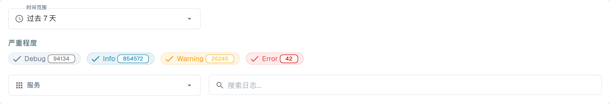
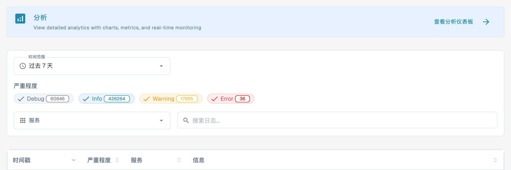

# 活动日志

<figure><figcaption>
活动日志筛选器；日志条目已隐藏。
</figcaption></figure>

活动日志可实时查看所有 DocBits 服务中的系统事件。您可以使用它监控处理活动、排查错误并审计系统行为。

## 分析横幅

页面顶部的横幅链接到 **Analytics Dashboard（分析仪表板）**，可查看图表、指标并进行实时监控。

## 筛选器

| 筛选器 | 描述 |
|--------|-------------|
| **时间范围** | 选择时间段（例如：今天、最近 7 天、最近 30 天）。 |
| **严重级别** | 切换要包含或排除的严重级别：**Debug（调试）**、**Info（信息）**、**Warning（警告）**、**Error（错误）**。每个标签会显示当前计数。 |
| **服务** | 按服务筛选日志（例如：api、auth、api-service）。 |
| **搜索日志** | 在日志消息中进行自由文本搜索。 |

## 日志表格

<figure><figcaption>
真实中文活动日志界面：服务列标识生成日志的服务，并与服务筛选器一致。日志条目和导出元数据均在截图范围之外。
</figcaption></figure>

| 列 | 描述 |
|--------|-------------|
| **时间戳** | 事件发生的日期和时间。可排序。 |
| **严重级别** | 按颜色标记的徽标：Info（蓝色）、Warning（黄色）、Error（红色）、Debug（灰色）。 |
| **服务** | 生成日志的服务或模块（例如：api、auth、api-service）。 |
| **消息** | 包含事件详情的完整日志消息。 |

结果采用分页显示——使用底部的控件浏览各页。

## 页脚操作

| 操作 | 描述 |
|-------------|-------------|
| **自动刷新** | 切换是否按固定间隔自动刷新日志视图。 |
| **立即刷新** | 手动刷新日志数据。 |
| **导出 JSON** | 将当前筛选后的日志导出为 JSON 文件。 |
| **下载日志** | 下载完整日志数据。 |
