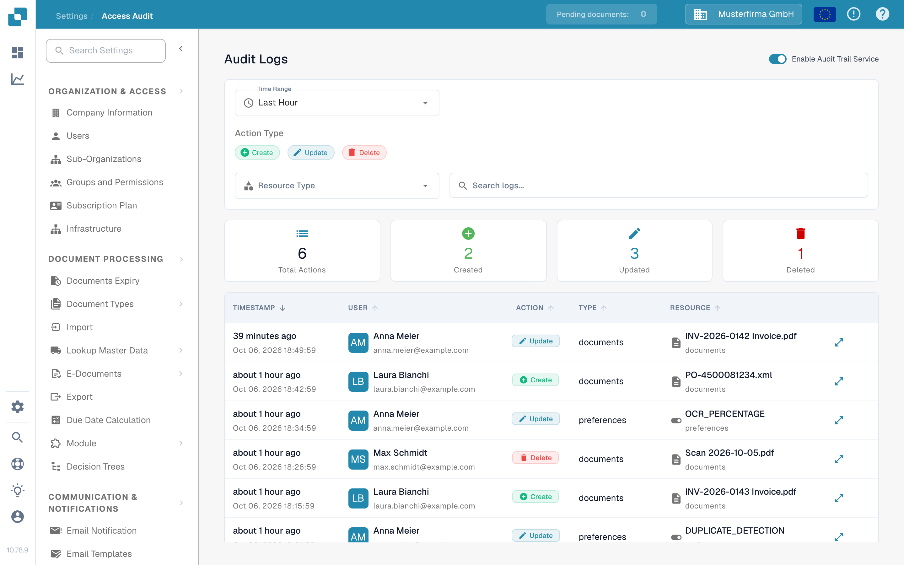
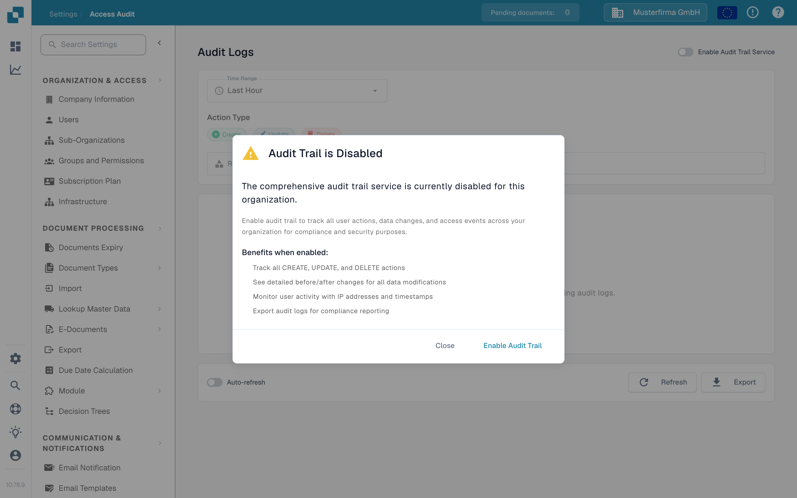

# 访问审计

<figure><figcaption>
启用审计日志之前的英文 Sandbox 页面。
</figcaption></figure>

访问审计会记录谁在何时创建、更改或删除了资源。打开 **Settings → Activity Logging → Access Audit** 查看日志。只有在计划收集审计事件时，才为组织启用此服务。

## 审计日志关闭时

<figure><figcaption>
此对话框会在启用服务前说明将记录哪些内容。
</figcaption></figure>

在浏览器会话中首次访问时，可能会显示 **Audit Trail is Disabled**。**Close** 会关闭对话框并保持审计日志关闭。**Enable Audit Trail** 会为当前组织启用该服务。对话框后方页面上的 **Enable Now** 和 **Enable Audit Trail Service** 开关也可以启用该服务。这些控件会更改组织设置；它们并非仅用于预览功能。

服务关闭时，筛选器和日志表无法显示事件。空状态会说明如何启用日志记录。启用后，如有需要，可使用开关再次将其关闭。只有在服务已启用并收集到数据时，才能查看事件。

## 查找事件

| 控件 | 功能 |
|---|---|
| **Time Range** | 将列表限制在某个时间段内，例如 Last Hour、Today 或 Last 7 Days。 |
| **Create**、**Update**、**Delete** | 包含或排除这些类型的操作。 |
| **Resource Type** | 将结果限制为某种资源类型，例如文档或设置。 |
| **Search logs** | 按文本搜索当前显示的审计条目。 |
| **Refresh** | 加载一次符合条件的最新条目。 |
| **Auto-refresh** | 页面打开期间自动更新列表。 |
| **Export** | 将当前审计日志数据下载为 JSON 文件。 |

摘要卡片会显示所选筛选条件下的操作总数，以及创建、更新和删除的操作数。在表格中，**Timestamp** 显示事件发生时间，**User** 标识操作人，**Action** 说明所做的更改，**Resource** 标识受影响的项目。打开某一行的详情控件可查看记录的更改。如果没有显示任何事件，请确认服务已启用，并在更改其他筛选条件前扩大时间范围。
