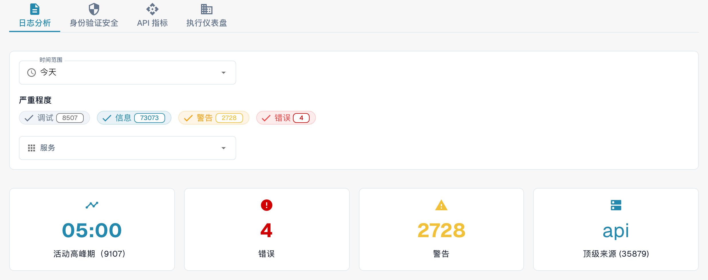

# 分析

使用组织管理员账户打开 **设置 → 活动记录 → 分析**。此页面汇总日志活动、身份验证事件、API 使用情况和管理概览。请先查看 **日志分析**。需要调查某条记录时，选择 **查看事件日志** 打开事件列表。

<figure><figcaption>
当前 Dev 环境的中文界面。计数来自测试环境，与您的组织不同。
</figcaption></figure>

## 选项卡

| 选项卡 | 说明 |
|--------|------|
| **日志分析** | 日志级别分布、时间变化趋势和按服务细分的数据。 |
| **身份验证安全** | 身份验证事件、登录尝试和安全指标。 |
| **API 指标** | API 请求量、响应时间和错误率。 |
| **执行仪表盘** | 面向组织管理员的概览；是否可用取决于您的角色。 |

各选项卡有各自的时间设置。切换选项卡后，请再次检查所选时段。

## 日志筛选器

| 筛选器 | 说明 |
|--------|------|
| **时间范围** | 选择 **最后一小时**、**今天**、**过去 7 天**、**过去 30 天** 或 **自定义**。自定义范围会显示开始和结束日期及时间字段。 |
| **严重程度** | 点击 **调试**（Debug）、**信息**、**警告** 或 **错误**，以包含或排除相应级别。筛选项上的数字是当前计数。 |
| **服务** | 选择一个或多个服务，查看其事件。 |

## 汇总卡片

日志筛选器下方有四张汇总卡片：

| 卡片 | 说明 |
|------|------|
| **活动高峰期** | 日志量最高的时间及对应计数。 |
| **错误** | 所选时段内的错误数。 |
| **警告** | 所选时段内的警告数。 |
| **顶级来源** | 产生日志最多的服务及对应计数。 |

## 真实用户监控（RUM）

有浏览器遥测数据时，RUM 区域会显示前端性能指标。可用数据取决于环境和所选时段。空白图表、数据不可用提示或加载占位均不能视为测量结果。

## 日志图表和下载

在 **日志分析** 中选择以下视图之一：

| 视图 | 说明 |
|------|------|
| **严重程度** | 饼图，显示日志级别分布。 |
| **时间线** | 折线图，显示日志量随时间的变化。 |
| **服务** | 条形图，按服务细分日志。 |

在 **时间线** 图表右上角打开菜单，选择 **Download SVG**、**Download PNG** 或 **Download CSV**。这些选项针对当前显示的图表；其他图表不一定提供相同的工具栏。

如果没有可用数据，请扩大 **时间范围** 或减少 **严重程度** 筛选条件。

## 带有堆栈跟踪的 JS 错误

当此卡片可用时，环境标签会说明错误的环境范围，例如 **仅限 dev**。卡片列出最近的浏览器异常，时间上限为 24 小时。**复制所有 JSON** 复制当前卡片已加载的记录，而非完整的事件日志。没有记录时，该按钮处于禁用状态。

有记录时，点击消息可展开堆栈跟踪。行操作可将该条记录复制为 JSON，或复制其堆栈跟踪。仅当记录包含跟踪 ID 时，才会显示跟踪链接。
