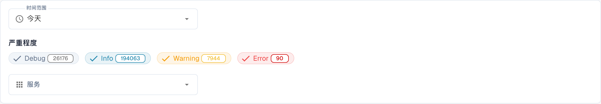

# 分析

<figure><figcaption>
当前中文 Analytics 筛选卡片：时间范围、严重程度和服务筛选。Debug、Info、Warning、Error 是日志级别名称；本图只证明这些筛选控件已显示，不代表其他标签页已完整翻译或 RUM/图表数据已经加载。
</figcaption></figure>

“分析”页面可帮助您检查日志模式、身份验证事件、API 使用情况和高层概览。请先查看 **Logs Analytics**。需要调查某条具体记录时，选择 **View Event Logs** 打开底层事件列表。

## 选项卡

| 选项卡 | 说明 |
|-----|-------------|
| **Logs Analytics** | 日志严重性分布、时间线图表和服务细分。 |
| **Auth Security** | 身份验证事件、登录尝试和安全相关指标。 |
| **API Metrics** | API 请求量、响应时间和错误率。 |
| **Executive Dashboard** | 面向组织管理员的高层概览；其他角色可能看不到此选项卡。 |

## 筛选器

| 筛选器 | 说明 |
|--------|-------------|
| **Time Range** | 选择指标的时间范围（例如 Today、Last 7 Days）。 |
| **Severity** | 点击 Debug、Info、Warning 或 Error，以包含或排除相应级别。筛选项上的数字表示当前数量。 |
| **Service** | 选择要检查其事件的服务。 |

## 汇总卡片

筛选器下方会显示四张汇总卡片：

| 卡片 | 说明 |
|------|-------------|
| **Peak Activity** | 日志量最高的时段及其总数。 |
| **Errors** | 所选时段内的错误总数。 |
| **Warnings** | 所选时段内的警告总数。 |
| **Top Source** | 产生日志最多的服务及其数量。 |

## 真实用户监控（RUM）

当 RUM 已配置且数据加载完成时，此区域用于查看浏览器会话的前端性能指标。本次检查没有验证 RUM 结果；加载占位不能视为有效数据。

## 分析图表

在 **Logs Analytics** 中，选择三个图表按钮之一，以更改相同筛选后日志的显示方式：

| 视图 | 说明 |
|------|-------------|
| **Severity** | 饼图，显示日志级别分布（Debug、Info、Warning、Error）。 |
| **Timeline** | 折线图，显示一段时间内的日志量。 |
| **Service** | 条形图，按服务细分日志。 |

如果图表显示没有可用数据，请尝试扩大 **Time Range** 范围或减少 **Severity** 筛选条件。截图仅展示 Dev 测试环境的筛选卡片，计数不代表您的组织。部分其他标签页和汇总标签仍为英文，属于产品翻译缺口。
