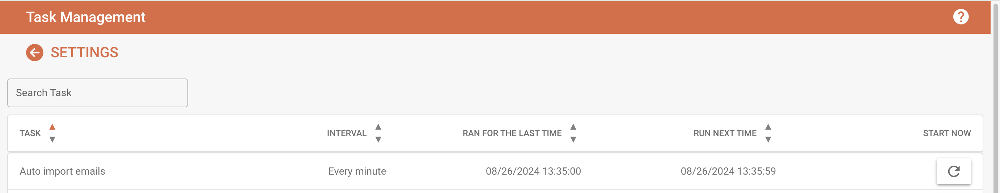

# 任务管理

在“日志设置”部分的“任务管理”设置中，你可以查看所有 Celery 任务的概览，包括任务间隔、任务上次运行时间以及下次运行时间。此外，你还可以选择重新运行任务。如果要查找特定任务，可以使用搜索栏。&#x20;

<figure><figcaption></figcaption></figure>

你可以使用列名旁边的小箭头对列表进行排序。&#x20;

按住鼠标左键并拖动列，即可重新排列列的顺序。&#x20;
