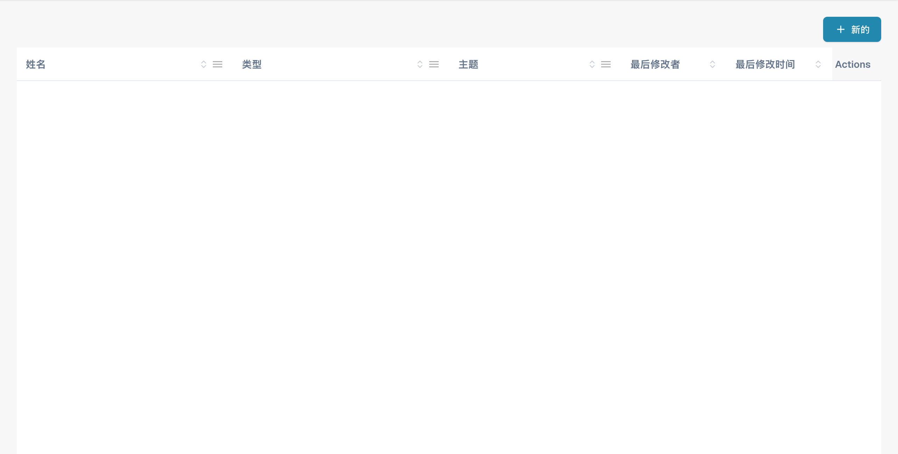
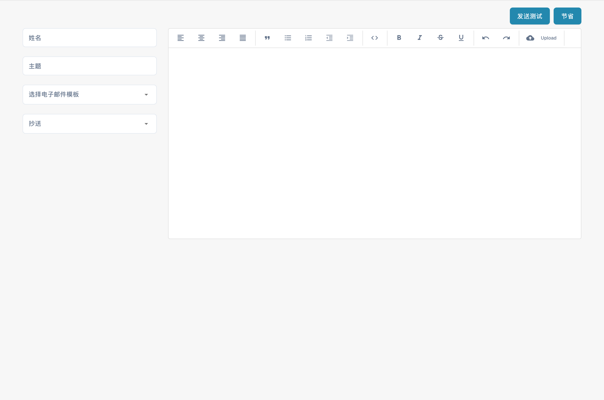

# 编辑电子邮件模板

<figure><figcaption><p>供应商邮件模板列表。 “姓名”在此表示通知名称，“Actions”列尚未翻译。</p></figcaption></figure>

### 概述

“电子邮件模板”功能允许管理员创建和自定义自动发送给供应商的电子邮件。其中一个关键元素是 `{{magic_link}}`，它会为每位收件人提供专属的动态链接。

#### 什么是 `{{magic_link}}`？

`{{magic_link}}` 是一个占位符，发送电子邮件时会动态替换为唯一 URL。该 URL 通常会引导收件人完成某项操作，例如注册、审批，或访问供应商门户中的特定部分。

### 编辑电子邮件模板

<figure><figcaption><p>新建供应商邮件模板的编辑器。 界面中的“姓名”实际表示模板名称，“节省”表示保存；本例未保存或发送邮件。</p></figcaption></figure>

#### 访问电子邮件模板编辑器

1. **导航至电子邮件模板**：
   * 从主菜单进入 **电子邮件模板**（电子邮件模板）部分。
2. **选择要编辑的模板**：
   * 点击模板名称，选择要编辑的电子邮件模板（例如，“Supplier Invitation Email”（供应商邀请电子邮件））。
3. **编辑模板**：
   * 编辑器允许您修改电子邮件的 HTML 代码和视觉设计。
   * 您可以使用提供的选项卡，在可视化编辑和代码编辑之间切换。

<figure><figcaption></figcaption></figure>

#### 将 `{{magic_link}}` 设置为链接

要将 `{{magic_link}}` 设置为电子邮件中的可点击链接，请确保在模板的 HTML 代码中正确设置其格式。请按以下步骤操作：

1. **在 HTML 代码中找到链接部分**：
   * 在代码编辑器中，找到要放置 magic link 的部分。通常它位于 `<a>`（锚点）标签内。
2. **插入 `{{magic_link}}` 占位符**：

   * 将锚点标签的 `href` 属性替换为 `{{magic_link}}`。
   * 确保链接样式与电子邮件模板相符。示例如下：

    ```html
    <a href="{{magic_link}}" target="_blank" style="
        background-color: #B7184B;
        border-radius: 25px;
        font-family: 'Montserrat', Arial, sans-serif;
        font-size: 14px;
        font-weight: bold;
        padding: 12px 25px;
        color: #FFFFFF;
        text-decoration: none;
        display: inline-block;
        cursor: pointer;">
        Complete Registration
    </a>
    ```

### 3. 自定义链接文本：

• 修改开始 \<a> 标签与结束 \</a> 标签之间的文本，以说明您希望用户执行的操作。例如，“Complete Registration”（完成注册）或“Access Your Account”（访问您的账户）。

4\. 保存并测试模板：

• 完成修改后，点击 Save（保存）按钮。

• 您可以使用 Send Test（发送测试）按钮发送测试电子邮件，以确认链接能否正常使用。

## 使用 \{{magic\_link\}} 的最佳实践

• 链接位置：将 \{{magic\_link\}} 放在电子邮件中醒目的位置，确保收件人能够轻松找到。

• 明确的行动号召：链接文本应清楚地说明要执行的操作，例如“Complete Registration”（完成注册）或“Confirm Your Email”（确认电子邮件地址）。

• 样式：确保链接的样式与电子邮件模板的其余部分保持一致，同时在视觉上足够醒目。

• 测试：编辑模板后，务必发送测试电子邮件，验证 \{{magic\_link\}} 能否正确解析，以及样式是否合适。

## 总结

在电子邮件模板中正确设置 \{{magic\_link\}}，可确保收件人收到个性化且便于操作的电子邮件，引导他们在供应商门户中完成相应任务。这有助于提升用户体验，并确保顺利完成入驻和沟通流程。

\

本文档为管理员提供了逐步说明，介绍如何在电子邮件模板中设置和使用 \{{magic\_link\}}，确保电子邮件功能正常且外观清晰。
