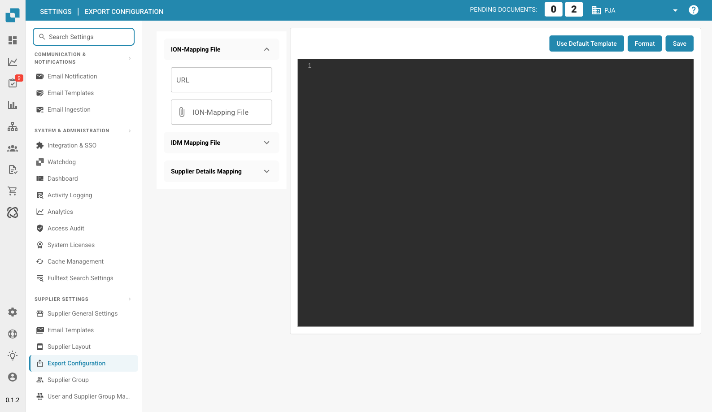

# 供应商门户导出配置

<figure><figcaption><p>供应商导出配置页面</p></figcaption></figure>

## 概述

导出配置文件是供应商门户中的关键组件，用于定义供应商门户与 ERP 系统之间的数据映射方式。此配置可确保数据在各系统间准确传输和同步，从而支持顺畅、高效的运营。

## 配置文件结构

导出配置文件采用 JSON 对象结构，其中包含多个映射。每个映射都关联到 ERP 系统中的一个特定程序，并定义要执行的操作、要映射的字段以及要应用的条件。

## 主要组成部分

### 1. 程序

* **定义**：指定此映射适用的 ERP 程序。
* **示例**：`"program": "CRS620MI"`

### 2. 操作

* **定义**：定义可以执行的操作，例如添加或更新记录。
*   **示例**：

    ```json
    "actions": {
        "add": "AddSupplier",
        "update": "UpdSupplier"
    }
    ```

### 3. 映射

• 定义：指定 ERP 系统中的字段与供应商门户中的字段之间的映射。

• 组成部分：

• erp\_field\_name：ERP 系统中的字段名称。

• value\_field\_name：供应商门户中对应的字段名称。

• value：如果供应商门户中没有对应字段，则使用此静态值。

• if\_conditions：可选条件，用于根据特定条件确定值。

• 示例：

```json
{
    "erp_field_name": "SUNO",
    "value_field_name": "supplier_number"
}
```

### 4. 条件逻辑 (if\_conditions)

• 定义：指定使用某个值必须满足的条件。

• 组成部分：

• field\_name：要进行评估的供应商门户字段名称。

• field\_value：触发条件的值。

• then\_value：满足条件时要使用的值。

• 示例：

```json
{
    "erp_field_name": "SUTY",
    "value": "0",
    "if_conditions": [{
        "field_name": "supplier_group",
        "field_value": "FRT",
        "then_value": "5"
    }]
}
```

### 5. 循环 (loop\_on)

• 定义：指定配置应遍历项目列表的部分，例如地址或参考信息。

• 示例：

```json
"loop_on": "address_details"
```

### 6. 计算字段 (value\_field\_calculated)

• 定义：指定应在运行时计算的字段，例如生成当前日期。

• 示例：

```json
{
    "erp_field_name": "STDT",
    "value_field_calculated": "now()"
}
```

### 7. 包含列表的字段映射 (mapping\_field\_name and mapping\_list)

• 定义：根据预定义列表，将供应商门户中的特定值映射为 ERP 系统中的对应值。

• 组成部分：

• mapping\_field\_name：用于确定映射关系的字段。

• mapping\_list：将供应商门户中的值转换为 ERP 系统中的值的字典。

• 示例：

```json
{
    "erp_field_name": "RFID",
    "mapping_field_name": "reference_type",
    "mapping_list": {
        "10": "PURCHASING",
        "15": "DLVRY PHN#",
        "20": "COA",
        "25": "QA",
        "30": "FINANCE",
        "35": "SALES"
    }
}
```

## 配置示例解析

### 添加和更新供应商 (CRS620MI)

• 程序：CRS620MI

• 操作：

• 添加供应商：AddSupplier

• 更新供应商：UpdSupplier

• 映射字段：

• SUNO → supplier\_number

• SUNM → name

• CSCD → supplier\_country

• TINO → tax\_id

• 其他字段包括静态值和条件映射。

### 地址详情 (CRS620MI)

• 循环对象：_**address\_details**_

• 操作：

• 添加地址：AddAddress

• 更新地址：AddAddress

• 映射字段：

• SUNO → supplier\_number

• ADR1 → address

• TOWN → city

• 其他字段包括计算字段，例如用于获取当前日期的 now()。

### 参考信息 (CRS620MI)

• 循环对象：_**reference\_details**_

• 操作：

• 添加供应商参考信息：AddSupplierRef

• 更新供应商参考信息：AddSupplierRef

• 映射字段：

• SUNO → supplier\_number

• RFTY → reference\_type

• RFID 使用列表进行映射，用于转换 “PURCHASING”、“QA” 和 “FINANCE” 等类型。

## 使用导出配置

### 1. 上传配置文件

#### 1. 前往导出配置：

• 从主菜单进入“导出配置”部分。

#### 2. 上传配置文件：

• 点击 ION-Mapping File 或 IDM Mapping File 部分，上传相应的配置文件。

#### 3. 保存配置：

• 上传完成后，点击 Save 按钮以应用配置。

### 2. 使用默认模板

• 如果要恢复为系统提供的默认配置模板，请点击 Use Default Template 按钮。

### 3. 格式化 JSON

• 使用 Format 按钮自动格式化 JSON 代码，以提高可读性。

## 结论

此配置文件对于确保供应商门户与 ERP 系统之间的数据正确映射和同步至关重要。了解其结构和主要组成部分后，管理员即可有效管理和自定义导出流程，以满足具体的业务需求。

## 完整示例&#x20;

```json
[{
    "program": "CRS620MI",
    "actions": {
        "add": "AddSupplier",
        "update": "UpdSupplier"
    },
    "mapping": [{
        "erp_field_name": "SUNO",
        "value_field_name": "supplier_number"
    }, {
        "erp_field_name": "SUNM",
        "value_field_name": "name"
    }, {
        "erp_field_name": "SUTY",
        "value": "0",
        "if_conditions": [{
            "field_name": "supplier_group",
            "field_value": "FRT",
            "then_value": "5"
        }]
    }, {
        "erp_field_name": "CSCD",
        "value_field_name": "supplier_country"
    }, {
        "erp_field_name": "DTFM",
        "value_field_name": "date_format"
    }, {
        "erp_field_name": "ORTY",
        "value": "F20"
    }, {
        "erp_field_name": "DT4T",
        "value": "1"
    }, {
        "erp_field_name": "DTCD",
        "value": "2"
    }, {
        "erp_field_name": "CUCD",
        "value_field_name": "currency"
    }, {
        "erp_field_name": "TINO",
        "value_field_name": "tax_id"
    }, {
        "erp_field_name": "PHNO",
        "value_field_name": "supplier_phone"
    }, {
        "erp_field_name": "CRTP",
        "value": "1"
    }, {
        "erp_field_name": "ATPR",
        "value": "1"
    }, {
        "erp_field_name": "SUCL",
        "value_field_name": "supplier_group"
    }, {
        "erp_field_name": "LNCD",
        "value_field_name": "language"
    }, {
        "erp_field_name": "CONO",
        "value": "781_DDD"
    }, {
        "erp_field_name": "TEDL",
        "value": "FOB"
    }, {
        "erp_field_name": "TEPY",
        "value_field_name": "payment_term"
    }, {
        "erp_field_name": "TEPA",
        "value": "001"
    }, {
        "erp_field_name": "PYME",
        "value": "CRP"
    }]
}, {
    "program": "CRS620MI",
    "loop_on": "address_details",
    "actions": {
        "add": "AddAddress",
        "update": "AddAddress"
    },
    "mapping": [{
        "erp_field_name": "SUNO",
        "main_value_field": "supplier_number"
    }, {
        "erp_field_name": "ADTE",
        "value_field_name": "address_type"
    }, {
        "erp_field_name": "ADID",
        "value_field_name": "address_type",
        "if_conditions": [{
            "field_name": "address_type",
            "field_value": "10",
            "then_value": ""
        }]
    }, {
        "erp_field_name": "STDT",
        "value_field_calculated": "now()"
    }, {
        "erp_field_name": "ADR1",
        "value_field_name": "address"
    }, {
        "erp_field_name": "TOWN",
        "value_field_name": "city"
    }, {
        "erp_field_name": "ECAR",
        "value_field_name": "state"
    }, {
        "erp_field_name": "PONO",
        "value_field_name": "postal_code"
    }, {
        "erp_field_name": "CSCD",
        "value_field_name": "supplier_country"
    }]
}, {
    "program": "CRS620MI",
    "loop_on": "reference_details",
    "actions": {
        "add": "AddSupplierRef",
        "update": "AddSupplierRef"
    },
    "mapping": [{
        "erp_field_name": "SUNO",
        "main_value_field": "supplier_number"
    }, {
        "erp_field_name": "RFTY",
        "value_field_name": "reference_type"
    }, {
        "erp_field_name": "RFID",
        "mapping_field_name": "reference_type",
        "mapping_list": {
            "10": "PURCHASING",
            "15": "DLVRY PHN#",
            "20": "COA",
            "25": "QA",
            "30": "FINANCE",
            "35": "SALES"
        }
    }, {
        "erp_field_name": "YRE1",
        "value_field_name": "reference_name"
    }, {
        "erp_field_name": "PHNO",
        "value_field_name": "telephone_no"
    }, {
        "erp_field_name": "EMAL",
        "value_field_name": "email_address"
    }]
}]
```
