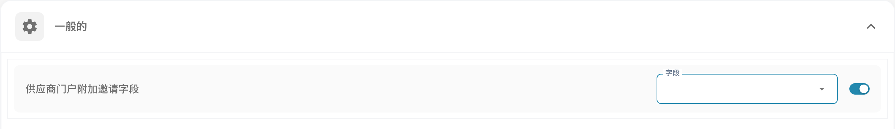

# 供应商常规设置

<figure><figcaption>
供应商门户的常规设置。
</figcaption></figure>

### 概览

**供应商常规设置**界面为管理员提供了自定义供应商门户所需的重要工具。主要功能包括上传公司徽标以及定义政策和隐私声明。这些设置对于保持品牌一致性并确保符合法律要求至关重要。

### 上传徽标

#### 用途

**上传徽标**功能允许管理员上传公司徽标，自定义供应商门户。这有助于提升品牌辨识度，并为访问门户的用户提供一致的视觉体验。

#### 上传徽标的步骤

1. **访问供应商常规设置**：
   * 从主菜单进入**供应商常规设置**部分。
2. **找到上传徽标部分**：
   * 向下滚动到设置页面中的**上传徽标**部分。
3. **上传新徽标**：
   * 点击**上传徽标**区域，打开文件选择对话框。
   * 选择要上传的图像文件。通常支持 `.png`、`.jpg` 或 `.jpeg` 格式。
   * 上传的徽标会显示在预览区域。
4. **保存上传的徽标**：
   * 上传徽标后，点击**保存**按钮以应用更改。
   * 新徽标随后会显示在整个供应商门户中。

#### 最佳实践

* **徽标尺寸**：确保徽标尺寸适合桌面端和移动端视图。系统可能会提供指南或自动调整尺寸。
* **文件大小**：使用经过压缩的图像文件，以缩短加载时间并提升用户体验。
* **品牌一致性**：在所有平台上使用相同的徽标，以保持一致的品牌形象。

### 政策和隐私声明

#### 用途

**政策和隐私声明**部分允许管理员上传或定义管理供应商门户使用的法律文件。这些文件对于满足法律和监管要求至关重要，其中说明了使用条款、数据保护政策以及面向用户的其他重要信息。

#### 上传政策和隐私声明的步骤

1. **访问供应商常规设置**：
   * 从主菜单进入**供应商常规设置**部分。
2. **找到政策和隐私声明部分**：
   * 向下滚动到**政策和隐私声明**部分。
3. **上传或更新文件**：
   * 点击**上传文档**按钮，选择相关文件。
   * 从本地存储中选择文档文件。通常支持 `.pdf`、`.docx` 或 `.txt` 格式。
   * 上传的文件会列在此部分，供审核。
4. **保存更改**：
   * 上传或更新文件后，点击**保存**按钮，确保新政策已生效。

#### 最佳实践

* **定期更新**：定期检查并更新政策和隐私声明，确保其符合最新的法律要求和公司政策。
* **清晰易用**：确保上传的文件清晰、简洁，并且所有用户都能访问。如果供应商群体来自多个国家或地区，可考虑提供翻译版本。
* **法律审核**：上传前请法律顾问审核所有文件，确保其符合相关法律法规。
