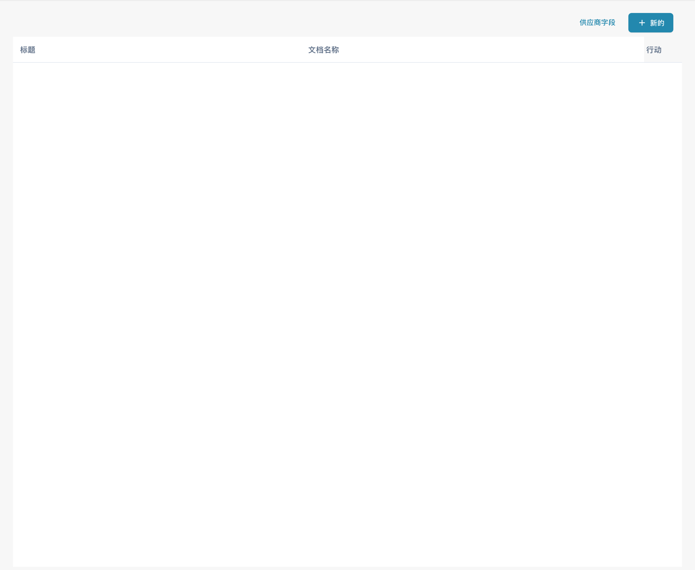

# 供应商布局

<figure><figcaption>
中文供应商布局列表，包含标题、文档名称、“供应商字段”和“新的”入口；布局数据已隐藏。本图展示列表，未展示已保存的布局编辑结果。
</figcaption></figure>

此页面列出供应商用户和供应商管理所用的布局。使用标题和文档名称找到相关布局，再打开布局编辑器调整字段、位置及必填信息。

**供应商字段**用于查看可用字段；**新的**用于开始创建布局。新建或保存会更改组织配置，请先确认要使用的文档类型。截图展示列表入口，未展示已完成的布局编辑。
