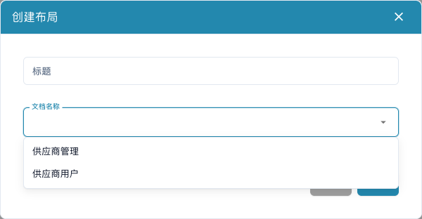

# 配置供应商表单

<figure><figcaption>
保存新布局前，先选择供应商用户或内部管理用户。
</figcaption></figure>

供应商布局定义供应商和内部员工使用的表单，不改变发票打印样式，也不训练发票提取。需要管理员权限，并事先确定每类用户应提供或查看的信息。

## 选择用户类型

1. 打开**设置 → 供应商设置 → 供应商布局**。
2. 检查已有布局，先确认是否应修改现有项，而不是另建一个。
3. 新建时填写清晰标题，选择文档名称：供应商用户用于外部表单，供应商管理用于内部表单。
4. 保存定义，从列表打开相应布局，再次核对适用用户。

## 配置字段和结构

1. 打开供应商字段，检查标题、ERP 字段名、值列表，以及必填、只读和隐藏属性。
2. 创建新字段时填写名称、标题和类型。选择/搜索/单选字段需要合适的值列表；文件字段需要文档类型，其他字段应核对 ERP 字段名。
3. 保存正确的字段设置。字段定义与表单排布是两个独立步骤。
4. 在正确布局中使用**元素**和**字段**安排分组及字段，选中元素后检查其可用属性。
5. 为分组填写有效名称和标题。没有合适现存值或业务流程时，不应将必填字段设为隐藏或只读。
6. 保存后重新打开布局，确认排布已保留。**取消**退出编辑器；使用默认模板可能替换当前排布，应明确确认用途。

## 分别测试两种视图

使用虚构供应商及测试账号，分别检查注册表单和内部供应商详情：必填提示、选项、文件上传，以及隐藏/只读行为。编辑器保存成功不代表注册、审批或 ERP 导出成功。

字段缺失时检查定义、可见性、布局和用户类型；ERP 值缺失时还要检查供应商导出映射。

另见[供应商门户](../../setup/supplier-portal/README.md)、[常规设置](supplier-general-settings.md)和[供应商权限](supplier-permissions.md)。
